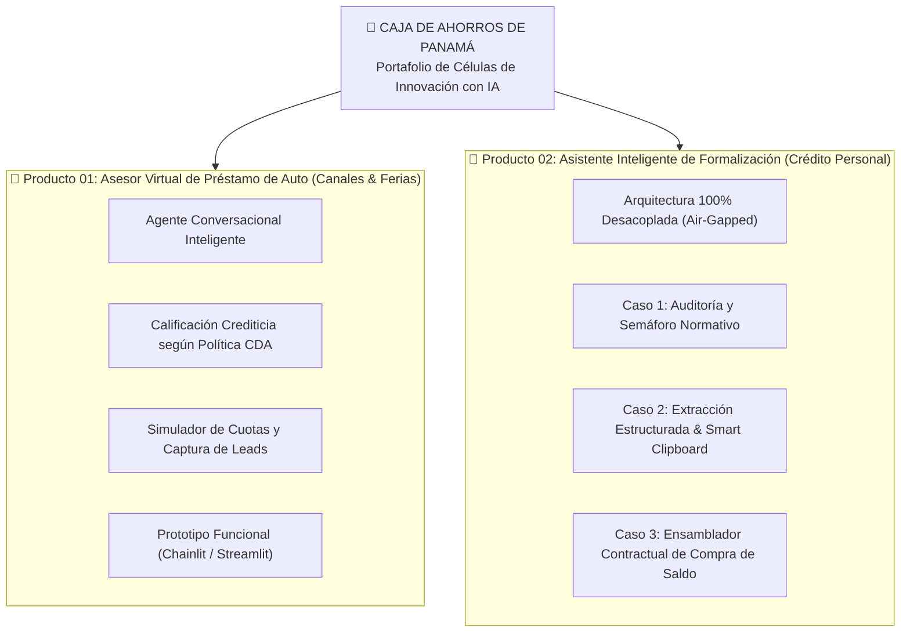

# Células de Innovación con Inteligencia Artificial — Caja de Ahorros (CDA)

Repositorio institucional de arquitectura, diseño técnico-funcional, prototipado y automatización de procesos para las **Células de Innovación con IA de Caja de Ahorros de Panamá**, lideradas técnicamente por **StraTech** (Líder Técnico: Rodolfo Blasser).

---

## 🏛️ Contexto y Alcance Estratégico

El propósito de este repositorio es centralizar los entregables de ingeniería, requerimientos funcionales, arquitecturas de software y entornos de ejecución de los productos desarrollados por la Célula de Innovación para optimizar la eficiencia operativa, la originación comercial y el cumplimiento normativo bancario.

Actualmente, el repositorio alberga **dos productos principales**:



---

## 🚀 Productos del Repositorio

### 1. [innovation-cda](file:///c:/Users/rblasser/OneDrive%20-%20Latinex/Escritorio/PROJECTS/CDA/celulas/innovation-cda) — Asesor Virtual de Préstamo de Auto
Solución conversacional interactiva concebida para stands de ferias automotrices (Panamá Motor Show y ferias locales) y canales digitales autogestionados.

* **Objetivo de Negocio:** Guiar a los prospectos en tiempo real, filtrar su perfil según las políticas crediticias de Caja de Ahorros, calcular su letra mensual estimada y capturar leads calificados listos para cierre por ejecutivos bancarios.
* **Componentes Principales:**
  * **Motor de Calificación y Reglas:** Basado en la [politica_prestamo_auto.pdf](file:///c:/Users/rblasser/OneDrive%20-%20Latinex/Escritorio/PROJECTS/CDA/celulas/innovation-cda/potential-artifact/politica_prestamo_auto.pdf) oficial (edad 21–75 años, ingreso mínimo, relación cuota-ingreso).
  * **Entorno de Prototipado:** Implementación funcional en Python con Chainlit y Streamlit ubicada en [innovation-cda/dev-env/](file:///c:/Users/rblasser/OneDrive%20-%20Latinex/Escritorio/PROJECTS/CDA/celulas/innovation-cda/dev-env).
  * **Documento de Diseño:** [propuesta-asesor-virtual-feria-autos.md](file:///c:/Users/rblasser/OneDrive%20-%20Latinex/Escritorio/PROJECTS/CDA/celulas/innovation-cda/design/propuesta-asesor-virtual-feria-autos.md).
  * **Recursos Visuales:** [cda-agente-feria-autos.jpg](file:///c:/Users/rblasser/OneDrive%20-%20Latinex/Escritorio/PROJECTS/CDA/celulas/innovation-cda/cda-agente-feria-autos.jpg) y [cda-agente-auto-flujo.png](file:///c:/Users/rblasser/OneDrive%20-%20Latinex/Escritorio/PROJECTS/CDA/celulas/innovation-cda/cda-agente-auto-flujo.png).

---

### 2. [formalizacion-pp](file:///c:/Users/rblasser/OneDrive%20-%20Latinex/Escritorio/PROJECTS/CDA/celulas/formalizacion-pp) — Asistente de Formalización de Préstamos Personales
Herramienta de aceleración de operaciones de crédito diseñada bajo el **paradigma 100% desacoplado** (*Sidecar Copilot*), operando con **CERO dependencias** técnicas de Ultimus BPM, CERO acceso al Core IBS y CERO túneles VPN ni accesos a bases de datos bancarias.

* **Los 3 Casos de Uso Clave:**
  1. **Auditoría Inteligente y Semáforo de Pre-Formalización:** Control cruzado de identidad y vigencias documentales. Incorpora la regla de parada inmediata (🔴 Semáforo Rojo) ante la falta del **Certificado de Jubilación de la CSS** (que demora entre 7 y 20 días hábiles en tramitarse físicamente) y la regla de no descuento en diciembre.
  2. **Copiloto de Extracción Estructurada y Smart Clipboard:** Extracción con visión espacial de tablas complejas (cartas de trabajo de empresas privadas y lectura de grilla diminuta de **Planilla y Posición** en talonarios de Contraloría). Provee un panel con botones de copiado en 1 clic (`navigator.clipboard.writeText`) para volcar los 10–15 campos en Ultimus en **30 a 50 segundos** (reducción del 90% del tiempo con 0% de errores tipográficos hacia el Core IBS).
  3. **Pre-Diligenciador y Ensamblador Contractual:** Automatización de expedientes de **Compra de Saldo / Consolidación de Pasivos**. Extrae datos de cartas de saldo de terceros bancos (Banco General, Banistmo, BAC, etc.) y genera instantáneamente las **Promesas Irrevocables de Pago, Pagarés Notariales y Órdenes de Descuento** sobre plantillas oficiales `.docx` listas para firma.
* **Documentos de Referencia:**
  * [diseno-asistente-formalizacion-desacoplado.md](file:///c:/Users/rblasser/OneDrive%20-%20Latinex/Escritorio/PROJECTS/CDA/celulas/formalizacion-pp/design/diseno-asistente-formalizacion-desacoplado.md): Especificación técnica, ergonomía UX, ciberseguridad y sustento con testimonios de líderes funcionales.
  * [diagramas-flujo-casos-uso-desacoplados.md](file:///c:/Users/rblasser/OneDrive%20-%20Latinex/Escritorio/PROJECTS/CDA/celulas/formalizacion-pp/design/diagramas-flujo-casos-uso-desacoplados.md): Diagramas de flujo Mermaid de negocio y técnicos.
  * [requerimientos-tecnicos-agente-formalizacion.md](file:///c:/Users/rblasser/OneDrive%20-%20Latinex/Escritorio/PROJECTS/CDA/celulas/formalizacion-pp/requerimientos-tecnicos-agente-formalizacion.md): Especificación de infraestructura y modelos.
  * [cda-use-cases-formalizacion-pp.jpg](file:///c:/Users/rblasser/OneDrive%20-%20Latinex/Escritorio/PROJECTS/CDA/celulas/formalizacion-pp/cda-use-cases-formalizacion-pp.jpg): Infografía panorámica de los 3 casos de uso.
  * [transcripts/](file:///c:/Users/rblasser/OneDrive%20-%20Latinex/Escritorio/PROJECTS/CDA/celulas/formalizacion-pp/transcripts): Minutas y transcripciones oficiales con los líderes funcionales de Crédito y TI (Ricardo Herrera y Ediel).

---

## 📁 Estructura del Proyecto

```text
cda-celulas/
│
├── README.md                                   # Documento maestro institucional (este archivo)
├── AGENTS.md                                   # Reglas de preservación e integridad documental
├── git-push.bat                                # Script automatizado de commit y push a origin/main
├── push.bat                                    # Atajo rápido en consola para git-push.bat
│
├── formalizacion-pp/                           # PRODUCTO 02: Formalización de Préstamos Personales
│   ├── design/                                 # Diseños arquitectónicos y diagramas de flujo
│   │   ├── diseno-asistente-formalizacion-desacoplado.md
│   │   ├── diagramas-flujo-casos-uso-desacoplados.md
│   │   ├── arquitectura-agente-formalizacion.md
│   │   ├── diseno-operativo-y-arquitectura-formalizacion-pp.md
│   │   └── especificacion-casos-prioritarios-v1.md
│   ├── transcripts/                            # Transcripciones y recaps de reuniones oficiales
│   │   ├── Req_ Funcional - Formalización préstamo_ Transcript.txt
│   │   ├── Req_ Funcional - Formalización préstamo_ Recap.txt
│   │   ├── Llamada_Inicial_Automatización del Proceso de Formaliza_ Transcript.txt
│   │   ├── Llamada_Inicial_Automatización del Proceso de Formaliza_ Recap.txt
│   │   ├── Req_ Técnico - Formalización PP Transcript.txt
│   │   └── Req_ Técnico - Formalización PP Recap.txt
│   ├── formatos/                               # Plantillas oficiales en blanco (.docx, .pdf)
│   ├── diligenciados/                          # Ejemplos de contratos generados
│   ├── knowledge/                              # Políticas normativas y manuales de crédito
│   └── cda-use-cases-formalizacion-pp.jpg      # Infografía de los 3 casos de uso
│
└── innovation-cda/                             # PRODUCTO 01: Asesor Virtual de Auto
    ├── design/                                 # Propuesta integral y narrativa de feria
    │   └── propuesta-asesor-virtual-feria-autos.md
    ├── dev-env/                                # Prototipo funcional (Chainlit / Streamlit / Gemini)
    │   ├── app.py                              # Aplicativo interactivo en Chainlit
    │   ├── app_streamlit.py                    # Alternativa interactiva en Streamlit
    │   ├── gemini_client.py                    # Integración con Google Gemini API
    │   ├── knowledge_base.py                   # Lógica de políticas y cálculo de letra
    │   ├── run.bat                             # Script de arranque del servidor local
    │   └── leads_feria_autos.json              # Almacenamiento local de prospectos
    ├── potential-artifact/                     # Documentación de soporte y políticas
    │   └── politica_prestamo_auto.pdf          # Política de Crédito de Auto CDA
    ├── cda-agente-feria-autos.jpg              # Infografía del asistente en stand
    └── cda-agente-auto-flujo.png               # Diagrama de flujo del asesor virtual
```

---

## 🛠️ Guía Rápida de Uso

### 1. Sincronización Automática con GitHub
Para sincronizar cambios locales con el repositorio remoto de forma asistida, utilice el script por lotes provisto en la raíz:

```powershell
# Ejecución interactiva (le solicitará mensaje o generará uno automático con fecha)
.\git-push.bat

# O con mensaje directo:
.\push.bat "docs: actualizar documentacion de formalizacion"
```

### 2. Ejecución del Prototipo del Asesor de Auto (`innovation-cda`)
Para levantar el servidor del Asesor Virtual de Auto localmente:

1. Ingrese a la carpeta del entorno de desarrollo:
   ```powershell
   cd innovation-cda\dev-env
   ```
2. Asegúrese de contar con un archivo `.env` configurado con su `GEMINI_API_KEY`.
3. Inicie el servidor ejecutando:
   ```powershell
   .\run.bat
   ```
4. Acceda al navegador en `http://localhost:8000` para interactuar con el copiloto bancario.

---

## 🛡️ Principios de Arquitectura y Gobernanza

1. **Integridad Documental:** Ningún documento contractual o normativo institucional se sobrescribe sin validación explícita (normado en [AGENTS.md](file:///c:/Users/rblasser/OneDrive%20-%20Latinex/Escritorio/PROJECTS/CDA/celulas/AGENTS.md)).
2. **Cero Fricción Tecnológica:** Los casos de formalización se diseñan bajo desacoplamiento operativo estricto para evitar bloqueos por dependencias de red interna, Active Directory o licenciamiento de BPM.
3. **Enfoque Human-in-the-Loop:** La inteligencia artificial actúa como copiloto asistencial; el control decisional final y la validación ante el Core IBS permanecen en manos del analista bancario.
4. **Trazabilidad Absoluta:** Cada regla y cálculo técnico está fundamentado con minutos y citas verificables en las transcripciones de las mesas de trabajo con Caja de Ahorros.

---

**Caja de Ahorros de Panamá & StraTech**  
*Células de Innovación con Inteligencia Artificial — Octubre 2026*
