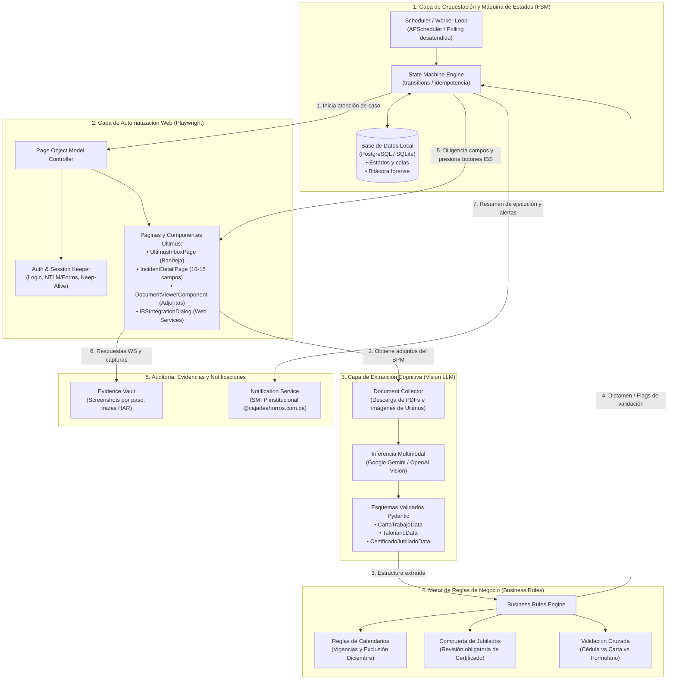
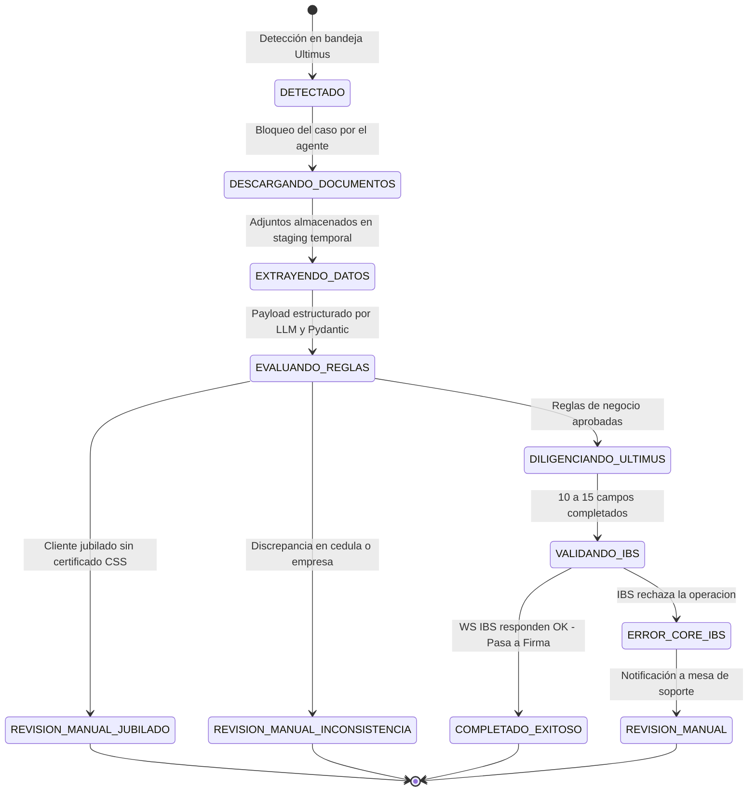
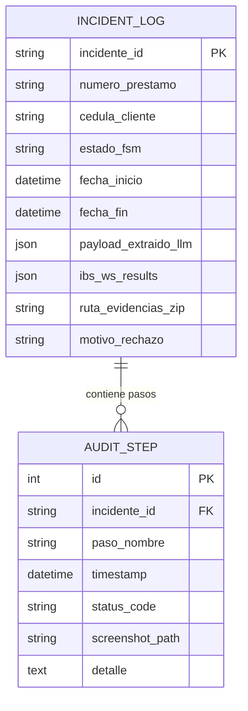
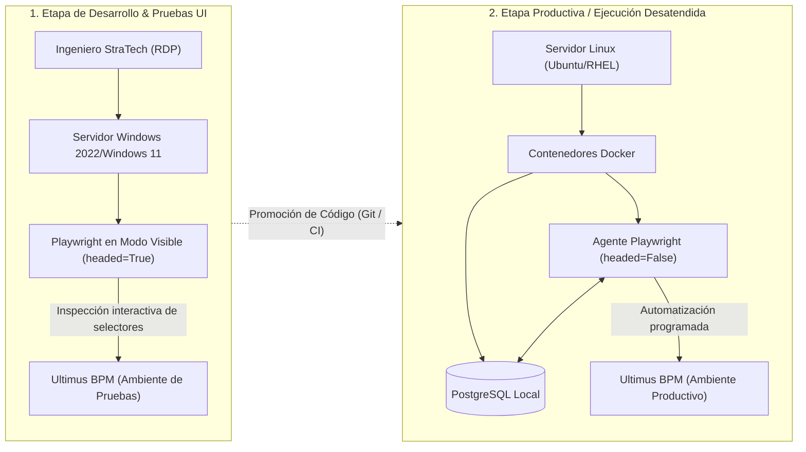

# Diseño de Arquitectura Técnica: Sistema Agéntico de Automatización
## Proceso de Formalización de Préstamos Personales en Ultimus BPM
**Proyecto:** Célula de Innovación Caja de Ahorros — Producto 02  
**Cliente:** Caja de Ahorros de Panamá  
**Elaborado por:** Rodolfo Blasser — Líder Técnico de Célula (StraTech)  
**Fecha:** 28 de octubre de 2026  
**Versión:** 1.0 (Diseño de Arquitectura de Automatización con Playwright y Python)  

---

## 1. Resumen Ejecutivo y Objetivos de la Arquitectura

El presente documento define la arquitectura técnica detallada para la automatización del proceso de **Formalización de Préstamos Personales** en el aplicativo **Ultimus BPM** de Caja de Ahorros.

### 1.1. Propósito
Sustituir el trabajo operativo manual y repetitivo de transcripción y validación que realizan los ejecutivos en la etapa de *Revisión Documental / Formalización*, mediante un **agente de software inteligente** desarrollado en **Python** que integra:
1. **Playwright** para la interacción y navegación web resiliente sobre Ultimus BPM.
2. **Modelos de Lenguaje Multimodales (LLMs con Visión)** para la lectura y estructuración de expedientes no estandarizados (cartas de trabajo, comprobantes de pago, fichas de CSS, órdenes de descuento).
3. **Pydantic** para la validación y tipado estricto de esquemas de datos.
4. **Máquina de Estados Finita (FSM)** para el control de ciclo de vida e idempotencia del trámite.
5. **Base de Datos Dedicada Aislada** para observabilidad y auditoría forense bajo el principio bancario de cero escritura en las bases institucionales.

### 1.2. Principios Rectores de Seguridad y Diseño
* **Cero Conexión Directa a IBS:** El agente **NO** se conecta directamente a IBS, **NO** invoca APIs/Web Services directos contra el core bancario ni accede a sus bases de datos. Su interacción se limita al 100% a la navegación en la interfaz web de **Ultimus BPM**.
* **Principio de Cero Escritura en el Core:** El agente no escribe directamente en tablas de Ultimus BPM ni en bases de datos de Caja de Ahorros. Toda la interacción transaccional se realiza **a través de los botones de la interfaz web**, delegando en Ultimus la ejecución de los Web Services existentes hacia el core bancario (**IBS**).
* **No Repudio y Trazabilidad:** El agente opera bajo un usuario de servicio nominal de dominio (`svc_agente_formalizacion`), dejando huella inequívoca en las bitácoras del banco de cada acción realizada.
* **Aislamiento de Estado:** Toda bitácora, captura de pantalla y estado de cola se almacena en una base de datos local y dedicada del agente (PostgreSQL o SQLite).
* **Contención de Excepciones (Human-in-the-Loop):** Los casos con documentación faltante (ej. certificado de jubilación sin incorporar), inconsistencias de identidad o errores reportados por Ultimus sobre IBS se pausan y derivan inmediatamente a revisión manual.

---

## 2. Diagrama de Arquitectura Global del Sistema

El sistema implementa una **Arquitectura Modular por Capas (Clean Architecture)**:



---

## 3. Matriz del Stack Tecnológico Recomendado

| Componente | Tecnología / Librería | Versión | Justificación Técnica |
| :--- | :--- | :--- | :--- |
| **Runtime Base** | **Python** | `3.11+` | Estabilidad corporativa, tipado estricto, compatibilidad con Playwright y clientes de IA. |
| **Automatización Web** | **Playwright for Python** | `1.45+` | Selectores orientados a accesibilidad (`get_by_role`, `get_by_text`), control de red síncrona/asíncrona (`wait_for_response`) y soporte visual y headless. |
| **Validación de Datos** | **Pydantic** | `v2.x` | Validación estricta en tiempo de ejecución, parsing JSON automático y deserialización garantizada. |
| **Máquina de Estados** | **Transitions** / **python-statemachine** | Última estable | Transiciones atómicas y trazables; garantiza que ningún caso se procese dos veces por error. |
| **Persistencia del Agente** | **SQLAlchemy** + **PostgreSQL** (Docker) / **SQLite** | `PostgreSQL 16` | Aislamiento completo de bases institucionales; registro forense de auditoría. |
| **Inferencia Documental** | **Google GenAI SDK** (Gemini 1.5 Flash/Pro) / **OpenAI SDK** | Última estable | Comprensión multimodal nativa de PDFs y escaneos de múltiples páginas con salidas estructuradas JSON. |
| **Programador / Colas** | **APScheduler** | `3.10+` | Ejecución programada periódica y desatendida del worker sin sobrecargar infraestructura. |
| **Notificaciones** | **aiosmtplib** / **smtplib** nativo | Estándar Python | Integración directa con el servidor SMTP interno del banco para reportes operativos y alertas. |

---

## 4. Especificación Detallada de Módulos

### 4.1. Capa 1: Orquestador y Máquina de Estados (State Machine)

El ciclo de vida de cada préstamo se gestiona a través de una FSM con transiciones atómicas:



* **Idempotencia:** Antes de procesar un incidente, el agente consulta su base de datos local mediante el `incidente_id` y `numero_prestamo`. Si el estado previo es `COMPLETADO_EXITOSO` o `PROCESANDO_ACTIVO`, el agente no duplicará transacciones.

### 4.2. Capa 2: Automatización Web con Playwright (Page Object Model)

La arquitectura de navegación desacopla la lógica del flujo de la implementación específica de los selectores HTML de Ultimus:

#### A. Estructura de Clases POM:
* `BasePage`: Clase base que encapsula timeouts, esperas explícitas, inyección de credenciales y el método unificado `take_evidence_screenshot(step_name)`.
* `UltimusLoginPage`:
  * Autenticación con credenciales institucionales.
  * Detección de sesión activa o caducada (manejo de *keep-alive* y re-login transparente).
* `UltimusInboxPage`:
  * Navega a la bandeja del proceso *Préstamo Personal*, etapa *Revisión Documental*.
  * Itera sobre la lista de tareas asignadas.
  * Abre el formulario modal/incidente correspondiente.
* `IncidentDetailPage`:
  * Extrae los metadatos base del caso (cliente, monto, número de préstamo).
  * Interactúa con los 10 a 15 campos requeridos de la formalización (código de empresa, deducción, condiciones de pago).
* `IBSActionDialog`:
  * **Interacción Indirecta (100% UI):** El agente no invoca los Web Services de IBS directamente; hace clic en los botones provistos en la interfaz de Ultimus:
    1. *Actualizar / Validar Cliente IBS*.
    2. *Crear / Reservar Préstamo*.
    3. *Apertura de Cuenta de Ahorro* (cuando aplique).
  * **Sincronización:** El agente escucha la respuesta asíncrona (AJAX/Postback) que el servidor web de Ultimus envía de vuelta al navegador tras haber consultado internamente a IBS:
    ```python
    # El agente espera la respuesta de red entre el navegador y el servidor de Ultimus
    async with page.expect_response(
        lambda r: "ValidaClienteIBS" in r.url and r.status == 200,
        timeout=30000
    ) as response_info:
        await page.get_by_role("button", name="Validar Cliente IBS").click()
    
    # Se extrae el resultado reflejado por Ultimus (número de préstamo o mensaje de error)
    response_payload = await response_info.value.json()
    ```

### 4.3. Capa 3: Extracción Cognitiva e Inteligencia Documental (LLM + Pydantic)

Los documentos adjuntos en Ultimus (PDFs digitales, escaneos o fotografías) se procesan con un LLM multimodal bajo un esquema de tipado estricto:

```python
from pydantic import BaseModel, Field
from typing import Optional

class CartaTrabajoData(BaseModel):
    nombre_empleado: str = Field(description="Nombre completo del trabajador")
    cedula: str = Field(description="Cédula de identidad personal en formato estándar")
    salario_base_mensual: float = Field(description="Salario base mensual reportado")
    posicion_cargo: str = Field(description="Cargo que desempeña en la empresa")
    fecha_ingreso: str = Field(description="Fecha de inicio de labores en formato YYYY-MM-DD")
    tipo_contrato: str = Field(description="Indefinido, Fijo o Eventual")
    empresa_empleadora: str = Field(description="Razón social de la empresa emisora")

class TalonarioData(BaseModel):
    salario_neto: float = Field(description="Salario neto a recibir después de deducciones")
    descuentos_totales: float = Field(description="Monto acumulado de descuentos")
    periodo_pago: str = Field(description="Quincena o mes evaluado")

class ExpedienteFormalizacion(BaseModel):
    es_jubilado: bool = Field(description="Verdadero si el cliente es jubilado o pensionado")
    numero_certificado_jubilado: Optional[str] = Field(None, description="Número de certificado CSS/Contraloría")
    carta_trabajo: Optional[CartaTrabajoData] = None
    talonario: Optional[TalonarioData] = None
    observaciones_extra: Optional[str] = None
```

* **Privacidad de Datos (Data Privacy):** Si las políticas de ciberseguridad lo exigen, los nombres y cédulas pueden anonimizarse en memoria antes del envío a la API externa de IA, reemplazándolos por tokens de correlación temporal que se restauran localmente tras la inferencia.

### 4.4. Capa 4: Motor de Reglas de Negocio (Business Rules Engine)

Aplica las validaciones del banco antes de confirmar la formalización en Ultimus:
1. **Regla de Identidad Cruzada:**
   * La cédula y nombre en la `CartaTrabajoData` deben concordar con el nombre del cliente en el incidente de Ultimus. Si hay discrepancia fonética o numérica mayor a un umbral estricto, el caso se suspende para revisión manual.
2. **Regla de Jubilados y Pensionados:**
   * Si el cliente se identifica como jubilado, se evalúa la presencia del `numero_certificado_jubilado`.
   * Si no se encuentra registrado en Ultimus ni existe adjunto legible, el agente no avanza el caso a la etapa de firma y lo etiqueta como: `CASO_PAUSADO_REQUIERE_CERTIFICADO_CSS`.
3. **Regla de Calendarios de Descuento Institucionales:**
   * Verifica que la fecha de inicio del cobro del préstamo cumpla los plazos de vigencia de las órdenes de descuento según la institución empleadora.
   * Aplica la política institucional de **exclusión de descuentos durante el mes de diciembre**.

### 4.5. Capa 5: Base de Datos Local, Evidencias y Observabilidad

#### A. Modelo de Datos Local (SQLAlchemy):


#### B. Bóveda de Evidencias:
* En cada paso crítico (antes de presionar botones de IBS y al culminar el flujo), el agente almacena un screenshot en alta definición: `storage/evidences/{incidente_id}/{timestamp}_{step}.png`.
* En caso de excepción no controlada, Playwright genera un archivo de traza completo (`trace.zip`) para su análisis forense post-mortem en Playwright Trace Viewer.

#### C. Servicio de Notificaciones (SMTP):
* **Notificación en Tiempo Real:** Envío de correo inmediato ante incidentes rechazados por el IBS o pausados por falta de certificado de jubilado.
* **Balance Diario Consolidado:** Al cierre de la jornada operativa, el agente envía a los supervisores un correo corporativo con:
  * Total de préstamos formalizados con éxito.
  * Total de préstamos derivados a revisión manual (desglosados por motivo).
  * Tiempos promedio de procesamiento por expediente.

---

## 5. Estructura de Proyecto Recomendada (Scaffolding de Código)

```text
formalizacion_agent/
│
├── config/
│   ├── __init__.py
│   ├── settings.py              # Variables de entorno (.env), URLs, timeouts, proxy SSL
│   └── discount_calendars.json  # Tablas de vigencias institucionales y exclusiones
│
├── core/
│   ├── __init__.py
│   ├── fsm.py                   # Motor de Máquina de Estados Finita (Transitions)
│   ├── exceptions.py            # Excepciones de negocio (IBSError, MissingCertError, etc.)
│   └── database.py              # Conexión SQLAlchemy y pool de conexiones
│
├── models/
│   ├── __init__.py
│   ├── schemas.py               # Modelos Pydantic para extracción documental y validación
│   └── entities.py              # Modelos de base de datos local (IncidentLog, AuditStep)
│
├── browser/
│   ├── __init__.py
│   ├── context_factory.py       # Inicialización de Playwright (Headed/Headless, Proxy, Viewport)
│   ├── base_page.py             # Clase base (esperas explícitas, capturas de pantalla, safe_click)
│   └── pages/
│       ├── __init__.py
│       ├── login_page.py        # Autenticación corporativa en Ultimus
│       ├── inbox_page.py        # Bandeja de entrada y selección de incidentes
│       ├── incident_form_page.py# Llenado de los 10 a 15 campos de formalización
│       └── ibs_dialog_page.py   # Manejo de modales y Web Services de IBS
│
├── cognitive/
│   ├── __init__.py
│   ├── llm_client.py            # Cliente unificado de inferencia (Gemini / OpenAI)
│   └── document_extractor.py    # Pipeline de extracción estructurada de adjuntos
│
├── rules/
│   ├── __init__.py
│   ├── business_validator.py    # Validador integral de consistencia de datos
│   └── calendar_rules.py        # Motor de reglas para calendarios de descuento
│
├── services/
│   ├── __init__.py
│   ├── evidence_vault.py        # Almacenamiento seguro de capturas y trazas de red
│   └── notification_service.py  # Emisor de correos y alertas por SMTP institucional
│
├── tests/
│   ├── test_schemas.py          # Pruebas unitarias de modelos Pydantic
│   ├── test_rules.py            # Pruebas unitarias de reglas de calendarios y jubilados
│   └── test_pom_flows.py        # Pruebas de integración sobre entorno de test de Ultimus
│
├── storage/                     # Volúmenes locales persistentes (ignorados por Git)
│   ├── db/                      # Archivo SQLite o datos persistentes de PostgreSQL
│   └── evidences/               # Capturas de pantalla y trazas organizadas por incidente
│
├── .env.example                 # Plantilla de variables de entorno seguras
├── Dockerfile                   # Imagen base oficial de Python 3.11 con Playwright y Chromium
├── docker-compose.yml           # Orquestación del Agente + Base de Datos PostgreSQL local
├── requirements.txt             # Dependencias del proyecto
└── main.py                      # Punto de entrada de ejecución del agente
```

---

## 6. Estrategia de Entornos y Despliegue



1. **Servidor Windows (Desarrollo y Ajuste Fino de Selectores):**
   * Facilita al desarrollador observar la apertura de modales, alertas emergentes de JavaScript y tiempos de latencia reales del BPM.
2. **Servidor Linux (Ejecución Programada y Desatendida):**
   * Contenedor Docker optimizado con dependencias de Chromium preinstaladas.
   * Ejecución continua y silenciosa que no requiere intervención humana a menos que surjan excepciones de negocio.

---

## 7. Hoja de Ruta de Desarrollo e Hitos

| Fase | Duración Estimada | Entregables Principales |
| :--- | :--- | :--- |
| **Fase 1: Mapeo y PoC de Navegación** | 1 a 2 semanas | Recorrido con Ediel en Ultimus; mapeo de selectores POM; pruebas de login y lectura de bandeja. |
| **Fase 2: Extracción Documental Cognitiva** | 1 a 2 semanas | Pipeline de descarga de adjuntos; prompts y esquemas Pydantic para cartas de trabajo y fichas. |
| **Fase 3: Integración de Reglas y Web Services** | 2 semanas | FSM operativa; compuertas para jubilados y calendarios; parametrización del catálogo de respuestas de IBS. |
| **Fase 4: Pruebas Integradas y Hardening** | 2 semanas | Pruebas end-to-end en servidor Windows; empaquetado Docker; validación con usuario de servicio `svc_agente_formalizacion`. |
| **Fase 5: Despliegue en Producción** | 1 semana | Despliegue en servidor Linux; configuración de reportes diarios SMTP a supervisores; paso a régimen supervisado. |
