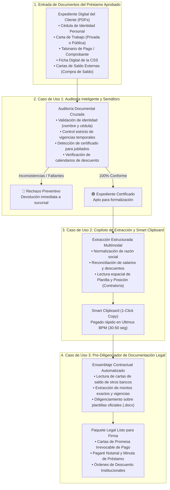
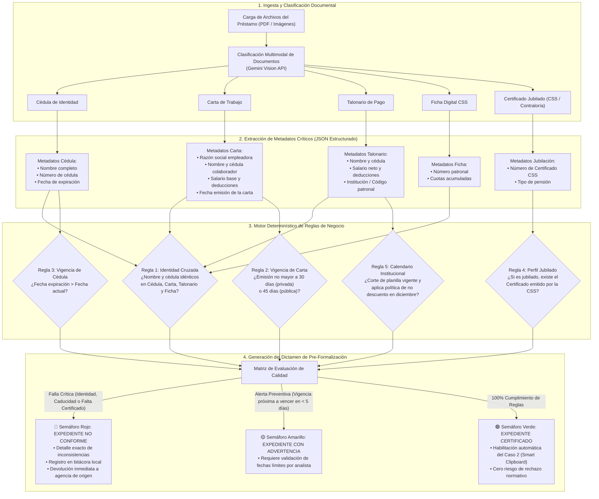
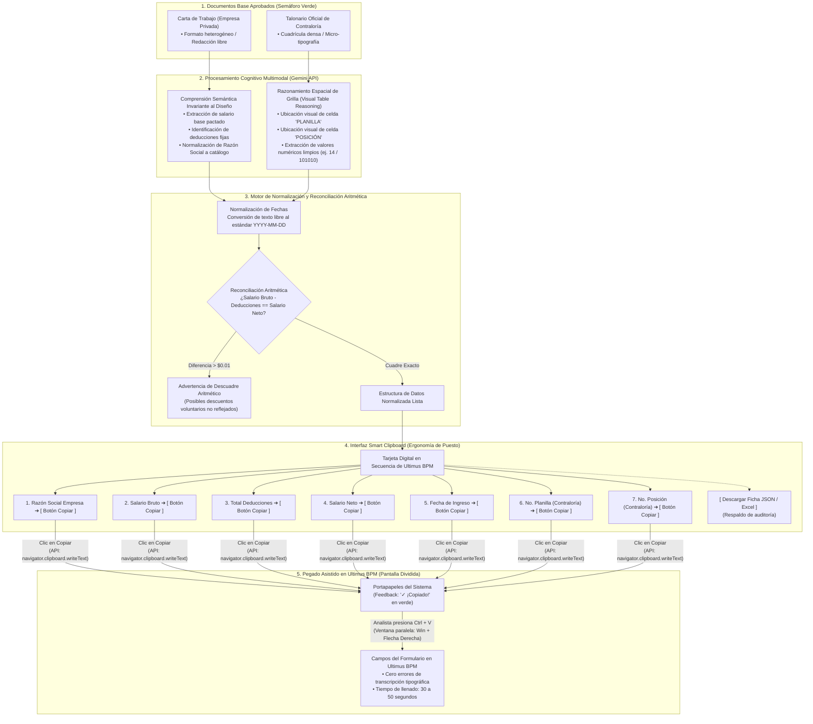
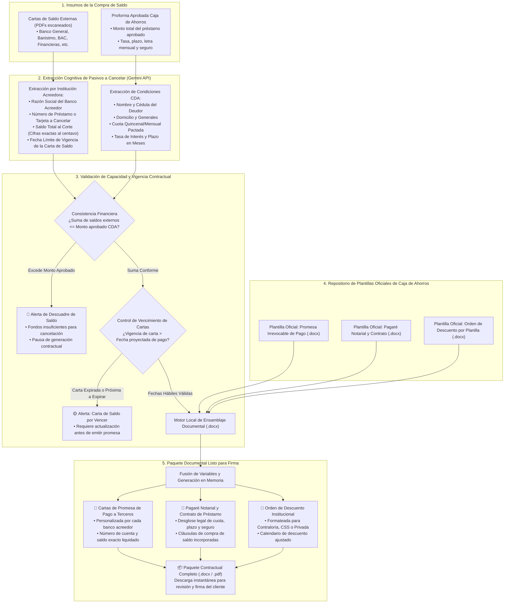

# Diagramas de Flujo de Negocio con Sustento Técnico
## Casos de Uso del Asistente Inteligente de Formalización Desacoplado (Sin Ultimus ni Core Bancario)

**Proyecto:** Célula de Innovación Caja de Ahorros — Producto 02 (Formalización de Préstamos Personales)  
**Audiencia:** Operaciones de Crédito, Riesgo Operativo, Auditoría Interna, Tecnología y Canales  
**Elaborado por:** Célula de Innovación (StraTech / Caja de Ahorros) — Líder Técnico: Rodolfo Blasser  
**Fecha:** 28 de octubre de 2026  
**Versión:** 1.0 (Documento Exclusivo de Diagramación de Procesos y Flujos de Datos)  

---

## 1. Mapa General: Los Tres Casos de Uso en el Ciclo de Formalización

---

## 2. Caso de Uso 1: Auditoría Inteligente y Semáforo de Pre-Formalización
### *(Checklist Normativo y Consistencia Documental Cruzada)*

### Perspectiva de Negocio:
Evita que el analista invierta tiempo abriendo y leyendo manualmente entre 4 y 6 documentos PDF para descubrir errores al final del trámite. Detecta expedientes viciados antes de iniciar la digitación en el BPM, protegiendo al banco de sanciones normativas y eliminando reprocesos con sucursales.

### Sustento Técnico:
Ingesta en memoria volátil sin persistencia externa. Inferencia multimodal vía Gemini API con extracción tipada de metadatos de identidad, fechas y entidades institucionales. Motor determinístico de reglas booleanas para cotejo cruzado de cédulas, cálculo de días hábiles de vigencia y validación contra matrices de corte de planillas y calendarios de descuento.

---

## 3. Caso de Uso 2: Copiloto de Extracción Estructurada y Smart Clipboard
### *(Smart Clipboard & Normalización de Datos para Carga en Ultimus)*

### Perspectiva de Negocio:
Elimina el desgaste cognitivo y los errores de dedo al transcribir manualmente 10 a 12 campos desde documentos impresos o escaneados hacia Ultimus BPM. Protege al banco de rechazos en los Web Services de IBS causados por números de planilla o posición erróneos en empleados públicos, y reduce el tiempo de tipeo de 10 minutos a 30-50 segundos mediante pantalla dividida.

### Sustento Técnico:
Uso de modelos de visión multimodal con invariancia de diseño (*Zero-Shot Layout Invariance*) para interpretar cartas privadas no homogéneas y razonamiento espacial sobre tablas (*Visual Table Reasoning*) para extraer celdas en cuadrículas densas de Contraloría. Reconciliación matemática estricta antes de la entrega. Empleo de la API nativa del navegador (`navigator.clipboard.writeText`) para copiado seguro en un clic con retroalimentación visual, respetando las políticas de ciberseguridad sin requerir extensiones ni scripts invasivos.

---

## 4. Caso de Uso 3: Pre-Diligenciador y Ensamblador de Documentación Contractual
### *(Cartas de Promesa de Pago, Pagarés y Órdenes de Descuento para Compra de Saldo)*

### Perspectiva de Negocio:
En préstamos para consolidación de pasivos externos, el analista pierde entre 20 y 35 minutos buscando saldos y cuentas en cartas de bancos competidores para tipear minutas y promesas en Word. El módulo automatiza la extracción de deudas externas y diligencia en segundos el paquete contractual oficial de Caja de Ahorros, garantizando exactitud matemática y jurídica para la firma del cliente.

### Sustento Técnico:
Extracción semántica multimodal de cartas de saldo de cualquier banco de la plaza panameña (Banco General, Banistmo, BAC, Global Bank, etc.). Validación cruzada de fechas de vigencia de la promesa contra la fecha de desembolso proyectada. Motor local de ensamblaje documental (*Document Templating Engine*) que inyecta variables en plantillas `.docx` oficiales de Caja de Ahorros respetando formatos notariales, firmas y cláusulas condicionales.

---

## 5. Resumen Comparativo de Arquitectura Técnica y Valor de Negocio

| Dimensión | Caso de Uso 1: Auditoría Inteligente | Caso de Uso 2: Smart Clipboard | Caso de Uso 3: Ensamblador Contractual |
| :--- | :--- | :--- | :--- |
| **Objetivo de Negocio** | Filtrar expedientes viciados o incompletos antes de ingresar al sistema. | Acelerar el tipeo de datos en Ultimus BPM sin cometer errores tipográficos. | Automatizar la emisión legal de cartas de pago a otros bancos y pagarés. |
| **Sustento Técnico Clave** | Inferencia multimodal estructurada + motor determinístico de reglas booleanas. | *Visual Table Reasoning* (grillas densas) + Web Clipboard API nativa. | Extracción de pasivos + motor de templating `.docx` en memoria volátil. |
| **Interacción con Ultimus** | **Cero contacto** (Actúa como filtro previo en escritorio del analista). | **Pegado asistido manual** (`Ctrl + V`) en pantalla dividida sin plugins. | **Cero contacto** (Genera archivos Word/PDF listos para firma y archivo). |
| **Ahorro de Tiempo Medido** | De 20 minutos a **10 segundos** de revisión. | De 10 minutos a **30–50 segundos** de digitación. | De 35 minutos a **15 segundos** de redacción. |
| **Impacto en Riesgo Operativo** | Cero multas por expedientes sin vigencia o sin certificado de jubilados. | Cero rechazos de Web Services en IBS por Planilla/Posición erróneas. | Cero errores en cifras o números de cuentas de bancos competidores. |
