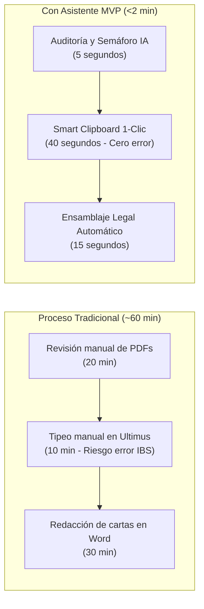
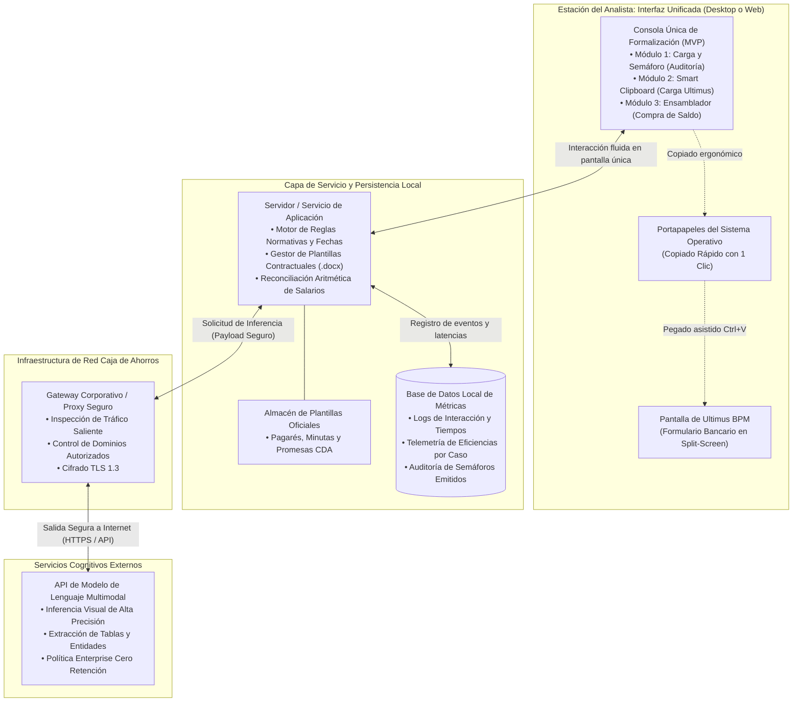
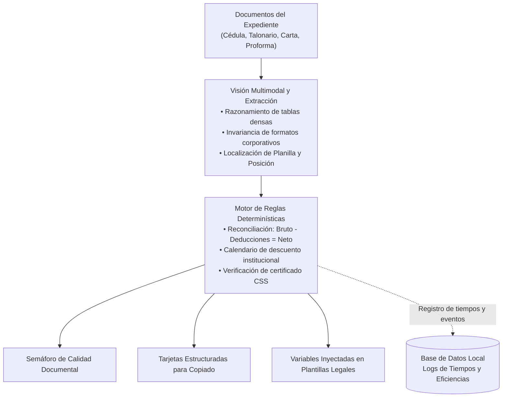
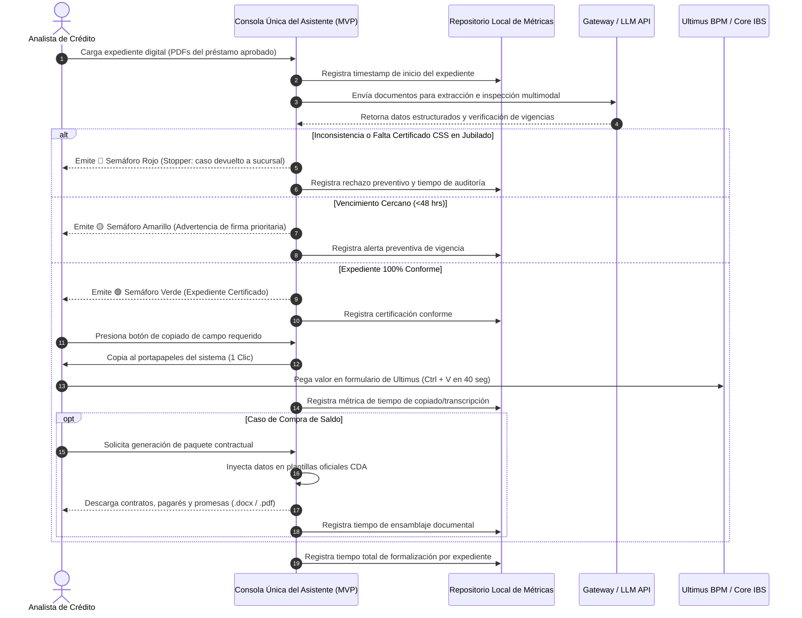

# Diseño de Arquitectura: Producto Mínimo Viable (MVP) - Asistente Inteligente de Formalización de Préstamos Personales
## Solución Asistencial MVP Desacoplada para Operaciones de Crédito Bancario

**Organización:** Caja de Ahorros de Panamá  
**Liderazgo Técnico:** Célula de Innovación (StraTech / Caja de Ahorros)  
**Audiencia:** Dirección de Operaciones, Vicepresidencia de Crédito, Arquitectura de TI y Seguridad  
**Fecha:** Octubre 2026  
**Versión:** 1.2 (Especificación de Arquitectura de Producto Mínimo Viable - MVP)  

---

## 1. Introducción

La formalización de préstamos personales constituye el eslabón crítico entre la aprobación de un crédito y la entrega efectiva de los fondos al cliente. En este proceso, el personal operativo del banco debe validar que los documentos físicos o digitales del expediente cumplan con todas las políticas normativas, transcribir manualmente información sensible hacia el sistema de gestión de procesos (Ultimus BPM) y elaborar contratos, pagarés notariales y cartas de promesa de pago a otras entidades financieras en casos de compra de saldo.

El **Asistente Inteligente de Formalización de Préstamos Personales** se concibe y estructura como un **Producto Mínimo Viable (MVP)** de productividad operativa diseñado bajo el paradigma de *Copiloto Asistencial Desacoplado*. Su propósito como MVP no es sustituir los sistemas bancarios centrales ni reemplazar el juicio del analista humano, sino proveer una capa de asistencia ágil que inspecciona expedientes en segundos, extrae datos con precisión milimétrica y pre-redacta la documentación legal requerida, manteniendo en todo momento al analista bancario en control decisional (*Human-in-the-Loop*).

Como MVP, la solución unifica la atención de sus tres casos de uso en **una sola interfaz de usuario**, eliminando la fragmentación operativa, e incorpora un componente de **persistencia en una base de datos local embebida** para registrar la trazabilidad de tiempos e interacciones. Este mecanismo permite cuantificar con datos duros las ganancias de eficiencia del banco, midiendo el ahorro de horas-hombre y validando la viabilidad del modelo antes de afrontar inversiones mayores o integraciones complejas con la infraestructura tecnológica central.

Este documento establece el diseño de arquitectura técnica y operativa del MVP, contemplando su mapa de componentes, estrategia de seguridad, capacidades de inteligencia artificial, flujo de trabajo, cobertura de riesgos y la justificación de sus decisiones de implementación.

---

## 2. Visión de Negocio

### 2.1. El Problema Operativo Actual
En las sesiones de levantamiento técnico y funcional con las áreas de Crédito y Tecnología, se identificaron tres cuellos de botella que incrementan el tiempo de ciclo por expediente de forma sustancial:

1. **Expedientes Retenidos por Documentación Faltante:** En clientes jubilados, la formalización no puede avanzar a firma sin el certificado físico emitido por la Caja de Seguro Social (CSS), un trámite externo que toma entre 7 y 20 días hábiles. Iniciar la gestión en Ultimus sin este documento provoca que el caso quede trabado y consuma esfuerzo innecesario de seguimiento.
2. **Transcripción Manual y Riesgo de Rechazo:** Para cada préstamo aprobado, el analista digita entre 10 y 15 campos numéricos y textuales. En talonarios de empleados públicos (Contraloría), la búsqueda de números de "Planilla" y "Posición" en tipografías diminutas genera fatiga visual y errores de tipeo que resultan en rechazos inmediatos por parte de los servicios web del Core Bancario (IBS).
3. **Confección Artesanal de Compra de Saldo:** La consolidación de deudas exige redactar cartas de compromiso y pagarés individualizados hacia terceros bancos (Banco General, Banistmo, BAC, etc.), copiando números de cuenta y montos al centavo desde documentos escaneados en plantillas de procesador de texto, demandando de 20 a 35 minutos por operación.

### 2.2. Cobertura Integral de Riesgos Operativos Bancarios
Uno de los mayores valores del MVP para la Dirección de Operaciones y la Gestión de Riesgos es el blindaje sistemático ante fallas humanas recurrentes:

| Riesgo Operativo Tradicional | Causa Raíz en Operación Manual | Mitigación Automatizada del Copiloto MVP | Impacto Institucional |
| :--- | :--- | :--- | :--- |
| **Errores en Transcripción de Datos Críticos** | Tipeo manual de números de cuenta, cédulas o posiciones de Contraloría en Ultimus BPM. | Extracción con visión espacial y pegado en 1 clic (*Smart Clipboard*) con datos normalizados y reconciliados. | **Cero rechazos en Web Services de IBS**, evitando reprocesos y bloqueos transaccionales. |
| **Omisión de Documentos Vencidos** | Pasar por alto cartas de trabajo o talonarios con más de 30 días de antigüedad por fatiga visual. | Verificación cronológica determinística que compara fechas de emisión contra la fecha actual del sistema. | **Semáforo Amarillo o Rojo preventivo**, impidiendo formalizar con documentación no vigente. |
| **Apertura Prematura de Casos de Jubilados** | Iniciar el caso en Ultimus sin contar con el certificado físico de jubilación de la CSS. | Regla de negocio que detecta perfil de jubilado y exige la presencia del documento de la CSS. | **Detención inmediata (Semáforo Rojo)**, evitando expedientes paralizados de 7 a 20 días hábiles en bandeja. |
| **Infracción de Calendarios de Descuento** | Programar descuentos por planilla en periodos no autorizados por las instituciones públicas. | Regla lógica codificada que bloquea descuentos en diciembre para préstamos personales. | **Cumplimiento estricto de convenios institucionales** y calendarios oficiales de Contraloría y CSS. |

### 2.3. Objetivos y Retorno de Inversión del MVP
* **Validación Empírica en Campo:** Comprobar en un entorno operativo controlado la reducción del tiempo promedio de formalización de aproximadamente 60 minutos a menos de 2 minutos por caso (aceleración superior al 95%).
* **Calidad y Cero Rechazos:** Eliminar discrepancias tipográficas en la comunicación hacia el Core IBS mediante extracción estructurada y copiado asistido.
* **Medición Objetiva:** Trazabilidad precisa de tiempos por etapa almacenada en una base de datos local embebida para evaluar ganancias reales de productividad y sustentar la evolución del producto hacia fases institucionales definitivas.

---

## 3. Arquitectura: Mapa de Componentes

La arquitectura del asistente se fundamenta en un diseño desacoplado que opera en el perímetro del usuario analista. La solución se concibe para soportar **dos variantes de despliegue**, adaptables según las políticas de infraestructura y seguridad que la institución determine para la fase de MVP:

* **Variante A (Aplicación Desktop / Agente Local):** Desplegada en la estación de trabajo del analista bancario. Ideal para una adopción inmediata del MVP sin requerir servidores web dedicados ni certificados de intranet institucional.
* **Variante B (Aplicación Web Interna / Portal de Intranet):** Alojada en un servidor de aplicaciones interno dentro de la red corporativa del banco, accesible mediante navegador web por los analistas autorizados.

Ambas variantes convergen en una **interfaz de usuario unificada** y comparten exactamente los mismos componentes lógicos, protocolos de seguridad y canales de salida hacia el modelo de inteligencia artificial.

### 3.1. Diagrama de Arquitectura de Componentes (MVP)

### 3.2. Descripción Detallada de Componentes

1. **Consola de Interfaz Única (Single-Pane Workspace):**
   * Ofrece un único entorno de trabajo visual donde el analista atiende de forma integrada los 3 casos de uso sin tener que alternar entre herramientas o pestañas dispersas:
     * **Panel Superior / Auditoría:** Arrastre de documentos y despliegue del Semáforo normativo con alertas de inconsistencias.
     * **Panel Central / Smart Clipboard:** Despliegue de tarjetas con los datos estructurados extraídos y botones individuales de copiado en 1 clic para trasladar a Ultimus BPM en pantalla dividida (*Win + Flechas*).
     * **Panel Inferior / Ensamblador Legal:** En casos de compra de saldo, botón de generación y descarga inmediata del paquete contractual completo (`.docx` y `.pdf`).
2. **Servidor o Servicio de Aplicación:**
   * En la Variante Desktop, opera como un proceso local ligero en el equipo del analista. En la Variante Web, reside en un servidor de aplicaciones interno del banco.
   * Ejecuta el motor determinístico de validación normativa (control de vigencia de 30 días, exclusión de descuentos en diciembre y detección de certificados requeridos).
   * Contiene el motor de ensamblaje documental que toma las variables extraídas y las inyecta en las plantillas oficiales pre-aprobadas de Caja de Ahorros.
3. **Base de Datos Local de Auditoría y Tiempos (Motor Embebido):**
   * Motor de base de datos embebido, ligero y autónomo, que opera integrado en la propia solución sin requerir administración de servidores de bases de datos adicionales ni licenciamientos de infraestructura pesada.
   * **Objetivo de Métricas y Eficiencia:** Registra automáticamente los eventos de cada expediente:
     * Marca de tiempo de carga del expediente (*timestamp* inicial).
     * Tiempo de respuesta de la auditoría y semáforo resultante (Verde, Amarillo, Rojo).
     * Tiempo dedicado al copiado y pegado de campos hacia Ultimus BPM.
     * Tiempo de generación de los contratos de compra de saldo.
     * Tiempo total invertido por expediente.
   * Permite a la gerencia operativa generar reportes cuantitativos de productividad, comparar el desempeño frente al proceso tradicional manual y sustentar con datos duros el retorno de inversión del MVP.
4. **Gateway Corporativo / Proxy Bancario:**
   * Canal obligatorio de intermediación para todo tráfico saliente de la red del banco hacia Internet.
   * Gestiona el túnel seguro hacia los extremos de la API del proveedor de inteligencia artificial, verificando certificados, aplicando listas blancas de destinos y auditando conexiones.
5. **API de Modelo de Lenguaje Multimodal (Nube Segura):**
   * Recibe las páginas o secciones documentales pertinentes para aplicar reconocimiento espacial y razonamiento sobre estructuras tabulares densas.
   * Devuelve estructuras de datos limpias y normalizadas (nombres, montos, números de cuenta, fechas) bajo acuerdos de nivel de servicio corporativos.

---

## 4. Estrategia de Datos y Seguridad

La arquitectura del MVP fue concebida bajo el principio de **Mínimo Privilegio y Cero Riesgo Transaccional**, salvaguardando los activos de información de Caja de Ahorros mediante los siguientes controles:

### 4.1. Desacoplamiento de Sistemas Críticos
* **Sin conexión al Core Bancario (IBS):** El asistente no posee credenciales, puertos abiertos ni enlaces de conexión directa con la base de datos central de transacciones bancarias. Esto elimina cualquier vector de riesgo de alteración o fuga de saldos desde el core.
* **Sin invasión sobre Ultimus BPM:** No se utilizan robots basados en automatización de interfaz (RPA) invasivos que pudieran bloquearse ante cambios de versión del BPM. La carga de datos la efectúa el analista humano mediante interacción de portapapeles asistido.

### 4.2. Función y Seguridad del Repositorio Local de Métricas
* **Datos Operativos y Telemetría Exclusiva:** La base de datos local almacena únicamente identificadores de sesión anonimizados, marcas de tiempo, resultados del semáforo y duración de eventos operativos.
* **No Persistencia de Datos Financieros Centrales:** Los documentos del cliente y contratos generados no se acumulan en la base de datos; se procesan en la memoria volátil de la sesión y se descargan localmente por el analista.
* **Ubicación Controlada:** El archivo de la base de datos local reside en el entorno de ejecución protegido del analista o en el almacenamiento seguro del servidor web interno, con permisos de lectura y escritura restringidos al perfil de la aplicación.

### 4.3. Protección de Datos en Tránsito
* **Cifrado Fuerte:** Todas las transmisiones hacia el Gateway y hacia la API del modelo de inteligencia artificial se realizan mediante protocolos seguros HTTPS sobre TLS 1.3.
* **Efimeridad de Datos (Zero-Data Retention):** El servicio de modelo cognitivo opera bajo suscripción corporativa (*Enterprise Agreement*) con cláusula de no almacenamiento y no reutilización de datos para entrenamiento de modelos.

---

## 5. Capacidades de Inteligencia Artificial

El sistema aprovecha modelos de lenguaje multimodal avanzados (*Vision-Language Models*) complementados con reglas de negocio determinísticas para garantizar máxima exactitud operativa:

1. **Razonamiento Espacial sobre Tablas Complejas:**
   Capacidad de localizar visualmente campos en grillas con alta densidad tipográfica, como los talonarios de pago de Contraloría General de la República, identificando inequívocamente los valores correspondientes a **Planilla** y **Número de Posición**, mitigando la confusión generada por tipografías reducidas o escaneos de baja resolución.
2. **Invariancia ante Diversidad de Formatos:**
   Interpretación de cartas de trabajo emitidas por múltiples empresas privadas con redacciones heterogéneas, extrayendo de manera estandarizada los salarios brutos, deducciones voluntarias, descuentos legales y salarios netos.
3. **Reconciliación Aritmética Automática:**
   Comprobación matemática inmediata de consistencia: el motor valida que el salario bruto reportado menos las deducciones totales equivalga al salario neto recibido antes de habilitar el copiado de datos.
4. **Extracción y Clasificación de Pasivos Externos:**
   Reconocimiento de cartas de saldo emitidas por cualquier banco de la plaza (Banco General, Banistmo, BAC Credomatic, financieras locales), identificando el nombre de la institución acreedora, el número de producto (préstamo o tarjeta), el saldo adeudado y la fecha de expiración de la promesa de pago.

---

## 6. Flujo de Proceso

El flujo operativo se estructura en tres etapas secuenciales gestionadas desde la **interfaz unificada** del analista:

### Descripción de las Fases en la Consola Única del MVP:
1. **Fase 1: Auditoría y Semáforo de Pre-Formalización:**
   * El analista arrastra el expediente aprobado al panel superior.
   * La solución audita consistencia de identidad y vigencias normativas (<30 días).
   * Si el cliente es jubilado y carece del certificado de la CSS, el sistema genera de forma instantánea un **Semáforo Rojo**, permitiendo devolver el expediente a la sucursal antes de perder tiempo procesándolo en Ultimus.
2. **Fase 2: Smart Clipboard en Pantalla Dividida:**
   * Una vez obtenido el **Semáforo Verde**, el panel central presenta tarjetas ordenadas con los 10 a 15 campos necesarios para Ultimus.
   * El analista hace clic sobre el campo deseado y lo pega directamente en el formulario del BPM. Esta acción toma entre 30 y 50 segundos por expediente, erradicando errores tipográficos hacia el Core IBS.
3. **Fase 3: Ensamblaje Documental de Compra de Saldo:**
   * En créditos destinados a consolidar pasivos, el panel inferior extrae las obligaciones de las cartas externas y completa automáticamente las **Promesas Irrevocables de Pago**, el **Pagaré Notarial** y la **Orden de Descuento** en formato editable `.docx` y visualizable `.pdf`, reduciendo 30 minutos de redacción a 15 segundos.
4. **Fase Continua de Métricas en el Repositorio Local:**
   * En segundo plano y sin fricción para el usuario, cada paso alimenta la base de datos local embebida con los tiempos reales invertidos, generando el insumo analítico para justificar la eficiencia del MVP ante la Dirección del banco.

---

## 7. Decisión Técnica

La arquitectura descrita adopta decisiones estratégicas deliberadas que responden a los principios de un **Producto Mínimo Viable (MVP)**: máxima entrega de valor de negocio con mínima fricción técnica e infraestructura ligera:

### 7.1. Justificación de la Dualidad Desktop vs. Web App Interna
* **Por qué habilitar la opción Desktop:** En el contexto de un MVP ágil, una aplicación de escritorio local permite iniciar pruebas piloto o producción de inmediato en un grupo controlado de analistas, sin depender de ventanas de mantenimiento de servidores corporativos, aprobaciones de infraestructura centralizada ni configuraciones de balanceadores de carga.
* **Por qué contemplar la opción Web App Interna:** Si la gobernanza institucional exige centralizar el despliegue del MVP para evitar instalaciones individuales en puestos de trabajo y gestionar actualizaciones desde un único punto, la arquitectura web interna permite servir el copiloto a través del navegador estándar del banco, reutilizando los servidores de aplicaciones corporativos existentes.

### 7.2. Elección de Base de Datos Local Embebida para Telemetría y Métricas de Tiempos
* **Autonomía y Cero Mantenimiento:** La adopción de un motor relacional embebido y autónomo responde directamente a los objetivos de un MVP: opera integrado en el proceso de la aplicación sin requerir instalación, configuración ni administración de servidores de bases de datos dedicados.
* **Rendimiento Inmediato:** Permite registrar trazas de auditoría y marcas de tiempo en microsegundos, asegurando que la medición de eficiencias no introduzca ninguna latencia perceptible para el analista.
* **Facilidad de Extracción:** El archivo de base de datos resultante puede consultarse o exportarse periódicamente mediante reportes analíticos para la toma de decisiones y sustento del caso de negocio ante la alta gerencia.

### 7.3. Salida Segura a Internet vía Gateway Corporativo
El consumo de modelos de inteligencia artificial mediante llamadas API a través del proxy/gateway del banco representa la alternativa técnica y económica más eficiente para el MVP:
* Elimina la necesidad de adquirir, alojar y mantener servidores con aceleración por hardware (GPUs de alto costo) dentro de los centros de datos de la institución.
* Asegura el acceso continuo a las versiones más recientes y precisas de los modelos cognitivos multimodales.
* Garantiza la trazabilidad del tráfico mediante los registros y políticas de inspección ya implementados en el firewall perimetral del banco.

### 7.4. Descarte de Soluciones Invasivas
Se descartó expresamente el uso de automatizaciones robóticas (RPA) que interactúen a ciegas sobre las pantallas de Ultimus BPM o que modifiquen bases de datos directas. El enfoque de **Smart Clipboard en Interfaz Única** respeta íntegramente la arquitectura bancaria actual, preserva la responsabilidad operativa del analista y entrega resultados de negocio inmediatos con costo de mantenimiento cercano a cero, cumpliendo con la premisa fundamental de un MVP exitoso.
