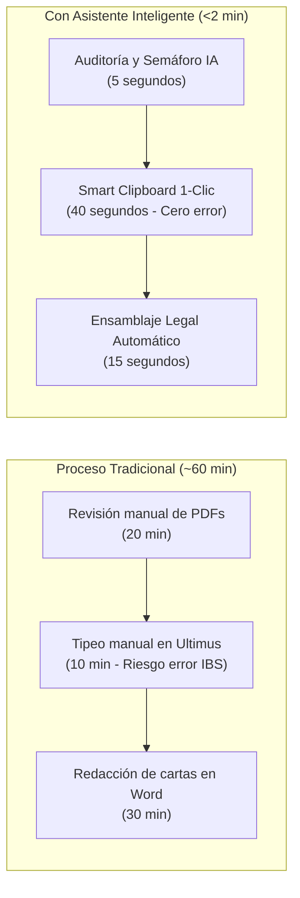
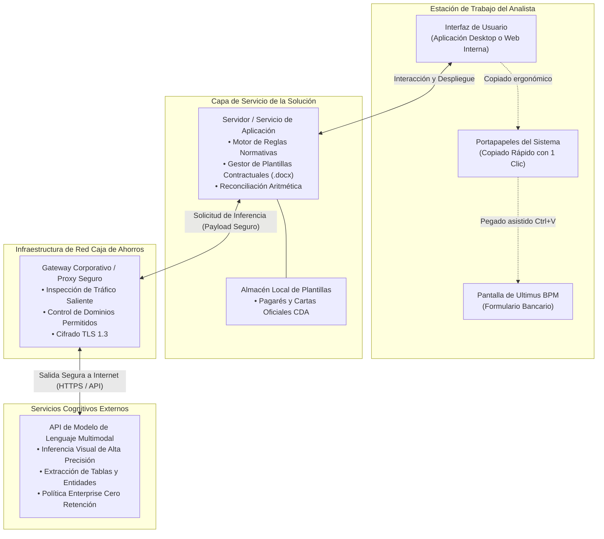
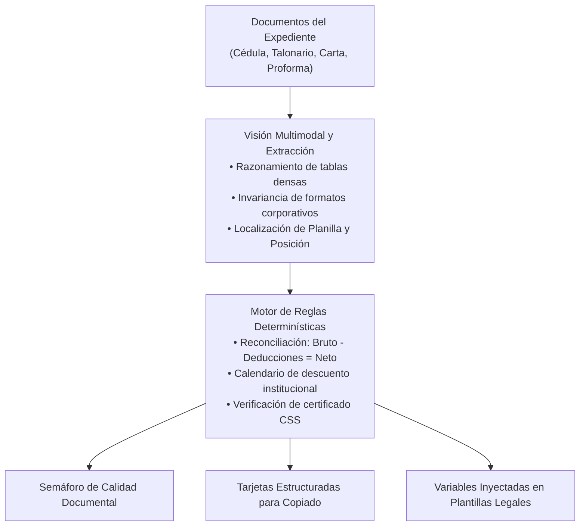
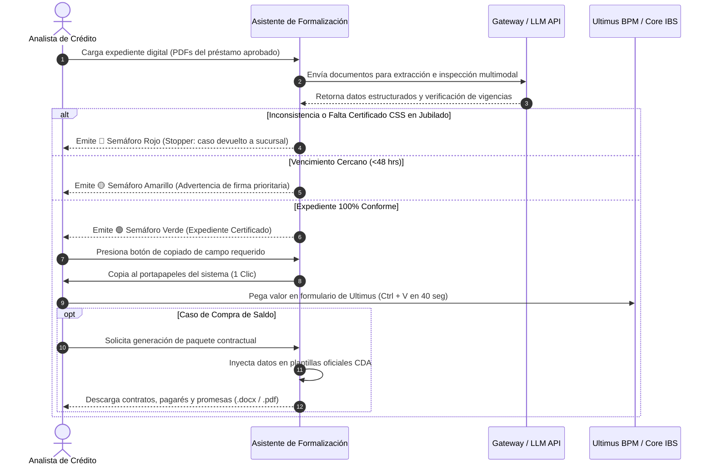

# Diseño de Arquitectura: Asistente Inteligente de Formalización de Préstamos Personales
## Solución Asistencial Desacoplada para Operaciones de Crédito

**Organización:** Caja de Ahorros de Panamá  
**Liderazgo Técnico:** Célula de Innovación (StraTech / Caja de Ahorros)  
**Audiencia:** Dirección de Operaciones, Vicepresidencia de Crédito, Arquitectura de TI y Seguridad  
**Fecha:** Octubre 2026  
**Versión:** 1.0 (Documento Técnico-Funcional de Arquitectura)  

---

## 1. Introducción

La formalización de préstamos personales constituye el eslabón crítico entre la aprobación de un crédito y la entrega efectiva de los fondos al cliente. En este proceso, el personal operativo del banco debe validar que los documentos físicos o digitales del expediente cumplan con todas las políticas normativas, transcribir manualmente información sensible hacia el sistema de gestión de procesos (Ultimus BPM) y elaborar contratos, pagarés notariales y cartas de promesa de pago a otras entidades financieras en casos de compra de saldo.

El **Asistente Inteligente de Formalización de Préstamos Personales** se concibe como una herramienta de productividad operativa diseñada bajo el paradigma de *Copiloto Asistencial Desacoplado*. Su propósito no es sustituir los sistemas bancarios centrales ni reemplazar el juicio del analista humano, sino proveer una capa de asistencia ágil que inspecciona expedientes en segundos, extrae datos con precisión milimétrica y pre-redacta la documentación legal requerida, manteniendo en todo momento al analista bancario en control decisional (*Human-in-the-Loop*).

Este documento establece el diseño de arquitectura técnica y operativa del asistente, contemplando su mapa de componentes, estrategia de seguridad, capacidades de inteligencia artificial, flujo de trabajo y la justificación de sus decisiones de implementación.

---

## 2. Visión de Negocio

### 2.1. El Problema Operativo Actual
En las sesiones de levantamiento técnico y funcional con las áreas de Crédito y Tecnología, se identificaron tres cuellos de botella que incrementan el tiempo de ciclo por expediente de forma sustancial:

1. **Expedientes Retenidos por Documentación Faltante:** En clientes jubilados, la formalización no puede avanzar a firma sin el certificado físico emitido por la Caja de Seguro Social (CSS), un trámite externo que toma entre 7 y 20 días hábiles. Iniciar la gestión en Ultimus sin este documento provoca que el caso quede trabado y consuma esfuerzo innecesario de seguimiento.
2. **Transcripción Manual y Riesgo de Rechazo:** Para cada préstamo aprobado, el analista digita entre 10 y 15 campos numéricos y textuales. En talonarios de empleados públicos (Contraloría), la búsqueda de números de "Planilla" y "Posición" en tipografías diminutas genera fatiga visual y errores de tipeo que resultan en rechazos inmediatos por parte de los servicios web del Core Bancario (IBS).
3. **Confección Artesanal de Compra de Saldo:** La consolidación de deudas exige redactar cartas de compromiso y pagarés individualizados hacia terceros bancos (Banco General, Banistmo, BAC, etc.), copiando números de cuenta y montos al centavo desde documentos escaneados en plantillas de procesador de texto, demandando de 20 a 35 minutos por operación.

### 2.2. Objetivos y Retorno de Inversión
* **Reducción de Tiempo de Ciclo:** Disminuir el tiempo promedio de formalización de aproximadamente 60 minutos a menos de 2 minutos por caso (aceleración superior al 95%).
* **Calidad y Cero Rechazos:** Eliminar discrepancias tipográficas en la comunicación hacia el Core IBS mediante extracción estructurada y copiado asistido.
* **Agilidad de Despliegue:** Operar de manera inmediata sin exigir desarrollos complejos ni modificaciones en Ultimus BPM o el Core IBS.

---

## 3. Arquitectura: Mapa de Componentes

La arquitectura del asistente se fundamenta en un diseño desacoplado que opera en el perímetro del usuario analista. La solución se concibe para soportar **dos variantes de despliegue**, adaptables según las políticas de infraestructura y seguridad que la institución determine:

* **Variante A (Aplicación Desktop / Agente Local):** Desplegada en la estación de trabajo del analista bancario. Ideal para una adopción inmediata sin requerir servidores web dedicados ni certificados de intranet institucional.
* **Variante B (Aplicación Web Interna / Portal de Intranet):** Alojada en un servidor de aplicaciones interno dentro de la red corporativa del banco, accesible mediante navegador web por los analistas autorizados.

Ambas variantes comparten exactamente los mismos componentes lógicos, protocolos de seguridad y canales de salida hacia el modelo de inteligencia artificial.

### 3.1. Diagrama de Arquitectura de Componentes

### 3.2. Descripción Detallada de Componentes

1. **Interfaz de Usuario (Desktop o Web Interna):**
   * Ofrece un panel ergonómico diseñado para trabajo en pantalla dividida (*Split-Screen*).
   * Presenta la bandeja de carga de documentos arrastrables (drag & drop) para los expedientes del crédito.
   * Despliega las tarjetas de datos extraídos con botones individuales de copiado rápido ("Smart Clipboard") y los botones de descarga de paquetes contractuales generados.
2. **Servidor o Servicio de Aplicación:**
   * En la Variante Desktop, funciona como un proceso local ligero en el equipo del analista. En la Variante Web, reside en un servidor de aplicaciones interno del banco.
   * Ejecuta el motor determinístico de validación normativa (fechas, exclusión de descuentos en diciembre y comprobación de certificados requeridos).
   * Contiene el motor de ensamblaje documental que toma las variables extraídas y las fusiona en las plantillas oficiales pre-aprobadas de Caja de Ahorros.
3. **Gateway Corporativo / Proxy Bancario:**
   * Canal obligatorio de intermediación para todo tráfico saliente de la red del banco hacia Internet.
   * Gestiona el túnel seguro hacia los extremos de la API del proveedor de inteligencia artificial, verificando certificados, aplicando listas blancas de destinos y auditando conexiones.
4. **API de Modelo de Lenguaje Multimodal (Nube Segura):**
   * Recibe las páginas o secciones documentales pertinentes para aplicar reconocimiento espacial y razonamiento sobre estructuras tabulares densas.
   * Devuelve estructuras de datos limpias y normalizadas (nombres, montos, números de cuenta, fechas) bajo acuerdos de nivel de servicio corporativos.
5. **Entorno de Procesamiento Temporal:**
   * El sistema no utiliza bases de datos permanentes para almacenar expedientes. Los documentos viajan en la memoria de la sesión activa del analista y se eliminan una vez culminada la operación o cerrada la aplicación.

---

## 4. Estrategia de Datos y Seguridad

La arquitectura fue concebida bajo el principio de **Mínimo Privilegio y Cero Riesgo Transaccional**, salvaguardando los activos de información de Caja de Ahorros mediante los siguientes controles:

### 4.1. Desacoplamiento de Sistemas Críticos
* **Sin conexión al Core Bancario (IBS):** El asistente no posee credenciales, puertos abiertos ni enlaces de conexión directa con la base de datos central de transacciones bancarias. Esto elimina cualquier vector de riesgo de alteración o fuga de saldos desde el core.
* **Sin invasión sobre Ultimus BPM:** No se utilizan robots basados en automatización de interfaz (RPA) invasivos que pudieran bloquearse ante cambios de versión del BPM. La carga de datos la efectúa el analista humano mediante interacción de portapapeles asistido.

### 4.2. Protección de Datos en Tránsito y Reposo
* **Cifrado Fuerte:** Todas las transmisiones hacia el Gateway y hacia la API del modelo de inteligencia artificial se realizan mediante protocolos seguros HTTPS sobre TLS 1.3.
* **Efimeridad de Datos (Zero-Data Retention):** Los documentos procesados se mantienen exclusivamente en memoria volátil durante la sesión de trabajo. El servicio de modelo cognitivo opera bajo suscripción corporativa (*Enterprise Agreement*) con cláusula de no almacenamiento y no reutilización de datos para entrenamiento de modelos.
* **Privacidad de la Información Personal:** Los identificadores y datos financieros extraídos solo viajan entre el analista y el servicio de inferencia temporal, sin persistirse en servidores intermedios de terceros.

---

## 5. Capacidades de Inteligencia Artificial

El sistema aprovecha modelos de lenguaje multimodal avanzados (*Vision-Language Models*) complementados con reglas de negocio determinísticas para garantizar máxima exactitud operativa:

1. **Razonamiento Espacial sobre Tablas Complejas:**
   Capacidad de localizar visualmente campos en grillas con alta densidad tipográfica, como los talonarios de pago de Contraloría General de la República, identificando inequívocamente los valores correspondientes a **Planilla** y **Número de Posición**, mitigando la confusión generada por tipografías reducidas o escaneos de baja resolución.
2. **Invariancia ante Diversidad de Formatos:**
   Interpretación de cartas de trabajo emitidas por múltiples empresas privadas con redacciones heterogéneas, extrayendo de manera estandarizada los salarios brutos, deducciones voluntarias, descuentos legales y salarios netos.
3. **Reconciliación Aritmética Automática:**
   Comprobación matemática inmediata de consistencia: el motor valida que el salario bruto reportado menos las deducciones totales equivalga al salario neto recibido antes de habilitar el copiado de datos.
4. **Extracción y Clasificación de Pasivos Externos:**
   Reconocimiento de cartas de saldo emitidas por cualquier banco de la plaza (Banco General, Banistmo, BAC Credomatic, financieras locales), identificando el nombre de la institución acreedora, el número de producto (préstamo o tarjeta), el saldo adeudado y la fecha de expiración de la promesa de pago.

---

## 6. Flujo de Proceso

El flujo operativo se estructura en tres etapas secuenciales gestionadas desde la pantalla del analista:

### Descripción de las Fases del Proceso:
1. **Fase 1: Auditoría y Semáforo de Pre-Formalización:**
   * El analista arrastra el expediente aprobado.
   * La solución audita consistencia de identidad (cédula y nombre idénticos en todos los recaudos) y vigencias normativas.
   * Si el cliente es jubilado y carece del certificado de la CSS, el sistema genera de forma instantánea un **Semáforo Rojo**, permitiendo devolver el expediente a la sucursal antes de perder tiempo procesándolo en Ultimus.
2. **Fase 2: Copiloto de Extracción y Portapapeles Asistido (Smart Clipboard):**
   * Una vez obtenido el **Semáforo Verde**, la pantalla presenta tarjetas ordenadas con los 10 a 15 campos necesarios para Ultimus.
   * El analista hace clic sobre el campo deseado y lo pega directamente en el formulario del BPM. Esta acción toma entre 30 y 50 segundos por expediente, erradicando errores tipográficos hacia el Core IBS.
3. **Fase 3: Ensamblaje Documental de Compra de Saldo:**
   * En créditos destinados a consolidar pasivos, el sistema extrae las obligaciones de las cartas externas y completa automáticamente las **Promesas Irrevocables de Pago**, el **Pagaré Notarial** y la **Orden de Descuento** en formato editable `.docx` y visualizable `.pdf`, reduciendo 30 minutos de redacción a 15 segundos.

---

## 7. Decisión Técnica

La arquitectura descrita adopta decisiones estratégicas deliberadas para maximizar el valor de negocio y minimizar la fricción técnica:

### 7.1. Justificación de la Dualidad Desktop vs. Web App Interna
* **Por qué habilitar la opción Desktop:** En escenarios de despliegue ágil, una aplicación de escritorio local permite iniciar pruebas piloto o producción de inmediato en un grupo controlado de analistas, sin depender de ventanas de mantenimiento de servidores corporativos, aprobaciones de infraestructura centralizada ni configuraciones de balanceadores de carga.
* **Por qué contemplar la opción Web App Interna:** Si la gobernanza institucional exige centralizar el despliegue para evitar instalaciones individuales en puestos de trabajo y gestionar actualizaciones desde un único punto, la arquitectura web interna permite servir el copiloto a través del navegador estándar del banco, reutilizando los servidores de aplicaciones corporativos existentes.

### 7.2. Salida Segura a Internet vía Gateway Corporativo
El consumo de modelos de inteligencia artificial mediante llamadas API a través del proxy/gateway del banco representa la alternativa técnica y económica más eficiente:
* Elimina la necesidad de adquirir, alojar y mantener servidores con aceleración por hardware (GPUs de alto costo) dentro de los centros de datos de la institución.
* Asegura el acceso continuo a las versiones más recientes y precisas de los modelos cognitivos multimodales.
* Garantiza la trazabilidad del tráfico mediante los registros y políticas de inspección ya implementados en el firewall perimetral del banco.

### 7.3. Descarte de Soluciones Invasivas
Se descartó expresamente el uso de automatizaciones robóticas (RPA) que interactúen a ciegas sobre las pantallas de Ultimus BPM o que modifiquen bases de datos directas. El enfoque de **Smart Clipboard** respeta íntegramente la arquitectura bancaria actual, preserva la responsabilidad operativa del analista y entrega resultados de negocio inmediatos con costo de mantenimiento cercano a cero.
