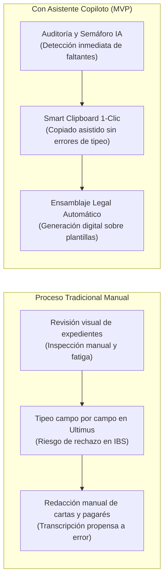
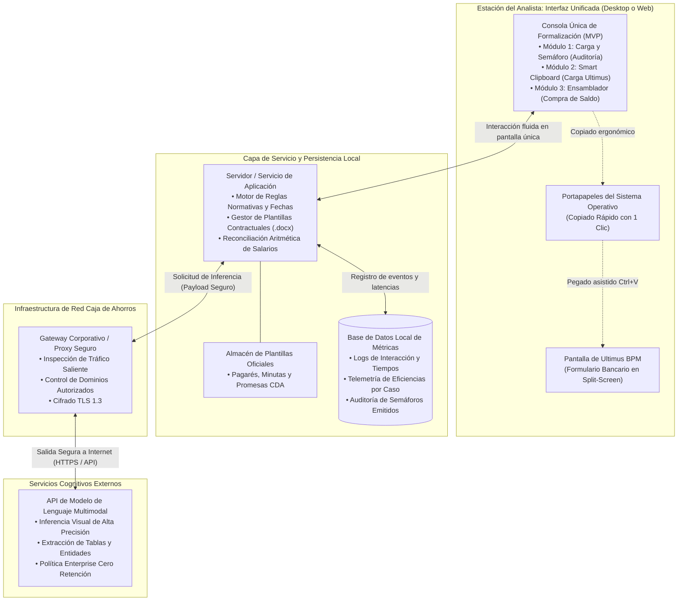
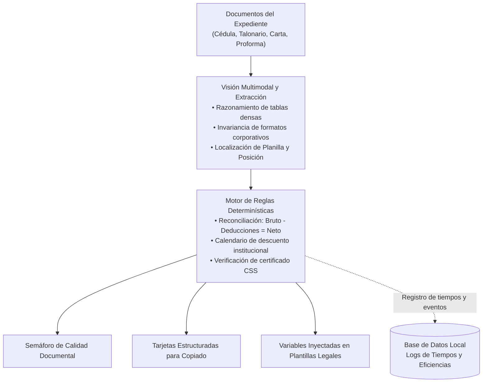

# Diseño de Arquitectura: Producto Mínimo Viable (MVP) - Asistente Inteligente de Formalización de Préstamos Personales
## Solución Asistencial MVP Desacoplada para Operaciones de Crédito Bancario

**Organización:** Caja de Ahorros de Panamá  
**Liderazgo Técnico:** Célula de Innovación (StraTech / Caja de Ahorros)  
**Fecha:** Octubre 2026  
**Versión:** 1.5 (Especificación de Arquitectura MVP con Medición Empírica de Eficiencias y Metodología de KPIs)  

---

## 1. Introducción

La formalización de préstamos personales constituye el eslabón crítico entre la aprobación crediticia y el desembolso de los fondos al cliente. En este proceso, el personal operativo del banco debe validar que los documentos físicos o digitales del expediente cumplan con todas las políticas normativas, transcribir manualmente datos hacia el sistema de gestión de procesos (Ultimus BPM) y elaborar contratos, pagarés notariales y cartas de promesa de pago a otras entidades financieras en casos de compra de saldo.

El **Asistente Inteligente de Formalización de Préstamos Personales** se concibe y estructura como un **Producto Mínimo Viable (MVP)** de productividad operativa diseñado bajo el paradigma de *Copiloto Asistencial Desacoplado*. Su propósito no es sustituir los sistemas centrales ni reemplazar el criterio del analista humano, sino proveer una capa de asistencia ágil que inspecciona expedientes, extrae datos con alta precisión y pre-redacta la documentación legal requerida, manteniendo en todo momento al analista bancario en control decisional (*Human-in-the-Loop*).

Como MVP, la solución unifica la atención de sus tres casos de uso en **una sola interfaz de usuario**, eliminando la fragmentación operativa, e incorpora un componente de **persistencia en una base de datos local embebida** para registrar la trazabilidad de tiempos e interacciones. Este mecanismo permite cuantificar con datos duros y contrastables las ganancias de eficiencia del banco, midiendo el ahorro de esfuerzo operativo y validando la viabilidad del modelo antes de afrontar inversiones mayores o integraciones complejas con la infraestructura tecnológica central.

---

## 2. Visión de Negocio

### 2.1. El Problema Operativo Actual
En las sesiones de levantamiento técnico y funcional con las áreas de Crédito y Tecnología, se identificaron tres cuellos de botella que incrementan el tiempo de ciclo por expediente y elevan la carga operativa:

1. **Expedientes Retenidos por Documentación Faltante:** En clientes jubilados, la formalización no puede avanzar a firma sin el certificado físico emitido por la Caja de Seguro Social (CSS), un trámite externo que depende de un tercero. Iniciar la gestión en Ultimus sin este documento provoca que el caso quede trabado en bandeja y consuma esfuerzo innecesario de seguimiento.
2. **Transcripción Manual y Riesgo de Rechazo:** Para cada préstamo aprobado, el analista digita entre 10 y 15 campos numéricos y textuales. En talonarios de empleados públicos (Contraloría), la búsqueda de números de "Planilla" y "Posición" en tipografías diminutas genera fatiga visual y errores de tipeo que resultan en rechazos inmediatos por parte de los servicios web del Core Bancario (IBS).
3. **Confección Artesanal de Compra de Saldo:** La consolidación de deudas exige redactar cartas de compromiso y pagarés individualizados hacia terceros bancos (Banco General, Banistmo, BAC, etc.), copiando números de cuenta y montos al centavo desde documentos escaneados en plantillas de procesador de texto, lo que demanda un esfuerzo manual considerable y eleva la probabilidad de errores en cifras contractuales críticas.

### 2.2. Cobertura Integral de Riesgos Operativos Bancarios
Uno de los mayores valores del MVP para la Dirección de Operaciones y la Gestión de Riesgos es el blindaje sistemático ante fallas humanas recurrentes:

| Riesgo Operativo Tradicional | Causa Raíz en Operación Manual | Mitigación Automatizada del Copiloto MVP | Impacto Institucional |
| :--- | :--- | :--- | :--- |
| **Errores en Transcripción de Datos Críticos** | Tipeo manual de números de cuenta, cédulas o posiciones de Contraloría en Ultimus BPM. | Extracción con visión espacial y pegado en 1 clic (*Smart Clipboard*) con datos normalizados y reconciliados. | **Cero rechazos en Web Services de IBS**, evitando reprocesos y bloqueos transaccionales. |
| **Omisión de Documentos Vencidos** | Pasar por alto cartas de trabajo o talonarios que exceden la vigencia reglamentaria institucional por fatiga visual. | Verificación cronológica determinística que compara fechas de emisión contra la fecha actual del sistema conforme a la política vigente. | **Semáforo Amarillo o Rojo preventivo**, impidiendo formalizar con documentación no vigente. |
| **Apertura Prematura de Casos de Jubilados** | Iniciar el caso en Ultimus sin contar con el certificado físico de jubilación de la CSS. | Regla de negocio que detecta perfil de jubilado y exige la presencia del documento de la CSS. | **Detención inmediata (Semáforo Rojo)**, evitando expedientes paralizados en bandeja por trámites externos de terceros. |
| **Infracción de Calendarios de Descuento** | Programar descuentos por planilla en periodos no autorizados por las instituciones públicas. | Regla lógica codificada que bloquea descuentos en diciembre para préstamos personales. | **Cumplimiento estricto de convenios institucionales** y calendarios oficiales de Contraloría y CSS. |

### 2.3. Objetivos y Retorno de Inversión del MVP
* **Medición y Optimización de Tiempos Operativos:** Establecer una línea base cuantitativa mediante la telemetría del MVP para registrar y analizar los tiempos reales invertidos en revisión, transcripción y redacción.
* **Calidad y Cero Rechazos:** Eliminar discrepancias tipográficas en la comunicación hacia el Core IBS mediante extracción estructurada y copiado asistido.
* **Medición Objetiva con Datos Reales:** Trazabilidad precisa de tiempos por etapa almacenada en una base de datos local embebida para respaldar las decisiones operativas con métricas empíricas comprobables.

### 2.4. KPI de Eficiencia y Metodología de Medición Sugerida para Caja de Ahorros

Para evaluar con objetividad técnica y financiera las ganancias de productividad alcanzadas por el MVP, se propone que Caja de Ahorros mida de su lado los resultados comparando el proceso tradicional manual frente al proceso asistido con el copiloto.

#### A. Definición del KPI Principal: Eficiencia Operativa de Formalización (EOF)
El indicador evalúa el porcentaje de optimización del tiempo total de ciclo invertido por expediente desde su apertura hasta la generación de los contratos:

$$\text{Eficiencia Operativa (\%)} = \frac{T_{\text{manual}} - T_{\text{asistido}}}{T_{\text{manual}}} \times 100$$

Donde:
* $T_{\text{manual}}$: Tiempo promedio invertido por un analista en formalizar un expediente manualmente (revisión de vigencias, tipeo campo por campo en Ultimus BPM y redacción manual de cartas/pagarés en procesador de texto).
* $T_{\text{asistido}}$: Tiempo total registrado por la telemetría del copiloto (calculado automáticamente entre la carga inicial del PDF y la descarga del paquete contractual).

#### B. Medición en Términos de Pasos Operativos

| Etapa Operativa | Flujo Tradicional Manual (9 pasos) | Flujo Asistido con Copiloto MVP (4 pasos) |
| :--- | :--- | :--- |
| **Paso 1** | Apertura e inspección visual de múltiples páginas PDF dispersas. | Carga del expediente digital en la consola única (arrastre de archivos). |
| **Paso 2** | Verificación manual de vigencia de fechas (<30 días) contra calendario. | Inspección automática y emisión del Semáforo normativo de calidad. |
| **Paso 3** | Búsqueda manual de documentos obligatorios (ej. certificado de jubilación CSS). | *(Consolidado en Paso 2: el Semáforo alerta de inmediato si falta).* |
| **Paso 4** | Reconciliación aritmética manual (bruto menos deducciones igual a neto). | *(Consolidado en Paso 2: cálculo determinístico automático).* |
| **Paso 5** | Búsqueda y lectura de Planilla y Posición en la grilla de Contraloría. | *(Consolidado en Paso 2: visión espacial ubica los campos con precisión).* |
| **Paso 6** | Tipeo manual campo por campo (10 a 15 campos) en el formulario de Ultimus. | Copiado asistido en 1 clic campo por campo hacia Ultimus (*Smart Clipboard*). |
| **Paso 7** | Búsqueda y apertura de plantillas de procesador de texto para compra de saldo. | Activación en 1 clic del ensamblador documental en el panel inferior. |
| **Paso 8** | Transcripción manual de acreedor, número de préstamo y saldo al centavo. | *(Consolidado en Paso 7: datos leídos directamente de las cartas de saldo).* |
| **Paso 9** | Redacción, formateo y guardado individual de promesas, pagarés y órdenes. | Descarga inmediata del paquete contractual oficial (.docx / .pdf). |

**Reducción de Pasos Operativos:** Disminución superior al 55% en pasos manuales (de 9 pasos complejos y propensos a fatiga a 4 pasos asistidos y verificados), concentrando la intervención humana en la toma de decisiones y el control.

#### C. Medición en Términos de Tiempo y Registro de Marcas (Telemetría)
Para evitar estimaciones subjetivas, CDA se apoya en los registros exactos de marcas de tiempo (*timestamps*) almacenados en la base de datos local embebida del copiloto:
* $t_0$: Timestamp de carga y lectura del expediente digital.
* $t_1$: Timestamp de emisión del Semáforo normativo (auditoría completada).
* $t_2$: Timestamp de finalización de copiado de datos hacia Ultimus BPM.
* $t_3$: Timestamp de generación y descarga del paquete contractual.
* $T_{\text{asistido}} = t_3 - t_0$.

#### D. KPI Secundario de Calidad Operativa: Tasa de Rechazos en Web Services de Core IBS
Indicador que evalúa la eliminación de reprocesos causados por digitación manual incorrecta:

$$\text{Tasa de Rechazos IBS (\%)} = \frac{\text{Expedientes Rechazados por Inconsistencia Tipográfica}}{\text{Total de Expedientes Tramitados}} \times 100$$

* Meta sugerida para CDA: 0% de rechazos en las interfaces de validación de IBS gracias a la normalización de datos del Smart Clipboard.

#### E. Protocolo Sugerido de Medición para CDA
1. **Fase de Línea Base:** CDA cronometra el tiempo invertido en una muestra control de expedientes formalizados manualmente (registrando $T_{\text{manual}}$ y el número de rechazos en IBS).
2. **Fase de Prueba Piloto con Copiloto:** CDA habilita el MVP en un grupo de analistas y extrae la telemetría de tiempos ($T_{\text{asistido}}$) registrada en la base de datos local embebida.
3. **Consolidación y Análisis de Retorno:** Comparar las medias de tiempos por tipo de cliente (jubilados, empleados públicos y compra de saldo) y calcular la ganancia porcentual de eficiencia y ahorro de horas-hombre.

---

## 3. Arquitectura: Mapa de Componentes

La arquitectura del asistente se fundamenta en un diseño desacoplado que opera en el perímetro del usuario analista. La solución soporta **dos variantes de despliegue** para el MVP:

* **Variante A (Aplicación Desktop / Agente Local):** Desplegada en la estación de trabajo del analista. Ideal para una adopción inmediata sin requerir servidores web dedicados ni certificados de intranet institucional.
* **Variante B (Aplicación Web Interna / Portal de Intranet):** Alojada en un servidor de aplicaciones interno dentro de la red corporativa del banco, accesible mediante navegador web institucional.

Ambas variantes convergen en una **interfaz de usuario unificada** y comparten exactamente los mismos componentes lógicos, protocolos de seguridad y canales de salida hacia el modelo cognitivo.

### 3.1. Diagrama de Arquitectura de Componentes (MVP)

### 3.2. Descripción Detallada de Componentes

1. **Consola de Interfaz Única (Single-Pane Workspace):**
   * Ofrece un único entorno de trabajo visual donde el analista atiende de forma integrada los 3 casos de uso:
     * **Panel Superior / Auditoría:** Arrastre de documentos y despliegue del Semáforo normativo con alertas de inconsistencias.
     * **Panel Central / Smart Clipboard:** Despliegue de tarjetas con los datos estructurados extraídos y botones individuales de copiado en 1 clic para trasladar a Ultimus BPM en pantalla dividida (*Win + Flechas*).
     * **Panel Inferior / Ensamblador Legal:** En casos de compra de saldo, botón de generación y descarga inmediata del paquete contractual completo (`.docx` y `.pdf`).
2. **Servidor o Servicio de Aplicación:**
   * En la Variante Desktop, opera como un proceso local ligero en el equipo del analista. En la Variante Web, reside en un servidor de aplicaciones interno del banco.
   * Ejecuta el motor determinístico de validación normativa (control de vigencia de documentos, exclusión de descuentos en diciembre y detección de certificados requeridos).
   * Contiene el motor de ensamblaje documental que toma las variables extraídas y las inyecta en las plantillas oficiales pre-aprobadas de Caja de Ahorros.
3. **Base de Datos Local de Auditoría y Tiempos (Motor Embebido):**
   * Motor de base de datos embebido, ligero y autónomo, que opera integrado en la solución sin requerir administración de servidores de bases de datos adicionales.
   * Registra automáticamente los eventos de cada expediente (marcas de tiempo de inicio, auditoría, copiado a Ultimus, generación contractual y tiempo total por caso).
   * Permite a la gerencia operativa generar reportes cuantitativos de productividad y comparar el desempeño frente al proceso tradicional manual.
4. **Gateway Corporativo / Proxy Bancario:**
   * Canal obligatorio de intermediación para todo tráfico saliente de la red del banco hacia Internet.
   * Gestiona el túnel seguro hacia la API del modelo cognitivo, verificando certificados, aplicando listas blancas y auditando conexiones.
5. **API de Modelo de Lenguaje Multimodal (Nube Segura):**
   * Recibe las páginas o secciones documentales pertinentes para aplicar reconocimiento espacial y razonamiento sobre estructuras tabulares densas.
   * Devuelve estructuras de datos limpias y normalizadas (nombres, montos, números de cuenta, fechas) bajo acuerdos de nivel de servicio corporativos.

---

## 4. Estrategia de Datos y Seguridad

La arquitectura del MVP fue concebida bajo el principio de **Mínimo Privilegio y Cero Riesgo Transaccional**:

### 4.1. Desacoplamiento de Sistemas Críticos
* **Sin conexión al Core Bancario (IBS):** El asistente no posee credenciales ni enlaces de conexión directa con la base de datos central de transacciones bancarias, eliminando vectores de riesgo de alteración o fuga de información transaccional.
* **Sin invasión sobre Ultimus BPM:** No se utilizan robots basados en automatización de interfaz invasivos que pudieran bloquearse ante cambios de versión del BPM. La carga de datos la efectúa el analista mediante copiado asistido.

### 4.2. Función y Seguridad del Repositorio Local de Métricas
* **Datos Operativos y Telemetría Exclusiva:** La base de datos local almacena únicamente identificadores de sesión anonimizados, marcas de tiempo, resultados del semáforo y duración de eventos operativos.
* **No Persistencia de Datos Financieros Centrales:** Los documentos del cliente y contratos generados no se acumulan en la base de datos; se procesan en la memoria volátil de la sesión y se descargan localmente por el analista.
* **Ubicación Controlada:** El archivo de base de datos reside en el entorno de ejecución protegido del analista o en el almacenamiento seguro del servidor web interno, con permisos restringidos.

### 4.3. Protección de Datos en Tránsito
* **Cifrado Fuerte:** Todas las transmisiones hacia el Gateway y hacia la API del modelo cognitivo se realizan mediante protocolos seguros HTTPS sobre TLS 1.3.
* **Efimeridad de Datos (Zero-Data Retention):** El servicio de modelo cognitivo opera bajo suscripción corporativa (*Enterprise Agreement*) con cláusula de no almacenamiento y no reutilización de datos para entrenamiento.

---

## 5. Capacidades de Inteligencia Artificial

El sistema aprovecha modelos de lenguaje multimodal avanzados (*Vision-Language Models*) complementados con reglas de negocio determinísticas para garantizar máxima exactitud operativa:

1. **Razonamiento Espacial sobre Tablas Complejas:**
   Capacidad de localizar visualmente campos en grillas con alta densidad tipográfica, como los talonarios de pago de Contraloría General de la República, identificando inequívocamente los valores correspondientes a **Planilla** y **Número de Posición**, mitigando la confusión generada por tipografías reducidas o escaneos de baja resolución.
2. **Invariancia ante Diversidad de Formatos:**
   Interpretación de cartas de trabajo emitidas por múltiples empresas privadas con redacciones heterogéneas, extrayendo de manera estandarizada los salarios brutos, deducciones voluntarias, descuentos legales y salarios netos.
3. **Reconciliación Aritmética Automática:**
   Comprobación matemática inmediata de consistencia: el motor valida que el salario bruto reportado menos las deducciones totales equivalga al salario neto recibido antes de habilitar el copiado de datos.
4. **Extracción y Clasificación de Pasivos Externos:**
   Reconocimiento de cartas de saldo emitidas por cualquier banco de la plaza (Banco General, Banistmo, BAC Credomatic, financieras locales), identificando la institución acreedora, el número de producto (préstamo o tarjeta), el saldo adeudado y la fecha de expiración de la promesa de pago.

---

## 6. Flujo de Proceso

El flujo operativo se estructura en tres etapas secuenciales gestionadas desde la **interfaz unificada** del analista:

### Descripción de las Fases en la Consola Única del MVP:
1. **Fase 1: Auditoría y Semáforo de Pre-Formalización:**
   * El analista arrastra el expediente aprobado al panel superior.
   * La solución audita consistencia de identidad y vigencias reglamentarias de los documentos según la política del banco.
   * Si el cliente es jubilado y carece del certificado de la CSS, el sistema genera de forma instantánea un **Semáforo Rojo**, permitiendo devolver el expediente a la sucursal antes de perder tiempo procesándolo en Ultimus.
2. **Fase 2: Smart Clipboard en Pantalla Dividida:**
   * Una vez obtenido el **Semáforo Verde**, el panel central presenta tarjetas ordenadas con los campos requeridos para Ultimus.
   * El analista hace clic sobre el campo deseado y lo pega directamente en el formulario del BPM. Esta interacción agiliza sustancialmente el traslado de datos y erradica los errores tipográficos hacia el Core IBS.
3. **Fase 3: Ensamblaje Documental de Compra de Saldo:**
   * En créditos destinados a consolidar pasivos, el panel inferior extrae las obligaciones de las cartas externas y completa automáticamente las **Promesas Irrevocables de Pago**, el **Pagaré Notarial** y la **Orden de Descuento** en formato editable `.docx` y visualizable `.pdf`, generando el paquete documental de forma inmediata a partir de los datos extraídos y eliminando la redacción manual artesanal.
4. **Fase Continua de Métricas en el Repositorio Local:**
   * En segundo plano y sin fricción para el usuario, cada paso alimenta la base de datos local embebida con los tiempos reales invertidos, generando el insumo analítico para justificar la eficiencia del MVP ante la Dirección del banco mediante datos empíricos contrastables.

---

## 7. Decisión Técnica

Las decisiones arquitectónicas adoptadas para el MVP priorizan la entrega de valor de negocio con mínima fricción técnica e infraestructura ligera:

### 7.1. Justificación de la Dualidad Desktop vs. Web App Interna
* **Por qué habilitar la opción Desktop:** En el contexto de un MVP ágil, una aplicación de escritorio local permite iniciar pruebas piloto o producción de inmediato en un grupo controlado de analistas, sin depender de ventanas de mantenimiento de servidores corporativos ni aprobaciones de infraestructura centralizada.
* **Por qué contemplar la opción Web App Interna:** Si la gobernanza institucional exige centralizar el despliegue del MVP para evitar instalaciones individuales en puestos de trabajo y gestionar actualizaciones desde un único punto, la arquitectura web interna permite servir el copiloto a través del navegador corporativo estándar.

### 7.2. Elección de Base de Datos Local Embebida para Telemetría y Métricas de Tiempos
* **Autonomía y Cero Mantenimiento:** La adopción de un motor relacional embebido responde directamente a los objetivos de un MVP: opera integrado en el proceso de la aplicación sin requerir instalación ni administración de servidores de bases de datos dedicados.
* **Rendimiento Inmediato:** Permite registrar trazas de auditoría y marcas de tiempo en microsegundos, asegurando que la medición de eficiencias no introduzca ninguna latencia perceptible para el analista.
* **Facilidad de Extracción:** El archivo de base de datos resultante puede consultarse periódicamente mediante reportes analíticos para la toma de decisiones basada en métricas reales.

### 7.3. Salida Segura a Internet vía Gateway Corporativo
El consumo de modelos de inteligencia artificial mediante llamadas API a través del proxy/gateway del banco representa la alternativa técnica y económica más eficiente para el MVP:
* Elimina la necesidad de adquirir y mantener servidores con aceleración por hardware dedicados dentro de los centros de datos de la institución.
* Asegura el acceso continuo a las versiones más recientes y precisas de los modelos cognitivos multimodales.
* Garantiza la trazabilidad del tráfico mediante los registros y políticas de inspección ya implementados en el firewall perimetral del banco.
