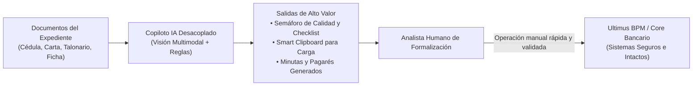
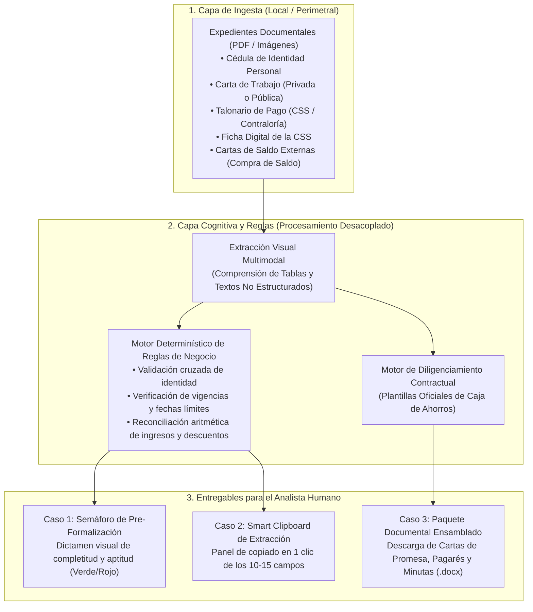
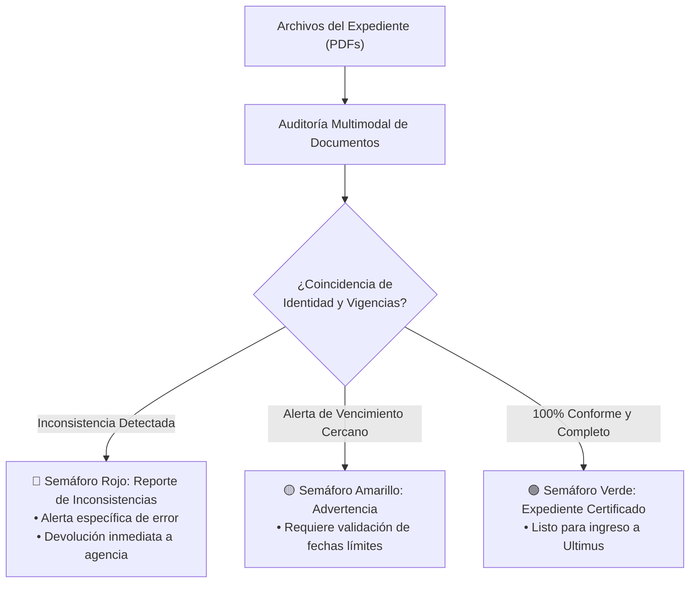
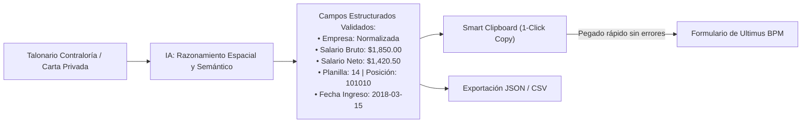
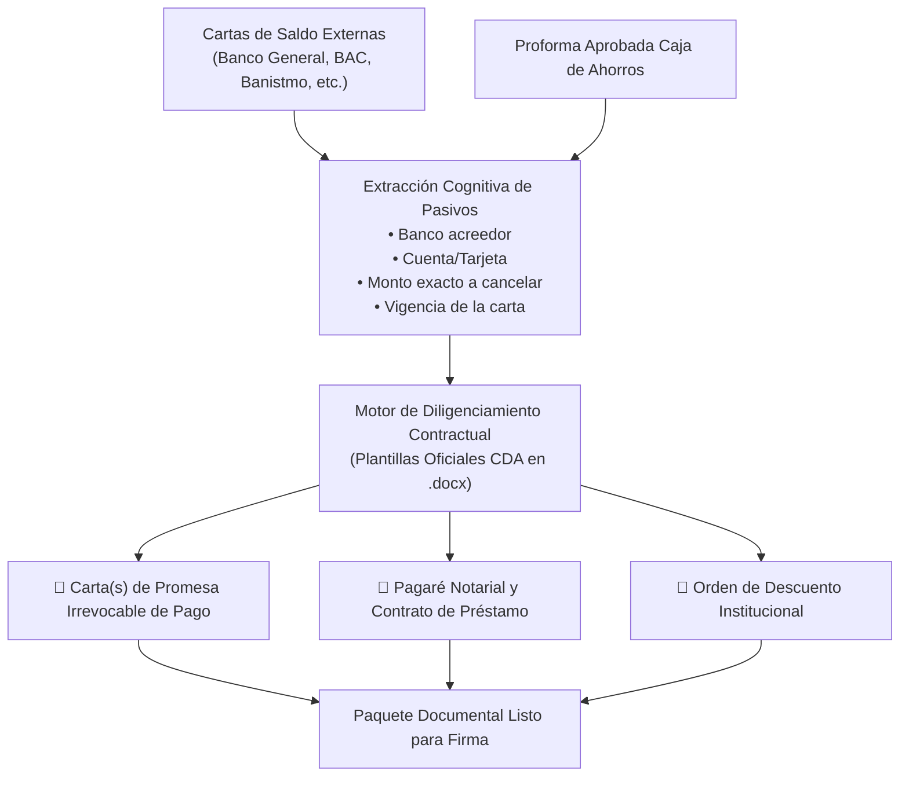
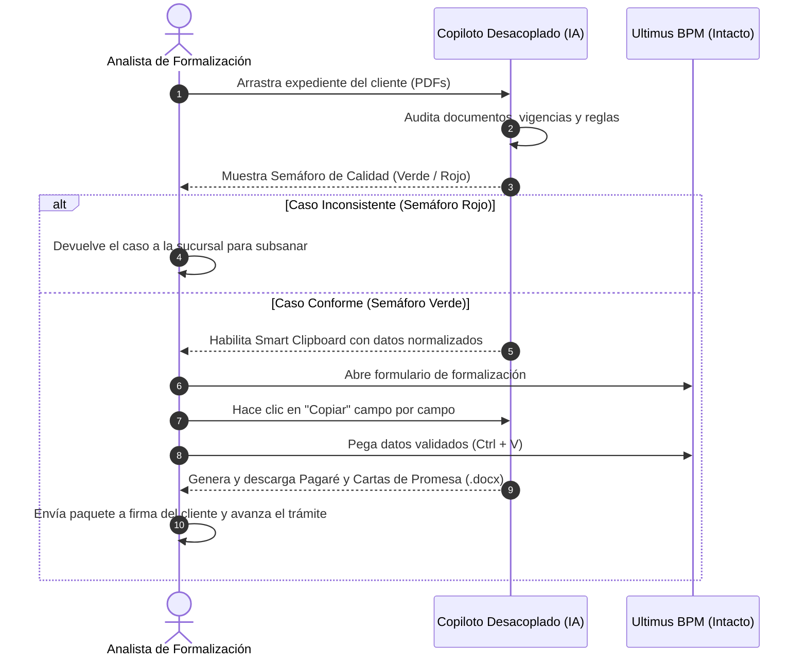

# Propuesta de Diseño: Asistente Inteligente de Formalización de Préstamos Personales
## Modelo Operativo Desacoplado (Sin Acceso a Ultimus BPM ni Recursos Internos del Banco)

**Proyecto:** Célula de Innovación Caja de Ahorros — Producto 02 (Formalización de Préstamos Personales)  
**Audiencia:** Vicepresidencia de Negocio y Consumo, Gerencia de Operaciones de Crédito, Vicepresidencia de Tecnología e Infraestructura, Seguridad de la Información y Riesgo Operativo  
**Elaborado por:** Célula de Innovación (StraTech / Caja de Ahorros) — Líder Técnico: Rodolfo Blasser  
**Fecha:** 28 de octubre de 2026  
**Versión:** 1.0 (Diseño Arquitectónico, Funcional y Casos de Uso en Entorno Aislado / *Sidecar*)  

---

## 1. Resumen Ejecutivo y Enfoque Estratégico

El proceso de **Formalización de Préstamos Personales** en Caja de Ahorros es una etapa operativa crítica donde convergen la revisión de expedientes físicos/digitales, la verificación del cumplimiento normativo y la transcripción de datos hacia los sistemas centrales para habilitar la firma del cliente y el posterior desembolso.

Tradicionalmente, las iniciativas de automatización plantean interactuar de manera directa con el aplicativo web de gestión de procesos (**Ultimus BPM**) o acceder a bases de datos y servicios del core bancario (**IBS**). No obstante, este enfoque suele enfrentar barreras operativas relevantes:
1. **Tiempos prolongados de homologación de accesos y credenciales institucionales.**
2. **Restricciones estrictas de seguridad de la información y riesgo operacional** respecto a herramientas que manipulen interfaces internas o bases de datos de clientes.
3. **Fragilidad de automatizaciones sobre la interfaz gráfica (RPA tradicional)** ante cambios en formularios o selectores de Ultimus.

### 1.1. La Premisa de Diseño: Arquitectura 100% Desacoplada (*Air-Gapped / Sidecar Copilot*)
Este documento define una alternativa de alto impacto que opera bajo dos restricciones inquebrantables:
* **CERO acceso a Ultimus BPM:** La herramienta de IA no interactúa con la interfaz gráfica de Ultimus, no requiere credenciales de usuario en el BPM ni se conecta a sus servidores.
* **CERO acceso directo a recursos internos del banco:** La herramienta no se conecta al Core IBS, no accede al Directorio Activo, no requiere VPN interna ni lee carpetas compartidas de la red bancaria.

### 1.2. El Paradigma de Valor: El "Copiloto del Analista"
La solución se concibe como un **Copiloto Inteligente de Escritorio o Portal Web Perimetral**. El analista humano de formalización (o el oficial de agencia) es quien voluntariamente suministra los archivos del expediente (PDFs escaneados o digitales) mediante una interfaz amigable (*drag & drop*). La inteligencia artificial multimodal procesa los documentos, ejecuta validaciones lógicas complejas y entrega al analista resultados estructurados, dictámenes de calidad y borradores contractuales listos para su uso.

---

## 2. Arquitectura Funcional del Copiloto Desacoplado

La arquitectura está diseñada para operar de forma autónoma, segura y sin fricción técnica con la infraestructura central de Caja de Ahorros:

### Componentes de la Solución:
1. **Frontend Ligero (Web App Local / Standalone):** Interfaz limpia y responsiva accesible desde el navegador del analista, optimizada para arrastrar y soltar expedientes.
2. **Motor Cognitivo Multimodal (Gemini API):** Interpreta documentos no estructurados (cartas de trabajo variadas) y grillas de alta densidad visual (talonarios de Contraloría y CSS).
3. **Capa de Reglas de Negocio Determinísticas:** Valida la concordancia matemática y normativa sin depender de la inferencia del modelo (garantizando 100% de reproducibilidad en cálculos financieros y fechas).
4. **Almacenamiento Efímero en Memoria:** Los documentos se analizan en memoria volátil durante la sesión del analista; ningún dato personal del cliente queda almacenado en servidores externos.

---

## 3. Especificación de los 3 Casos de Uso Viables

A continuación se detallan los tres casos de uso de mayor retorno operativo bajo la restricción de cero accesos al banco:

---

### 3.1. Caso de Uso 1: Auditoría Inteligente y Semáforo de Pre-Formalización
*(Checklist Normativo y Consistencia Documental Cruzada)*

#### A. Problema de Negocio que Resuelve
Actualmente, el analista de formalización recibe expedientes aprobados que frecuentemente contienen inconsistencias sutiles: cartas de trabajo con más de 30 o 45 días de expedición, cédulas vencidas, discrepancias de un dígito en la cédula entre la carta y el talonario, o casos de jubilados a los que les falta incorporar el certificado de la Caja de Seguro Social (CSS). El analista pierde entre 15 y 25 minutos inspeccionando visualmente archivo por archivo; si detecta un error al final del proceso o tras haber comenzado a cargar en Ultimus, el caso queda trabado o debe ser devuelto a la sucursal de origen.

#### B. Flujo Operativo del Caso de Uso
1. El analista arrastra el conjunto de archivos del préstamo a la pantalla del copiloto.
2. La IA clasifica y analiza visualmente cada documento en paralelo:
   * **Cédula de Identidad Personal:** Extrae nombre completo, número de cédula y fecha de expiración.
   * **Carta de Trabajo:** Extrae razón social, nombre del colaborador, salario base, deducciones, fecha de ingreso y fecha de emisión de la carta.
   * **Talonario de Pago / Comprobante:** Extrae nombre, cédula, desglose de salario neto y confirmación de descuentos.
   * **Ficha de la CSS:** Valida el número patronal y coincidencia de cuotas.
   * **Certificado de Jubilado (CSS / Contraloría):** Si el cliente es pensionado, detecta la presencia del certificado y extrae su número oficial.
3. El motor de reglas ejecuta los cotejos cruzados:
   * **Regla de Identidad:** Coincidencia exacta de nombre y cédula en el 100% de los documentos.
   * **Regla de Vigencia:** Fecha de emisión de la carta de trabajo no mayor a 30 días (empresa privada) o 45 días (sector público).
   * **Regla de Cédula Vigente:** La fecha de expiración debe ser posterior a la fecha del trámite.
   * **Regla de Calendarios de Descuento:** Valida que el trámite no colisione con el cierre de planillas de la institución ni con la política de exclusión de descuentos en diciembre.

#### C. Entregable para el Analista
El copiloto despliega en pantalla un **Dictamen de Calidad del Expediente con Semáforo Visual**:
* 🟢 **Verde (Expediente Conforme):** Todos los documentos son consistentes, vigentes y completos. El analista procede a formalizar con total tranquilidad.
* 🟡 **Amarillo (Alerta Preventiva):** Documentos válidos pero con advertencia (ej. la carta de trabajo vence en 48 horas).
* 🔴 **Rojo (Inconsistencia / Bloqueo):** Señala con exactitud el motivo de rechazo (ej. *"Discrepancia en cédula: Carta de trabajo indica 8-750-123, pero talonario indica 8-750-128"* o *"Falta incorporar el Certificado de Jubilación de la CSS"*). El analista devuelve el caso inmediatamente a la sucursal sin perder tiempo digitando en Ultimus.

---

### 3.2. Caso de Uso 2: Copiloto de Extracción Estructurada y Portapapeles Inteligente
*(Smart Clipboard & JSON/CSV Export para Carga Rápida en Pantalla)*

#### A. Problema de Negocio que Resuelve
Para formalizar en Ultimus, el analista debe transcribir manualmente entre 10 y 15 campos críticos. La tarea es propensa a errores tipográficos, especialmente en dos escenarios:
1. **Cartas de trabajo de Empresa Privada:** No existe un formato unificado en Panamá; cada empresa redacta el salario, deducciones y cargos de forma distinta.
2. **Talonarios de Contraloría (Sector Público):** Documentos con una grilla tipográfica diminuta y densa donde el analista debe ubicar con lupa el **Número de Planilla** (ej. 14) y el **Número de Posición** (ej. 101010). Un dígito erróneo en la posición genera el rechazo de los Web Services de IBS en Ultimus.

#### B. Flujo Operativo del Caso de Uso
1. El analista sube la carta de trabajo y el talonario de pago.
2. La IA multimodal aplica razonamiento de tablas densas (*Visual Table Reasoning*) e invariancia de diseño:
   * Identifica la razón social empleadora y la asocia a su denominación normalizada.
   * Extrae el salario bruto, total de deducciones legales, descuentos voluntarios y salario neto.
   * En empleados de Contraloría: localiza visualmente las coordenadas exactas de las celdas **"PLANILLA"** y **"POSICIÓN"** y extrae sus valores limpios.
   * Convierte fechas dispersas (*"15 de agosto de 2019"*, *"15/08/19"*) al formato estándar de base de datos (`YYYY-MM-DD`).
3. El motor realiza la reconciliación aritmética: comprueba que `Salario Bruto - Deducciones = Salario Neto`.

#### C. Entregable para el Analista
* **Smart Clipboard Asistido (Portapapeles con 1 Clic):** La pantalla del copiloto presenta una tarjeta organizada en el mismo orden secuencial que pide Ultimus. Al lado de cada dato hay un botón de **"Copiar"** con retroalimentación visual inmediata.
* **Descarga de Ficha en JSON / Excel:** Permite descargar un archivo estructurado con todos los datos extraídos para respaldo de auditoría o para una futura importación masiva.

#### D. Consideraciones Técnicas, de Ciberseguridad y Ergonomía Operativa (UX)

Para que la promesa de reducción de tiempos (de ~10 minutos a 30–50 segundos) y mitigación de errores sea viable en el entorno real de Caja de Ahorros, el diseño incorpora los siguientes controles:

1. **Viabilidad Técnica e Inocuidad ante Ciberseguridad:**
   * **Implementación Web Nativa:** Se utiliza la API estándar del navegador (`navigator.clipboard.writeText`), sin requerir privilegios de administrador (`Admin Rights`) ni instalación de ejecutables locales en la estación de trabajo.
   * **Descarte Justificado de Extensiones de Navegador:** Las extensiones `.crx` en Chrome/Edge son descartadas porque suelen ser bloqueadas por políticas de Directorio Activo (GPO) bancario y requieren permisos invasivos de lectura de pantalla.
   * **Descarte Justificado de Scripts de Emulación (AutoHotkey / PyAutoGUI):** Los scripts que simulan pulsaciones automáticas son detectados y neutralizados por las soluciones antivirus/EDR corporativas del banco (CrowdStrike, Defender for Endpoint) como potenciales amenazas de captura de teclado (*keylogger*).
   * **Conclusión de Seguridad:** El Smart Clipboard web es 100% inocuo, no inyecta código en Ultimus y no genera alertas de seguridad.

2. **Mitigación del Error Residual de Asignación:**
   * Aunque se eliminan los errores tipográficos (tipeo manual de números o nombres), persiste el riesgo de que el analista pegue el *Salario Bruto* en la casilla de *Salario Neto*.
   * **Solución de Secuencia Guiada (*Sequential Copy Buffer*):** Los campos en el Copiloto se ordenan con estricta fidelidad a la secuencia de tabulación del formulario de Ultimus. El sistema resalta visualmente el campo copiado y avanza automáticamente al siguiente, reduciendo la carga cognitiva.

3. **Ergonomía de Pantalla (Eliminación de la Fricción `Alt + Tab`):**
   * En estaciones con **doble monitor**, el analista mantiene el Copiloto en la pantalla secundaria y Ultimus en la principal.
   * En estaciones de **un solo monitor**, el procedimiento estandariza el uso de pantalla dividida nativa de Windows (`Win + Flecha Izquierda` para el Copiloto y `Win + Flecha Derecha` para Ultimus), eliminando la fatiga de alternar ventanas y permitiendo una cadencia de 3 a 5 segundos por campo.

4. **Retroalimentación Visual Inmediata (*Visual Feedback*):**
   * Al pulsar el botón "Copiar", este cambia instantáneamente de color (azul a verde) y muestra el texto `"✓ ¡Copiado!"` durante 1.5 segundos, eliminando cualquier duda del usuario sobre el éxito de la operación.

> **Impacto Calibrado:** Copiar, posicionar y pegar toma entre 3 y 5 segundos por campo. Para un total de 10 a 12 campos requeridos, el tiempo total se reduce de 10 minutos a un rango de 30 a 50 segundos, representando un ahorro real superior al 90% con cero errores tipográficos.

---

### 3.3. Caso de Uso 3: Pre-Diligenciador y Ensamblador de Documentación Contractual
*(Cartas de Promesa de Pago a Terceros, Pagarés y Órdenes de Descuento)*

#### A. Problema de Negocio que Resuelve
Una gran proporción de los préstamos personales tramitados en Caja de Ahorros corresponden a **Compra de Saldo y Consolidación de Deudas** (cancelación de tarjetas de crédito o préstamos en entidades como Banco General, Banistmo, BAC Credomatic, financieras, etc.).  
Para formalizar este tipo de crédito, el analista debe redactar una serie de documentos legales indispensables:
1. **Cartas de Promesa Irrevocable de Pago** a favor de cada una de las entidades externas acreedoras.
2. **Pagaré Notarial y Contrato de Préstamo Personal**.
3. **Orden de Descuento por Planilla**.

Actualmente, el analista abre plantillas de Microsoft Word, busca en los escaneos de las cartas de saldo externas los datos clave (nombre del banco acreedor, número de préstamo a cancelar, saldo exacto al centavo y fecha límite de vigencia de la promesa) y los copia a mano. Este proceso es lento, artesanal y presenta alto riesgo de errores en cifras contractuales o nombres de instituciones.

#### B. Flujo Operativo del Caso de Uso
1. El analista arrastra las cartas de saldo emitidas por los bancos terceros y la proforma de condiciones aprobadas de Caja de Ahorros.
2. La IA multimodal procesa las cartas de saldo de cualquier banco de la plaza panameña:
   * Identifica la entidad financiera emisora (ej. Banco General, S.A., Banco Nacional de Panamá, etc.).
   * Extrae el número de cuenta o tarjeta a cancelar.
   * Extrae el saldo total adeudado a la fecha de corte.
   * Identifica la fecha de vencimiento de la carta de saldo (plazo perentorio para hacer efectivo el pago).
3. El motor contractual toma las plantillas oficiales pre-aprobadas de Caja de Ahorros (almacenadas como formatos locales `.docx`) y fusiona automáticamente los campos variables:
   * Completa los datos generales del deudor (nombre, cédula, domicilio).
   * Genera las cláusulas específicas de desembolso para cada acreedor externo.
   * Redacta el texto formal de la Promesa Irrevocable de Pago.
   * Calcula y proyecta la fecha límite de presentación de la orden de descuento.

#### C. Entregable para el Analista
El copiloto entrega en pantalla un botón de **"Descargar Paquete Contractual Completo"** en formato editable (`.docx`) y en formato de visualización (`.pdf`):
* Carta de Promesa de Pago formalizada por acreedor.
* Pagaré del Préstamo Personal con los montos exactos de letra y tasa.
* Orden de Descuento institucional lista para sello y firma.

> **Impacto:** Convierte un proceso de confección documental que tomaba entre 20 y 35 minutos por cliente en una generación instantánea de 15 segundos, asegurando total rigor jurídico en cifras y redacción.

---

## 4. Matriz Comparativa y Beneficios de los 3 Casos de Uso

| Dimensión | Caso 1: Semáforo de Pre-Formalización | Caso 2: Smart Clipboard de Carga | Caso 3: Ensamblador Contractual |
| :--- | :--- | :--- | :--- |
| **¿Requiere acceso a Ultimus?** | **No** (Cero) | **No** (Cero) | **No** (Cero) |
| **¿Requiere acceso al Core IBS?** | **No** (Cero) | **No** (Cero) | **No** (Cero) |
| **¿Requiere red interna / VPN?** | **No** (Operación desacoplada) | **No** (Operación desacoplada) | **No** (Operación desacoplada) |
| **Insumo Principal** | PDFs del expediente del cliente | Carta de trabajo y talonario | Cartas de saldo de bancos externos |
| **Capacidad de IA Central** | Visión multimodal + Reglas lógicas | Visión espacial tabular + Normalización | Extracción de entidades + Templating legal |
| **Salida para el Analista** | Dictamen de Calidad (Verde / Rojo) | Panel de copiado rápido (1-click) | Documentos Word/PDF listos para firma |
| **Tiempo de Ejecución** | ~5 a 10 segundos | ~3 a 5 segundos | ~8 a 12 segundos |
| **Ahorro de Tiempo Humano** | De 20 min a 30 segundos de revisión | De 10 min a 45 seg de tipeo manual | De 30 min a 2 min de redacción |
| **Impacto Operativo** | Cero expedientes devueltos o trabados | Cero errores de transcripción en Ultimus | Cero discrepancias en compra de saldo |

---

## 5. Dinámica de Trabajo del Analista Humano (*Human-in-the-Loop*)

La implementación de este asistente no altera la arquitectura tecnológica central de Caja de Ahorros ni sustituye al personal bancario; actúa como un **acelerador de productividad humana**:

---

## 6. Consideraciones de Seguridad, Privacidad de Datos y Cumplimiento Normativo

Dado que el sistema procesa información personal y financiera de clientes (PII) bajo una modalidad desacoplada, se aplican estrictos controles de seguridad perimetral:

1. **Procesamiento Volátil en Memoria (*Stateless Architecture*):**  
   Los documentos subidos por el analista se procesan temporalmente en memoria RAM durante la sesión activa de análisis. Una vez emitido el resultado o cerrada la sesión, los archivos temporales se purgan automáticamente, evitando la persistencia no autorizada de expedientes de clientes.
2. **Cero Puertos Entrantes (*No Ingress*):**  
   La herramienta no requiere abrir ningún puerto de entrada desde internet hacia las estaciones de trabajo o servidores del banco. Únicamente requiere salida saliente cifrada (*Egress* HTTPS por puerto 443) hacia las APIs de procesamiento multimodal.
3. **Ofuscación y Anonimización Previa (Opcional en Capa Local):**  
   En caso de que las políticas de cumplimiento de Caja de Ahorros lo requieran, la herramienta puede aplicar una capa de enmascaramiento local de números de cuenta bancaria o primeros dígitos de cédula antes de enviar los fragmentos a inferencia.
4. **Cumplimiento de la Ley 81 de 2019 de Protección de Datos Personales:**  
   El uso de la herramienta se circunscribe estrictamente a la finalidad contractual de formalización del crédito solicitada por el cliente, sin compartición de datos con terceros ni uso para entrenamiento de modelos públicos.

---

## 7. Estrategia de Adopción e Implementación Rápida

Para validar el valor de esta propuesta con mínimo esfuerzo tecnológico y cero fricción con las áreas centrales de infraestructura:

* **Fase 1: Prototipo Funcional de los Casos 1 y 2 (Auditoría y Smart Clipboard):**  
  Despliegue de una aplicación web local ligera ejecutándose en las estaciones de analistas seleccionados para medir la reducción de tiempos de revisión y transcripción en expedientes reales de Empresa Privada y Contraloría.
* **Fase 2: Incorporación del Caso 3 (Diligenciamiento Contractual de Compra de Saldo):**  
  Parametrización de las plantillas oficiales de Cartas de Promesa de Pago y Pagarés de Caja de Ahorros para entrega de expedientes listos para firma.
* **Fase 3: Evaluación de Despliegue Centralizado Perimetral:**  
  Instalación del copiloto en un servidor web perimetral interno para acceso concurrente de todos los analistas de operaciones de crédito a nivel nacional.

---

## 8. Conclusión

La adopción de este **Modelo Operativo Desacoplado** permite a Caja de Ahorros capturar de forma inmediata los beneficios de la inteligencia artificial de última generación (reducción de tiempos de formalización de horas a minutos, eliminación de errores de digitación y ensamblaje automático de minutas de compra de saldo), **sin incurrir en semanas o meses de aprobaciones de red, sin depender de accesos a Ultimus BPM y con cero riesgo sobre el Core bancario IBS**.
