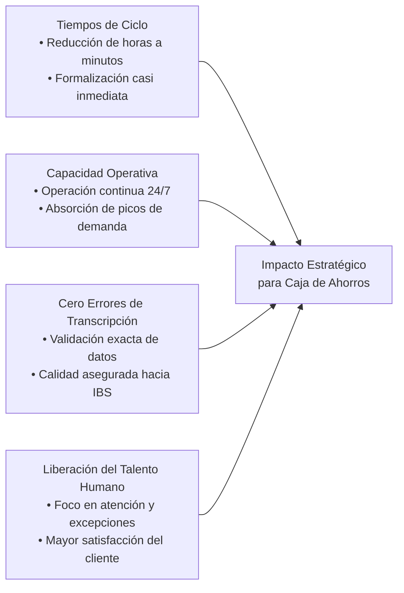
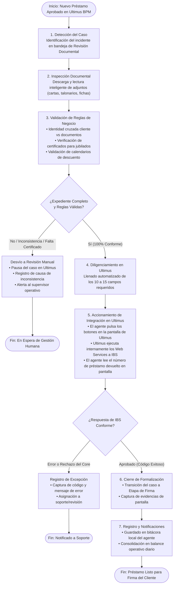
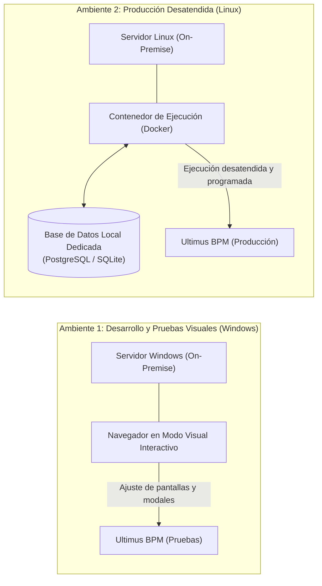

# Propuesta de Solución Operativa y Arquitectura de Automatización
## Formalización de Préstamos Personales en Ultimus BPM
**Proyecto:** Célula de Innovación Caja de Ahorros — Producto 02  
**Audiencia:** Vicepresidencia de Negocio y Consumo, Gerencia de Operaciones de Crédito, Vicepresidencia de Tecnología e Infraestructura, Seguridad de la Información  
**Elaborado por:** Célula de Innovación (StraTech / Caja de Ahorros)  
**Fecha:** 28 de octubre de 2026  
**Versión:** 1.0 (Documento Ejecutivo y Funcional con Consideraciones Técnicas de TI)  

---

## 1. Resumen Ejecutivo y Caso de Negocio

El proceso de **Formalización de Préstamos Personales** representa una de las etapas operativas más críticas para la experiencia del cliente y la eficiencia del banco. Actualmente, una vez que un crédito ha sido aprobado (por canal tradicional o por modelos analíticos), el expediente ingresa a la bandeja de *Revisión Documental y Formalización* dentro de **Ultimus BPM**.

En este punto, los analistas funcionales deben realizar un trabajo altamente manual, repetitivo y minucioso:
* Inspeccionar de 4 a 6 documentos adjuntos no homogéneos (cartas de trabajo, talonarios de pago, fichas de la CSS, cédulas y órdenes de descuento).
* Transcribir manualmente entre **10 y 15 campos** clave hacia el formulario de Ultimus.
* Activar las transacciones de validación y reserva hacia el core bancario (**IBS**).
* Avanzar el caso hacia la firma del cliente o reportar inconsistencias.

### 1.1. La Solución Propuesta
Implementar un **Asistente Operativo Agéntico (Operador Digital)** capaz de asumir de forma autónoma y controlada el flujo operativo rutinario. El sistema combina navegación web programática sobre el portal interno de Ultimus y capacidades cognitivas de inteligencia artificial para la lectura documental, operando dentro de la red del banco bajo estrictos estándares de ciberseguridad y auditoría.

### 1.2. Beneficios Tangibles de Negocio

---

## 2. Marco de Confianza, Seguridad y Cumplimiento Normativo

Para que esta automatización cuente con el respaldo de las áreas de **Riesgo, Auditoría y Ciberseguridad**, el diseño se rige por cuatro salvaguardas institucionales:

### 2.1. Interacción Exclusiva vía Ultimus BPM y Cero Conexión Directa a IBS
* **Sin conexión directa ni llamadas externas a IBS:** El agente **NO** se conecta directamente a IBS, **NO** invoca APIs/Web Services externos contra el core ni tiene acceso de lectura o escritura a sus bases de datos.
* **Operación 100% sobre la interfaz web de Ultimus:** El agente interactúa única y exclusivamente como un usuario humano frente al portal web de **Ultimus BPM**, diligenciando los campos y haciendo clic en los botones de acción del formulario.
* **Ultimus como único intermediario transaccional:** Es la plataforma interna de Ultimus BPM (a través de sus componentes de backend) la que ejecuta los servicios web institucionales hacia el core bancario (**IBS**). El agente simplemente espera a que la pantalla de Ultimus se actualice y lee directamente del navegador el resultado (número de préstamo generado o mensaje de excepción registrado en la sección de *Bitácora de Integración IBS*).

### 2.2. Identidad Nominal y No Repudio (Auditoría Forense)
* El agente opera con un **usuario de servicio nominal e institucional en el Directorio Activo** (ej. `svc_agente_formalizacion`).
* Cada consulta y transacción hacia el core bancario queda firmada con la identidad del agente, permitiendo diferenciar con certeza en las bitácoras qué operaciones fueron ejecutadas por el operador digital y cuáles por el personal humano.

### 2.3. Control Humano en el Ciclo (*Human-in-the-Loop*)
* El agente está diseñado para procesar de forma desatendida los casos estándar y consistentes.
* Si el expediente presenta inconsistencias de datos, documentos ilegibles, o si se trata de un cliente jubilado cuyo certificado de la CSS aún no ha sido incorporado físicamente, el agente **no arriesga el trámite**: pausa el caso, no acciona transacciones erróneas hacia IBS y transfiere el expediente a la bandeja de revisión manual con una alerta explicativa clara.

### 2.4. Seguridad de Red y Privacidad de la Información
* **Tráfico Saliente Estricto (Solo Egress por HTTPS 443):** El servidor del agente se ubica dentro de la red del banco y únicamente requiere salida saliente segura hacia repositorios oficiales y servicios de procesamiento documental por inteligencia artificial. No se abre ningún puerto entrante (*Ingress*) desde internet hacia el banco.
* **Privacidad de Datos:** La información analizada se procesa en memoria volátil durante la ejecución de cada caso; los expedientes originales permanecen en su repositorio institucional.

---

## 3. Detalle del Proceso Operativo Paso a Paso

El recorrido operativo que ejecuta el agente digital reproduce el trabajo funcional con verificaciones cruzadas en cada hito:

### 3.1. Detalle de los Pasos Funcionales

| Paso | Acción Operativa | Criterio de Control / Regla de Negocio |
| :--- | :--- | :--- |
| **1. Detección** | Monitoreo de la bandeja del proceso en Ultimus. | El agente toma el incidente, verifica que no haya sido atendido previamente y bloquea la tarea para evitar colisiones. |
| **2. Lectura Documental** | Análisis del contenido de los archivos adjuntos. | Capacidad para interpretar documentos digitales o escaneados (incluso con formatos variables) extrayendo: razón social empleadora, salario base, salario neto, deducciones y fecha de ingreso. |
| **3. Reglas de Negocio** | Verificación de políticas del banco antes de tocar sistemas core. | **A. Identidad:** Coincidencia exacta de nombre y cédula entre la solicitud y los soportes. **B. Jubilados:** Exigencia obligatoria del número de certificado de CSS/Contraloría. Si no existe, se detiene para evitar rechazos en IBS. **C. Calendarios:** Verificación de fechas límites de descuento por institución y aplicación de la política de no descuento en diciembre. |
| **4. Diligenciamiento** | Carga de los 10 a 15 campos en la pantalla de formalización. | Transcripción estructurada sin errores tipográficos de los datos validados. |
| **5. Integración Core IBS (Vía Ultimus)** | Accionamiento de los botones de integración en la pantalla de Ultimus. | **El agente NO contacta ni consulta a IBS directamente.** El agente pulsa los botones de acción del formulario (*Validar Cliente*, *Reservar Préstamo*, *Abrir Cuenta*). El backend de Ultimus ejecuta las llamadas a IBS y refleja los resultados en pantalla; el agente lee en el navegador el número de préstamo creado o la bitácora de error. |
| **6. Transición** | Avance del préstamo a la siguiente etapa. | Si las respuestas de IBS son exitosas, el caso avanza automáticamente a la etapa de *Firma de Documentos*. |
| **7. Evidencias y Reporte** | Registro de auditoría y cierre del lote. | Almacenamiento de captura de pantalla con marca de tiempo y envío de resumen consolidado a la jefatura de operaciones. |

---

## 4. Consideraciones Técnicas y de Infraestructura para el Equipo de TI

El diseño técnico ha sido concebido para integrarse de forma limpia y transparente en la infraestructura existente de Caja de Ahorros:

### 4.1. Despliegue en Contenedores (Docker)
* **Aislamiento y Portabilidad:** El motor del agente se empaqueta en un contenedor que incluye todos sus componentes de ejecución, librerías del sistema y dependencias de navegación web. Esto asegura que el comportamiento sea idéntico en desarrollo y producción, sin alterar la configuración del servidor anfitrión.
* **Operación Desatendida (*Headless*):** En producción (Linux), el contenedor opera sin interfaz gráfica, maximizando la eficiencia de procesamiento de CPU y memoria RAM.

### 4.2. Estrategia de Dos Entornos (Windows y Linux)
1. **Servidor Windows (Fase de Desarrollo y Validación Visual):**
   * Permite al equipo de ingeniería y a los líderes funcionales visualizar en pantalla completa cómo el agente interactúa con Ultimus (apertura de formularios, llenado de campos y modales emergentes), facilitando la depuración y aprobación funcional.
2. **Servidor Linux (Fase Productiva y Alta Disponibilidad):**
   * Aloja la ejecución programada mediante contenedores Docker, con inicio automático ante reinicios y bajo mantenimiento operativo.

### 4.3. Base de Datos Local Dedicada (Aislamiento y Auditoría)
Para no sobrecargar ni solicitar permisos de escritura sobre bases institucionales, el agente cuenta con una **base de datos relacional interna y local** (PostgreSQL o SQLite en contenedor):
* **Control de Cola e Idempotencia:** Garantiza que un préstamo jamás se procese dos veces por error o ante una interrupción de red.
* **Bitácora Forense:** Registra el ciclo de vida de cada caso (fecha/hora de inicio y fin, datos extraídos, códigos de respuesta devueltos por IBS y motivo de derivación manual).
* **Bóveda de Evidencias:** Archiva capturas de pantalla de confirmación por cada trámite completado para consulta de auditoría o reclamos.

### 4.4. Integración de Notificaciones (Correo Institucional)
* El agente utiliza la pasarela interna de correo (**SMTP corporativo**) para:
  1. Enviar alertas inmediatas a los supervisores cuando un caso es devuelto a revisión manual.
  2. Emitir diariamente al cierre de turno un reporte ejecutivo con el volumen total formalizado, tiempos promedio de atención y casuística de excepciones.

---

## 5. Matriz de Roles y Responsabilidades (RACI)

| Actividad / Entregable | Negocio / Operaciones | TI / Arquitectura | Ciberseguridad / Redes | Célula de Innovación (StraTech) |
| :--- | :---: | :---: | :---: | :---: |
| Definición y validación de reglas de negocio | **A / R** | C | I | **R** |
| Provisión de servidores (Windows y Linux) | I | **A / R** | C | C |
| Habilitación de salida segura a internet (HTTPS 443) | I | C | **A / R** | C |
| Creación de usuario de dominio nominal para el agente | I | **A / R** | C | C |
| Recorrido funcional guiado en Ultimus BPM | **R** | C | I | **R** |
| Entrega de catálogo de errores y respuestas de IBS | I | **A / R** | I | C |
| Construcción, pruebas y puesta a punto del agente | C | C | I | **A / R** |
| Acompañamiento en marcha blanca y soporte inicial | **R** | **R** | I | **A / R** |

*(**R:** Responsable de ejecutar, **A:** Quien aprueba, **C:** Consultado, **I:** Informado)*

---

## 6. Plan de Trabajo y Próximos Pasos Inmediatos

Para avanzar hacia la fase de construcción y certificación de la solución, se identifican las siguientes actividades prioritarias:

1. **Sesión de Recorrido Técnico de Ultimus:** Realizar la sesión de navegación guiada con el equipo de BPM para mapear la estructura visual de los formularios y la activación de los servicios web de IBS.
2. **Entrega de Catálogo de IBS:** Proporcionar por parte de TI el catálogo de códigos de respuesta y mensajes de error de los Web Services hacia el core bancario para parametrizar las compuertas de excepción.
3. **Alineación de Entornos y Accesos:** Aprobación por Infraestructura y Seguridad de las máquinas virtuales (Windows para desarrollo y Linux para producción), usuario de servicio nominal y salida HTTPS controlada.
4. **Desarrollo del Prototipo Funcional (PoC):** Demostración interactiva en el servidor Windows del ciclo completo de toma de expediente, lectura documental y diligenciamiento para aprobación de los tomadores de decisiones.
