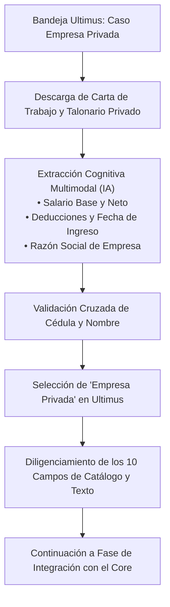
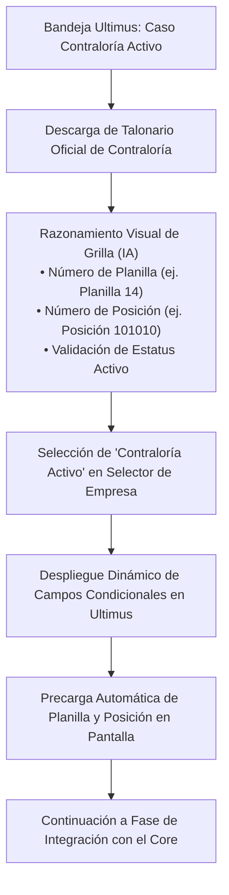
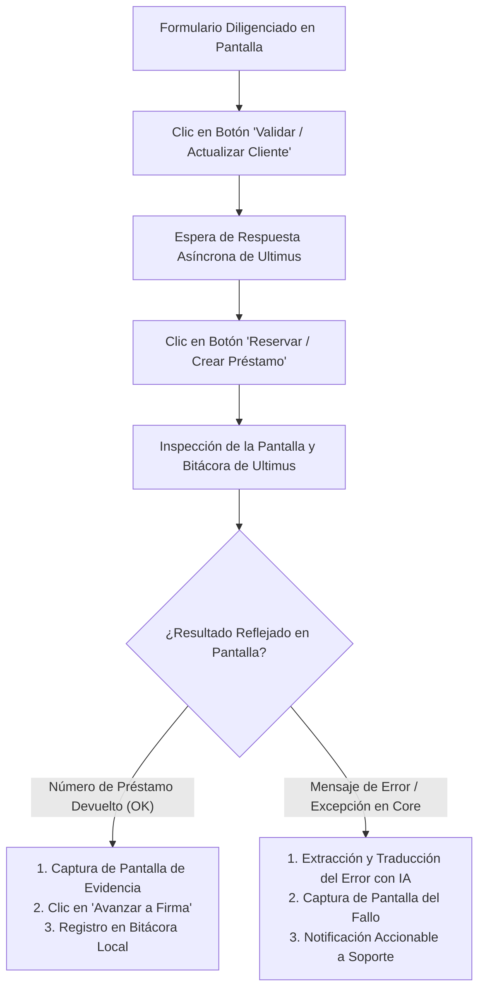
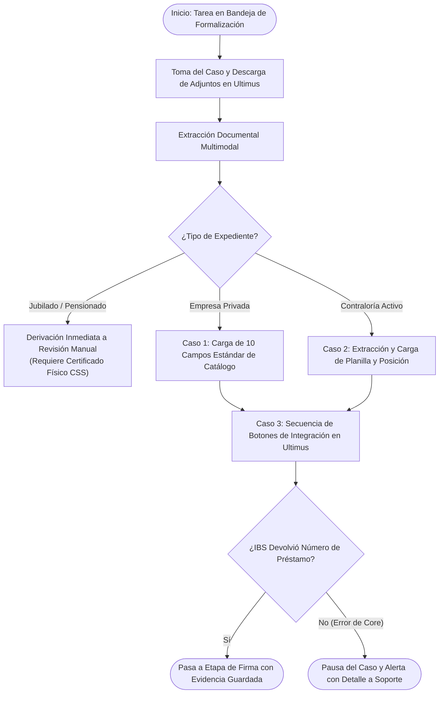

# Especificación Técnica y Operativa: Casos de Uso Prioritarios (V1.0)
## Automatización de la Formalización de Préstamos Personales en Ultimus BPM
**Proyecto:** Célula de Innovación Caja de Ahorros — Producto 02  
**Elaborado por:** Rodolfo Blasser — Líder Técnico de Célula (StraTech)  
**Fecha:** 28 de octubre de 2026  
**Versión:** 1.0 (Especificación de Casos de Alto Impacto Inicial y Stack Programático)  

---

## 1. Enfoque Estratégico y Alcance de la Versión Inicial

Para maximizar el impacto operativo inmediato y minimizar el riesgo de implementación, la versión inicial del agente se focaliza en el **flujo estándar de mayor volumen transaccional**: préstamos personales para **clientes asalariados activos** con documentación digital completa (sector privado y sector público/Contraloría).

### Premisas Clave de Diseño:
* **Foco en el Volumen Principal (80/20):** Resolver las tareas repetitivas que consumen más minutos al analista funcional.
* **Salvaguarda Estricta (*Safe Fallback*):** Cualquier caso atípico (inconsistencias de identidad, documentos ilegibles o clientes jubilados sin certificado físico incorporado) se desvía automáticamente a revisión manual sin trabar el sistema.
* **Cero Conexión Directa a IBS:** El agente interactúa al 100% a través de la interfaz web de **Ultimus BPM**; es Ultimus quien ejecuta las llamadas al core bancario.

---

## 2. Detalle de los 3 Casos de Uso Prioritarios

A continuación se detalla cada funcionalidad, combinando una **explicación intuitiva operativa**, el **flujo del agente** y el **valor específico que aporta la Inteligencia Artificial (Gemini API / Visión Multimodal)** frente a soluciones tradicionales.

---

### 2.1. Caso de Uso 1: Formalización de Préstamos para Empresa Privada (Flujo Estándar)

#### ¿De qué trata realmente? (Explicación Intuitiva)
* **¿Qué hace hoy el analista humano?:** Abre el incidente en Ultimus, descarga la carta de trabajo de la empresa privada (que viene con cualquier formato, diseño o redacción) y el talonario de pago. Lee visualmente el salario, deducciones y fecha de inicio, busca la empresa en la lista desplegable de Ultimus y tipea a mano los 10 campos requeridos.
* **¿Qué hace el agente?:** Toma los archivos adjuntos, la IA interpreta la carta de trabajo sin importar qué empresa privada la emitió ni cómo esté estructurada, extrae los datos limpios, asocia la empresa al catálogo de Ultimus y completa los campos de forma desatendida.
* > **En una frase:** Es el agente leyendo la carta de trabajo no estructurada de cualquier empresa privada de Panamá y transcribiendo con exactitud los 10 campos del formulario sin intervención humana.

#### Capacidades que aporta la Inteligencia Artificial (Gemini API) en este Caso:
1. **Comprensión Semántica Invariante al Diseño (*Zero-Shot Layout Invariance*):** Entiende el significado del texto sin importar cómo esté redactado. Identifica el salario ya sea que diga *"Salario nominal: $1,500.00"*, *"Devenga mensualmente B/. 1,500"*, o *"Sueldo base pactado de mil quinientos balboas"*, ignorando texto legal irrelevante.
2. **Normalización Estricta de Fechas y Monedas:** Convierte formatos dispares (*"15 de marzo de 2018"*, *"15/03/18"*, *"marzo 2018"*) al estándar estricto que exige Ultimus (`YYYY-MM-DD`), y limpia los montos monetarios a números flotantes limpios (`1500.00`).
3. **Resolución Semántica de Entidad (Mapeo a Catálogo):** Si la carta dice *"Servicios y Distribuciones Panamá S.A."*, la IA deduce la razón social comercial y la asocia (*fuzzy matching*) a la opción correspondiente en el menú desplegable de empresas de Ultimus.
4. **Control de Calidad e Integridad:** Detecta si adjuntaron un documento equivocado (ej. una cédula en lugar de la carta) o inconsistencias temporales (ej. fecha de ingreso posterior a la fecha de emisión).

#### Diagrama de Flujo:


---

### 2.2. Caso de Uso 2: Extracción y Precarga de "Planilla y Posición" para Empleados Públicos (Contraloría Activo)

#### ¿De qué trata realmente? (Explicación Intuitiva)
* **¿Qué hace hoy el analista humano?:** Abre el talonario de Contraloría (un documento denso, lleno de columnas, claves de descuento y números pequeños). Busca visualmente dónde está la fila que dice *"PLANILLA"* y la que dice *"POSICIÓN"*, memoriza los códigos (ej. Planilla 14, Posición 101010), cambia el selector de empresa a *"Contraloría Activo"* para que la pantalla despliegue dos casillas nuevas y tipea ambos números a mano con cuidado de no equivocarse en ningún dígito.
* **¿Qué hace el agente?:** La IA analiza visualmente el comprobante de Contraloría, localiza las casillas de planilla y posición en la cuadrícula, selecciona *"Contraloría Activo"* en Ultimus para que se abran las casillas y coloca los números exactos sin riesgo de error de dedo.
* > **En una frase:** Es el agente ubicando visualmente los códigos numéricos de planilla y posición en la cuadrícula densa del gobierno y precargándolos en las casillas correspondientes de Ultimus.

#### Capacidades que aporta la Inteligencia Artificial (Gemini API) en este Caso:
1. **Razonamiento Espacial sobre Grillas Complejas (*Visual Table Reasoning*):** La IA no lee texto plano en tira; analiza el documento de forma espacial y visual. Identifica dónde se cruzan las etiquetas *"PLANILLA"* y *"POSICIÓN"* en la cuadrícula oficial de Contraloría y extrae exclusivamente el valor numérico correspondiente, sin confundirlo con columnas contiguas de deducciones o gastos de representación.
2. **Identificación del Estatus del Funcionario:** Distingue de inmediato a partir del encabezado si el talonario corresponde a un empleado en funciones (*Activo*), a un colaborador por servicios profesionales temporales (*Contrato especial*) o a un *Jubilado/Pensionado*, permitiendo al sistema saber si debe continuar o desviar el trámite.
3. **Reconciliación Aritmética de Salario:** Valida que el salario bruto, los descuentos institucionales y el salario neto impresos en el talonario sean consistentes entre sí antes de enviarlos a Ultimus, detectando documentos incompletos o mal impresos.

#### Diagrama de Flujo:


---

### 2.3. Caso de Uso 3: Orquestación de la Secuencia de Integración y Lectura de Reserva (IBS vía UI de Ultimus)

#### ¿De qué trata realmente? (Explicación Intuitiva)
* **¿Qué hace hoy el analista humano?:** Llenar los datos del formulario (Casos 1 y 2) es solo la mitad del trabajo; el préstamo aún **no existe en el banco (IBS)**. El analista tiene que hacer clic en el botón *"Validar Cliente"*, esperar unos segundos; hacer clic en *"Reservar Préstamo"*, esperar otros segundos; y quedarse mirando la pantalla:
  * Si sale bien: Aparece un número oficial (el número de préstamo generado por IBS, ej. `#1004829`). El analista lo comprueba y presiona el botón para avanzar el caso a firma.
  * Si sale mal: Aparece un error en rojo (ej. *"cliente bloqueado en el core"*). El analista copia el error y avisa a soporte.
* **¿Qué hace el agente?:** Asume esa espera y esos clics por el humano. Pulsa los dos botones en secuencia, espera a que el servidor de Ultimus complete la consulta y revisa la pantalla: si apareció el número de préstamo, saca captura y avanza el trámite a firma; si apareció un error, copia el mensaje técnico, saca pantallazo y le avisa al supervisor.
* > **En una frase:** Es el agente pulsando los botones finales de confirmación, esperando la respuesta del banco y decidiendo si el préstamo queda listo para firma o si se detiene por error.

#### Capacidades que aporta la Inteligencia Artificial (Gemini API) en este Caso:
1. **Traducción de Errores Crípticos del Core a Lenguaje Accionable:** Los mensajes que el core bancario (IBS) refleja en la bitácora de Ultimus suelen ser códigos técnicos complejos (ej. `ERR-4022: CLI_EST_INACTVO_MOD` o `DIS-991: TOPE_CAPAC_EXCED`). La IA traduce este mensaje a una explicación clara para el analista humano: *"El cliente está inactivo en el core por falta de actualización de datos personales; requiere actualización previa en sucursal"*.
2. **Clasificación de Severidad de Excepciones:** Determina inteligentemente si el error devuelto por la interfaz de Ultimus es un **fallo transitorio de comunicación** (que amerita esperar y reintentar) o un **rechazo de negocio definitivo** (que debe enviarse de inmediato a la bandeja de soporte).
3. **Generación de Resúmenes de Auditoría y Bitácoras:** Redacta automáticamente la minuta ejecutiva del caso para el correo diario a la supervisión: *"Expediente #54597 formalizado exitosamente para Silvia Torres: se reservó el préstamo #1004829 en IBS por $15,000 a 60 meses"*.

#### Diagrama de Flujo:


---

### 2.4. Síntesis Comparativa: ¿Por qué Inteligencia Artificial Multimodal y no OCR Tradicional?

| Dimensión Operativa | Enfoque con OCR Tradicional (Tesseract / Regex) | Enfoque con Inteligencia Artificial Multimodal (Gemini API) |
| :--- | :--- | :--- |
| **Cartas de trabajo heterogéneas** | **Frágil:** Requiere programar y mantener una plantilla fija de expresiones regulares por cada empresa privada de Panamá. | **Resiliente:** Entiende el contexto semántico de cualquier empresa sin importar su redacción o diseño (*zero-shot*). |
| **Talonarios escaneados o inclinados** | **Falla frecuentemente:** Caracteres mal reconocidos, saltos de línea erróneos o columnas numéricas fusionadas. | **Robusto:** Interpreta imágenes inclinadas, con sombras o de baja resolución gracias a su entrenamiento visual. |
| **Estructuración de salida** | Requiere cientos de líneas de código frágil para limpiar y parsear cadenas de texto sueltas. | Devuelve directamente un objeto **JSON estrictamente tipado** bajo el esquema de validación predefinido. |
| **Mantenimiento en el tiempo** | Alto: cada nuevo formato institucional o cambio de diseño rompe el código existente. | Mínimo: el modelo se adapta naturalmente a variaciones tipográficas o cambios cosméticos. |

---

## 3. Matriz de Dependencias y Brechas de Información por Funcionalidad

Esta matriz contrasta las capacidades que ya son **100% programables hoy** frente a los **datos técnicos certeros** que deben relevarse en la sesión con el equipo de Caja de Ahorros para completar cada funcionalidad al 100%:

### 3.1. Dependencias del Caso 1: Préstamos para Empresa Privada (Flujo Estándar)

| Componente / Aspecto | Qué es Lograble Hoy (Información Conocida) | Qué Hace Falta Conocer (Información Certera Requerida) | Fuente / Responsable en el Banco |
| :--- | :--- | :--- | :--- |
| **Ingesta de Bandeja** | • Detección del incidente en la bandeja de *Revisión Documental*.<br>• Apertura del caso mediante navegación web. | • Identificador o selector HTML exacto de la tabla de tareas y del enlace para abrir el formulario del expediente. | Ediel (TI / BPM) |
| **Descarga de Adjuntos** | • Manejo de eventos de descarga de archivos con Playwright.<br>• Almacenamiento temporal seguro de PDFs en memoria o disco. | • Selector HTML del modal, pestaña o enlaces de descarga donde residen los adjuntos de la carta y el talonario. | Ediel (TI / BPM) |
| **Extracción Cognitiva** | • Extracción con modelos de visión de: Razón social, salario base, deducciones y fecha de ingreso.<br>• Validación con esquemas estrictos de Pydantic. | • Confirmación de si las cartas de trabajo de empresa privada siempre traen la fecha de ingreso en un formato estándar o si varía. | Ricardo Herrera (Funcional) |
| **Diligenciamiento de Campos** | • Algoritmo de mapeo de nombres de empresa hacia opciones del catálogo.<br>• Lógica de selección de desplegables y tipeo de texto. | • **Listado certero de los 10 campos:** Nombres/IDs de los 10 desplegables de catálogo en Ultimus.<br>• Identificadores de los 2 campos de texto manuscrito (código de deducción y fecha de inicio de descuento). | Ediel (TI / BPM) |
| **Validación de Identidad** | • Comparación estricta: Cédula en carta == Cédula en Ultimus.<br>• Derivación automática a revisión manual ante discrepancias. | • Regla sobre tolerancia en variaciones menores de nombres (ej. tildes, dos nombres vs un nombre) para evitar falsos rechazos. | Ricardo Herrera / Negocio |

---

### 3.2. Dependencias del Caso 2: Empleados Públicos (Contraloría Activo: Planilla y Posición)

| Componente / Aspecto | Qué es Lograble Hoy (Información Conocida) | Qué Hace Falta Conocer (Información Certera Requerida) | Fuente / Responsable en el Banco |
| :--- | :--- | :--- | :--- |
| **Activación de Entidad** | • Clasificación automática como funcionario público a partir del encabezado oficial de Contraloría. | • Valor exacto (código del selector) en el desplegable de Ultimus para activar *"Contraloría Activo"*. | Ediel (TI / BPM) |
| **Extracción de Planilla y Posición** | • Extracción determinista de los campos `numero_planilla` (ej. Planilla 14) y `numero_posicion` (ej. Posición 101010) desde el talonario.<br>• Modelado de datos en Pydantic (`DatosContraloria`). | • Confirmar si existen talonarios gubernamentales con múltiples posiciones presupuestarias simultáneas y cuál debe seleccionarse. | Ricardo Herrera (Funcional) |
| **Campos Condicionales en Pantalla** | • Lógica de espera para la renderización dinámica de los campos de Contraloría en Ultimus tras seleccionar la opción. | • **Selectores HTML de los campos condicionales:** ID/name de los inputs donde se digitan la *Planilla* y la *Posición*.<br>• Formato o máscara requerida por Ultimus (si exige ceros a la izquierda o solo el número entero). | Ediel (TI / BPM) |
| **Catálogo de Instituciones** | • Mapeo de entidades (ej. MEDUCA, MINSEG, MOP) hacia el catálogo de empleadores institucionales. | • Catálogo completo de instituciones públicas parametrizadas en Ultimus y sus valores de selección. | Ediel / Ricardo Herrera |

---

### 3.3. Dependencias del Caso 3: Secuencia de Integración IBS vía UI de Ultimus

| Componente / Aspecto | Qué es Lograble Hoy (Información Conocida) | Qué Hace Falta Conocer (Información Certera Requerida) | Fuente / Responsable en el Banco |
| :--- | :--- | :--- | :--- |
| **Accionamiento de Botones** | • Emulación de clics secuenciales en los botones de integración (*Validar Cliente* -> *Reservar Préstamo*).<br>• Sincronización asíncrona esperando que el postback/AJAX de Ultimus termine. | • **Selectores HTML exactos de los botones:** ID, name o texto accesible de los botones en pantalla.<br>• Tiempo promedio de espera / timeout para la respuesta de los Web Services de IBS. | Ediel (TI / BPM) |
| **Lectura del Número de Préstamo** | • Detección condicional: si el campo de número de préstamo se llena, se procede con la captura de pantalla y el clic en *"Avanzar a Firma"*. | • **Selector HTML del campo:** Dónde escribe Ultimus el número de préstamo devuelto por IBS (si es un input deshabilitado, un texto estático o un modal emergente). | Ediel (TI / BPM) |
| **Manejo de Errores de Core** | • Interrupción inmediata del flujo si no se genera el número de préstamo.<br>• Guardado de screenshot de error y notificación al supervisor por correo institucional. | • **Ubicación y selector de la Bitácora de Integración:** Selector HTML donde Ultimus muestra los mensajes de error devueltos por IBS.<br>• Ejemplos de los mensajes de error más comunes devueltos por el core para tipificar excepciones. | Ediel / Equipo de Core IBS |
| **Avance a la Etapa de Firma** | • Clic en el botón nativo de Ultimus para mover el expediente a la siguiente etapa de firma de documentos. | • Selector HTML exacto del botón de avance de etapa y confirmación de si requiere alguna confirmación en modal emergente (pop-up de alerta). | Ediel (TI / BPM) |

---

## 4. Diagrama Unificado del Pipeline Operativo (V1.0)

El siguiente flujo resume cómo los 3 casos de uso se integran de manera armónica en una sola rutina de ejecución:



---

## 5. Arquitectura Programática Requerida

Para habilitar estos 3 casos de uso en el código, se estructuran los siguientes componentes en Python:

### 4.1. Módulo de Navegación Web (Page Object Model)
* **`inbox_page.py`:**
  * Identificación y apertura de incidentes pendientes en la bandeja de *Revisión Documental*.
* **`document_viewer.py`:**
  * Descarga controlada de los archivos adjuntos (PDF/imágenes) desde los enlaces nativos de Ultimus hacia una ruta de almacenamiento temporal en memoria o disco.
* **`incident_form_page.py`:**
  * Métodos especializados para interactuar con los campos del formulario:
    * `select_company_type(tipo)`: Alterna entre *"Privada"* y *"Contraloría Activo"*.
    * `fill_standard_catalog_fields(datos)`: Selecciona opciones de listas desplegables.
    * `fill_government_fields(planilla, posicion)`: Escribe los campos numéricos condicionales.
    * `click_validate_customer()` y `click_reserve_loan()`: Acciona los botones de integración.
    * `get_loan_number_or_error()`: Extrae el valor del campo generado o el texto de la bitácora de Ultimus.

### 4.2. Contratos de Datos Fuertemente Tipados (Modelos Pydantic)
Garantizan que la salida de los modelos de inteligencia artificial cumpla con un formato estricto antes de interactuar con la pantalla:

```python
from pydantic import BaseModel, Field
from typing import Optional

class DatosContraloria(BaseModel):
    institucion: str = Field(description="Nombre de la entidad gubernamental")
    numero_planilla: str = Field(description="Número de planilla extraído del talonario")
    numero_posicion: str = Field(description="Número de posición presupuestaria")
    salario_neto: float = Field(description="Monto neto a cobrar")

class DatosEmpresaPrivada(BaseModel):
    empresa_empleadora: str = Field(description="Razón social de la empresa")
    salario_base: float = Field(description="Salario base mensual reportado")
    fecha_ingreso: str = Field(description="Fecha de inicio en formato YYYY-MM-DD")

class ExpedienteFormalizacion(BaseModel):
    tipo_cliente: str = Field(description="'PRIVADA', 'CONTRALORIA' o 'JUBILADO'")
    cedula: str = Field(description="Cédula de identidad personal")
    nombre_completo: str = Field(description="Nombre completo del cliente")
    datos_privada: Optional[DatosEmpresaPrivada] = None
    datos_contraloria: Optional[DatosContraloria] = None
```

### 4.3. Diccionario de Normalización de Catálogos (`catalog_mapping.json`)
Mapea los textos extraídos de las cartas y talonarios con los identificadores exactos de los menús desplegables de Ultimus:

```json
{
  "tipo_empresa": {
    "privada": "OPT_EMPRESA_PRIVADA",
    "contraloria": "OPT_CONTRALORIA_ACTIVO"
  },
  "mapeo_instituciones": {
    "MINISTERIO DE EDUCACION": "VAL_CAT_MEDUCA_01",
    "MINISTERIO DE SEGURIDAD": "VAL_CAT_MINSEG_02",
    "BANCO GENERAL": "VAL_CAT_EMP_BG"
  }
}
```

### 4.4. Orquestador de Pipeline (`pipeline.py`)
Script principal que ejecuta la secuencia lógica de cada expediente:

```python
async def procesar_expediente(page, incidente_id):
    # 1. Acceder y descargar documentos
    await inbox.abrir_incidente(incidente_id)
    archivos = await doc_viewer.descargar_adjuntos()
    
    # 2. Extracción cognitiva
    expediente = await cognitive_service.extraer_expediente(archivos)
    
    # 3. Compuerta de jubilados (Safe Fallback)
    if expediente.tipo_cliente == "JUBILADO":
        await db.registrar_pausa(incidente_id, "Jubilado pendiente de certificado fisico")
        return
        
    # 4. Diligenciamiento condicional
    if expediente.tipo_cliente == "CONTRALORIA":
        await form.seleccionar_tipo_empresa("contraloria")
        await form.llenar_datos_contraloria(expediente.datos_contraloria)
    else:
        await form.seleccionar_tipo_empresa("privada")
        await form.llenar_datos_privada(expediente.datos_privada)
        
    # 5. Ejecución de integraciones y lectura de respuesta
    await form.ejecutar_integracion_ibs()
    resultado = await form.obtener_resultado_reserva()
    
    # 6. Conclusión y trazabilidad
    if resultado.exitoso:
        await form.avanzar_a_firma()
        await db.registrar_exito(incidente_id, resultado.numero_prestamo)
        await page.screenshot(path=f"storage/evidences/{incidente_id}_exito.png")
    else:
        await db.registrar_error_core(incidente_id, resultado.mensaje_error)
        await page.screenshot(path=f"storage/evidences/{incidente_id}_error.png")
```

---

## 6. Dependencias Técnicas Requeridas

### 6.1. Librerías de Python (`requirements.txt`)

```text
# Automatización de Navegador Web
playwright>=1.45.0
greenlet>=3.0.0

# Inferencia Cognitiva y Extracción Documental
google-genai>=0.1.1
pypdf>=4.2.0
pillow>=10.3.0

# Contratos de Datos y Tipado Estricto
pydantic>=2.7.0
pydantic-settings>=2.2.0

# Persistencia Local y Auditoría Forense
SQLAlchemy>=2.0.30
psycopg2-binary>=2.9.9

# Resiliencia, Logs y Conectividad Corporativa (Proxy / SSL)
python-dotenv>=1.0.1
certifi>=2024.2.2
httpx>=0.27.0
tenacity>=8.3.0
loguru>=0.7.2

# Alertas y Notificaciones
aiosmtplib>=3.0.1
```

### 5.2. Componentes a Nivel de Sistema Operativo y Red
1. **Python 3.11+ (64-bit)** instalado en el servidor.
2. **Binarios certificados de Chromium:**
   ```bash
   python -m playwright install chromium
   ```
3. **Librerías del sistema para ejecución headless (Linux / Docker):**
   ```bash
   python -m playwright install-deps chromium
   ```
4. **Certificado Raíz de Caja de Ahorros (`.crt` / `.pem`):** Instalado en las variables de entorno `SSL_CERT_FILE` y `REQUESTS_CA_BUNDLE` para permitir la salida segura HTTPS a través del proxy del banco.
5. **Configuración de Variables de Entorno Seguras (`.env`):**
   * `ULTIMUS_URL`: URL del portal web de pruebas/producción.
   * `ULTIMUS_USER` y `ULTIMUS_PASSWORD`: Credenciales del usuario de servicio (`svc_agente_formalizacion`).
   * `GEMINI_API_KEY`: Llave de inferencia para extracción documental.
   * `HTTP_PROXY` / `HTTPS_PROXY`: Parámetros de salida de red corporativa.
   * `DATABASE_URL`: Conexión a la base de datos local (SQLite/PostgreSQL) para bitácora forense.

---

## 7. Grado de Dificultad y Prerrequisito Crítico

El grado de dificultad global de implementación es **Medio-Bajo (3 / 5)**:
* La lógica de extracción y la emulación de clics son directas y deterministas.
* No existe dependencia de desarrollos nuevos en el core bancario ni creación de APIs externas.

### Prerrequisito Crítico Inmediato:
La única actividad bloqueante para comenzar el desarrollo de estos componentes es la **sesión de navegación en vivo con Ediel**, con el objetivo de inspeccionar el código HTML de Ultimus y registrar:
1. El identificador del botón/enlace de descarga de adjuntos.
2. Los nombres de los 10 campos de catálogo de empresa privada.
3. Los nombres de los campos de planilla y posición de Contraloría.
4. Los nombres de los botones de validación y reserva de IBS.
