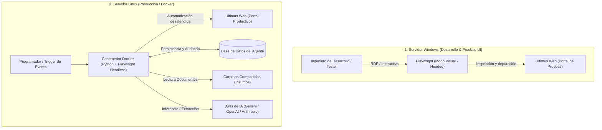

# Requerimientos Técnicos de Infraestructura y Despliegue
## Sistema Agéntico de Automatización: Formalización de Préstamos Personales
**Proyecto:** Célula de Innovación Caja de Ahorros — Producto 02  
**Elaborado por:** StraTech  
**Dirigido a:** Vicepresidencia de Tecnología, Infraestructura, Arquitectura y Ciberseguridad — Caja de Ahorros de Panamá  
**Fecha:** 13 de octubre de 2026  
**Versión:** 1.0 (Borrador Técnico de Requerimientos de Infraestructura)  

---

## 1. Resumen Ejecutivo y Propósito

El presente documento define los requerimientos técnicos, de red, infraestructura y accesos necesarios para habilitar el desarrollo, validación y posterior despliegue productivo del **Sistema Agéntico de Automatización del Proceso de Formalización de Préstamos Personales** en el aplicativo web **Ultimus BPM**.

El sistema utiliza una arquitectura basada en agentes de software construidos en **Python**, apoyados en **Playwright** para la automatización web y en modelos de lenguaje (LLMs) para el razonamiento e interpretación documental.

Para cumplir con el ciclo de vida de desarrollo de software del banco, se requiere una estrategia en dos etapas:
1. **Ambiente de Desarrollo y Pruebas Visuales:** Servidor Windows con soporte de interfaz gráfica y visualización del navegador web (Playwright con navegador interactivo) para la inspección de elementos dinámicos, ajuste de selectores y validación con los usuarios funcionales.
2. **Ambiente Productivo / Pre-productivo:** Servidor Linux para la ejecución automatizada y desatendida mediante contenedores **Docker** en modo *headless* (sin interfaz gráfica).

> **Nota sobre la Red:** Como StraTech no conoce la topología interna ni la segmentación de redes (VLANs/subredes) de Caja de Ahorros, se solicita a los equipos de **Infraestructura, Redes y Ciberseguridad** determinar la ubicación idónea de estos servidores en la zona que cumpla con los estándares institucionales de seguridad bancaria.

---

## 2. Requerimientos de Servidores y Entornos

### 2.1. Servidor de Desarrollo y Pruebas Visuales (Windows)
* **Objetivo:** Permitir a los ingenieros de desarrollo ejecutar y depurar los agentes agénticos en modo visual (`headless=False`) contra el portal web de Ultimus BPM, asegurando que los formularios, ventanas modales y tiempos de respuesta de la interfaz se manipulen con precisión.
* **Sistema Operativo:** Windows Server 2022 / 2025 o Windows 11 Enterprise (64-bit).
* **Capacidad Recomendada:**
  * **CPU:** 4 vCPUs.
  * **Memoria RAM:** 16 GB.
  * **Almacenamiento:** 100 GB SSD (o disco de alto rendimiento).
* **Acceso y Permisos:**
  * Acceso por Escritorio Remoto (RDP) para el equipo asignado de desarrollo.
  * Privilegios de **Administrador Local** sobre la sesión de usuario para la instalación y configuración de runtimes:
    * Python 3.11+.
    * Dependencias del navegador Playwright (Chromium / Firefox / WebKit).
    * Herramientas de soporte (Git, editores de código, gestores de paquetes).

### 2.2. Servidor Productivo / Ejecución Desatendida (Linux)
* **Objetivo:** Ejecutar el agente de manera desatendida, programada y contenerizada mediante Docker, operando Playwright en modo *headless* (`headless=True`) dentro de la infraestructura interna del banco.
* **Sistema Operativo:** Linux (Ubuntu Server 22.04 / 24.04 LTS o Red Hat Enterprise Linux / Rocky Linux 9).
* **Capacidad Recomendada:**
  * **CPU:** 4 a 8 vCPUs.
  * **Memoria RAM:** 16 GB a 32 GB.
  * **Almacenamiento:** 150 GB SSD (espacio para imágenes Docker, volúmenes de logs y almacenamiento temporal de archivos).
* **Acceso y Permisos:**
  * Acceso seguro vía SSH.
  * Privilegios de `sudo` para el usuario de despliegue para gestionar el motor de contenedores:
    * Docker Engine y Docker Compose (v2+).

---

## 3. Matriz de Conectividad y Reglas de Red (Firewall)

Ambos servidores deben residir dentro del perímetro on-premise de Caja de Ahorros, contando con las aperturas de conectividad descritas a continuación:

### 3.1. Tráfico Saliente a Internet (Egress — Puerto HTTPS 443)
Para la descarga de dependencias, construcción de contenedores y consumo de modelos cognitivos de IA, los servidores requieren salida HTTPS hacia:

| Destino / Dominio | Propósito | Justificación Técnica |
| :--- | :--- | :--- |
| `pypi.org` `files.pythonhosted.org` | Repositorios oficiales de Python | Descarga de paquetes y librerías del agente (`playwright`, `pydantic`, clientes de base de datos, utilidades de procesamiento). |
| `hub.docker.com` `registry-1.docker.io` `production.cloudflare.docker.com` | Repositorio oficial Docker Hub | Descarga de imágenes base oficiales (Python, Chromium headless, etc.) para el build de contenedores. |
| `playwright.azureedge.net` `cdn.playwright.dev` | CDN de Microsoft Playwright | Descarga de binarios y drivers de navegadores certificados para Playwright. |
| APIs de Inteligencia Artificial: • `generativelanguage.googleapis.com` (Gemini) • `api.openai.com` (OpenAI) • `api.anthropic.com` (Anthropic) | Consumo de Modelos Fundacionales (LLMs) | Extracción inteligente de información documental no estructurada (cartas de trabajo, comprobantes), razonamiento contextual y validación de reglas de negocio. |

> *Nota para Ciberseguridad:* Si la salida a internet está regulada a través de un proxy corporativo (ej. BlueCoat, Zscaler, Squid) o requiere inspección SSL, solicitamos la especificación de los parámetros del proxy (`HTTP_PROXY`, `HTTPS_PROXY`, `NO_PROXY`) y el certificado de la CA raíz del banco para incorporarlo en los almacenes de certificados de Python y Docker.

### 3.2. Tráfico Interno (Intranet / On-Premise)

| Recurso Interno | Protocolo / Puerto | Justificación del Acceso |
| :--- | :--- | :--- |
| **Portal Web Ultimus BPM** | HTTP/HTTPS (Puertos 80, 443 o puerto dedicado) | Interacción del agente con la interfaz web de formalización de préstamos personales. |
| **Carpetas Compartidas de Red (File Shares)** | SMB / CIFS (Puerto 445) | Lectura de documentos de soporte asociados al préstamo (cartas de trabajo en PDF, fichas CSS, talonarios, cédulas) y eventual movimiento a carpetas de procesados/rechazados. |
| **Servidor de Correo (MTA)** | SMTP (Puertos 25, 465 o 587) | Envío de notificaciones automáticas de inicio/fin de lote, reportes de operaciones y alertas por inconsistencias. |
| **Base de Datos Institucional (Insumos de Riesgo)** | TCP (según motor: Oracle 1521, SQL Server 1433, etc.) | Consultas de **solo lectura** (vía ODBC/JDBC o vista dedicada) para obtener la lista de préstamos aprobados (modelo tradicional o modelo de aprobados). |

---

## 4. Base de Datos Dedicada para el Sistema Agéntico

Para garantizar la auditoría, la observabilidad y la persistencia del agente sin sobrecargar ni interferir con las tablas de los aplicativos core del banco, se requiere una base de datos relacional dedicada:

* **Motor Seleccionado:** PostgreSQL en contenedor Docker (incluido en el stack del agente).
* **Definición de Arquitectura (Opción A):** 
  * La base de datos del sistema agéntico residirá como un **contenedor Docker dentro del propio Servidor Linux**, con volúmenes persistentes locales.
  * **Principio de Aislamiento y Seguridad:** El agente **NO escribirá en ninguna base de datos de Caja de Ahorros**. Cualquier interacción con las bases de datos institucionales del banco (Riesgo / Aprobados) se limita estrictamente a consultas de **solo lectura (SELECT)** vía ODBC o vistas controladas.
* **Propósito de esta Base de Datos Interna:**
  1. **Control de Estado de Ejecución (State Machine):** Registro del ciclo de vida de cada caso (pendiente, en proceso, validado con éxito, devuelto por error).
  2. **Bitácora y Trazabilidad Forense:** Registro detallado de cada acción realizada por el agente, respuestas recibidas de Ultimus, mensajes arrojados por los Web Services de IBS y tiempos de respuesta.
  3. **Idempotencia y Cola de Trabajo:** Evitar duplicidad o reprocesamientos accidentales de un mismo préstamo.

---

## 5. Especificaciones de Seguridad, Accesos y Privilegios (Dedicado al Equipo de Ciberseguridad y Riesgo)

Esta sección detalla técnica y operativamente los requisitos de permisos y accesos solicitados para el sistema agéntico, diseñada específicamente para la evaluación del equipo de **Seguridad de la Información y Ciberseguridad de Caja de Ahorros**. 

Todas las solicitudes se fundamentan en los principios de **mínimo privilegio (Least Privilege)**, **contención de radio de impacto (Blast Radius Reduction)**, **no repudio** y **auditabilidad completa**.

---

### 5.1. Privilegios de Administración sobre la Sesión de Usuario (Admin Local en Windows / Sudo en Linux)

Para habilitar el aprovisionamiento, despliegue continuo y mantenimiento del stack agéntico sin generar dependencia operativa constante del equipo de soporte de TI, se requiere elevación de privilegios circunscrita a la sesión de trabajo en cada entorno:

#### A. Servidor Windows (Ambiente de Desarrollo y Pruebas Visuales)
* **Requisito:** Permisos de **Administrador Local** en la sesión de usuario del servidor/máquina virtual asignada.
* **Justificación Técnica:**
  * Instalación y actualización de los entornos de ejecución base (Python 3.11+, Node.js/gestores de dependencias).
  * Descarga y registro en el sistema operativo de los binarios certificados de navegadores utilizados por Playwright (Chromium, Firefox, WebKit) y sus librerías dinámicas del sistema.
  * Instalación de certificados raíz corporativos en los almacenes de confianza de Windows y Python para habilitar el tráfico a través del proxy del banco.
  * Depuración interactiva local de procesos en ejecución y captura de trazas de diagnóstico.
* **Medidas de Seguridad y Mitigación (Ciberseguridad):**
  * **Alcance Aislado:** El rol de administrador es **estrictamente local** sobre el servidor de pruebas; **no se requieren ni solicitan privilegios de Domain Admin** ni elevaciones en el Directorio Activo de Caja de Ahorros.
  * **Acceso Controlado:** Acceso exclusivo por Escritorio Remoto (RDP) autenticado mediante credenciales institucionales, restringido a los ingenieros asignados a la célula.
  * **Sin Conexión Transaccional Directa:** Este servidor se utiliza para pruebas funcionales y desarrollo de selectores sobre el portal web de Ultimus; no tiene acceso de escritura a bases de datos transaccionales del banco.

#### B. Servidor Linux (Ambiente de Pre-producción y Producción)
* **Requisito:** Privilegios de `sudo` (o pertenencia al grupo `docker`) para el usuario de servicio de despliegue.
* **Justificación Técnica:**
  * Gestión completa del ciclo de vida de los contenedores Docker (`docker build`, `docker run`, `docker compose up/down`).
  * Creación y gestión de volúmenes persistentes en el disco local para los logs de auditoría y la base de datos interna PostgreSQL.
  * Configuración y administración del servicio Docker como demonio del sistema (`systemctl restart docker`).
* **Medidas de Seguridad y Mitigación (Ciberseguridad):**
  * **Principio de Mínimo Privilegio en Sudoers:** Si la política del banco prohíbe el comando `sudo ALL`, se pueden restringir las directivas en `/etc/sudoers` exclusivamente a los binarios necesarios: `/usr/bin/docker`, `/usr/bin/docker-compose`, `/usr/bin/systemctl * docker`.
  * **Opción Rootless Docker:** El motor de Docker puede configurarse en modo *Rootless* si las políticas de hardening de Caja de Ahorros así lo exigen, ejecutando los contenedores bajo el espacio de nombres de un usuario estándar sin privilegios de root en el host.

---

### 5.2. Salida Segura a Internet para Dependencias, Construcción de Contenedores y Modelos de IA

El sistema requiere conectividad saliente a internet exclusivamente a través del protocolo seguro **HTTPS (puerto 443)** hacia destinos previamente identificados y auditables.

#### A. Justificación Técnica de los Destinos Salientes
1. **Repositorios Oficiales de Dependencias:** Descarga de paquetes certificados de Python desde `pypi.org` y `files.pythonhosted.org` para el ensamblado del motor del agente.
2. **Registro de Contenedores (Docker Hub):** Descarga de imágenes base oficiales y verificadas (`python:3.11-slim`, `postgres:16-alpine`, etc.) desde `hub.docker.com` y `registry-1.docker.io`.
3. **CDN de Componentes del Navegador:** Descarga inicial de los binarios certificados del navegador para Playwright desde `cdn.playwright.dev` y `playwright.azureedge.net`.
4. **APIs de Modelos Fundacionales (LLMs):** Conexión segura con los endpoints de inferencia aprobados (`generativelanguage.googleapis.com`, `api.openai.com` o `api.anthropic.com`) para la extracción y estructuración de datos de expedientes (cartas de trabajo, comprobantes).

#### B. Controles de Ciberseguridad y Arquitectura de Red
* **Tráfico Unidireccional Estricto (Solo Egress):** Toda conexión es iniciada desde el servidor del agente hacia internet por HTTPS (443). **No se requiere abrir ningún puerto entrante (Ingress) desde internet hacia la red interna del banco.**
* **Filtrado por FQDN / Lista Blanca (Whitelisting):** Se solicita a Ciberseguridad/Redes aplicar reglas de firewall o proxy perimetral basadas estrictamente en la lista blanca de dominios oficiales señalada en la Sección 3.1.
* **Compatibilidad con Proxy Corporativo e Inspección SSL/TLS:**
  * El agente y sus entornos de ejecución soportan la configuración estándar de proxies empresariales (`HTTP_PROXY`, `HTTPS_PROXY`, `NO_PROXY`).
  * En caso de requerir inspección profunda de paquetes SSL, el equipo de desarrollo incorporará el certificado raíz institucional de Caja de Ahorros en el almacén de certificados de Python (`certifi`) y en las imágenes Docker para evitar disrupciones de conexión.
* **Gobernanza de Datos Sensibles (Data Privacy):**
  * La descarga de paquetes y construcción de contenedores no transmite ninguna información institucional hacia internet.
  * Para la inferencia documental con modelos de IA, se implementarán mecanismos de **anonimización o enmascaramiento previo de PII (Personally Identifiable Information)** según los lineamientos de cumplimiento normativo y privacidad de datos de Caja de Ahorros.

---

### 5.3. Acceso al Sistema Ultimus y Recursos Internos del Proceso

El agente agéntico actúa como un operador digital asistido que emula de forma segura las tareas repetitivas del personal de operaciones, interactuando con los siguientes recursos internos:

#### A. Aplicativo Web Ultimus BPM
* **Naturaleza del Acceso:** Conexión interna HTTP/HTTPS contra el portal web de Ultimus BPM (servidores web IIS internos).
* **Alcance Funcional:** 
  * Acceso exclusivo al flujo del proceso *"Formalización de Préstamos Personales"*.
  * Lectura de las bandejas de entrada para identificar los casos pendientes.
  * Diligenciamiento programático de los 10 a 15 campos requeridos de la etapa de formalización.
  * Ejecución de las acciones de los botones de interfaz que desencadenan las llamadas a los Web Services de integración hacia el core bancario (IBS) para:
    1. Actualización / validación del cliente en el core.
    2. Creación / reserva del número de préstamo.
    3. Apertura de cuenta de ahorros (cuando aplique).
* **Control de Seguridad:** El agente interactúa a través de la capa web de Ultimus respetando la lógica de negocio, reglas de validación y bitácoras nativas del BPM, evitando accesos directos descontrolados a la base de datos de Ultimus.

#### B. Carpetas Compartidas de Red (File Shares - SMB/CIFS Puerto 445)
* **Naturaleza del Acceso:** Conexión de red a los repositorios documentales donde residen los expedientes digitales de los clientes (cartas de trabajo, comprobantes de pago, fichas de la CSS, cédulas).
* **Privilegios Solicitados:**
  * **Lectura (`Read-Only`):** Acceso para inspeccionar, extraer y analizar el contenido documental de los expedientes asociados a cada préstamo.
  * **Escritura y Movimiento Acotado (Opcional):** En caso de acordar que el agente realice la clasificación post-procesamiento, se solicitará permiso de escritura **únicamente** sobre carpetas destino de control (`_procesados`, `_rechazados_para_revision_manual`), **sin otorgar permisos de eliminación (`DELETE`) sobre las carpetas de insumos originales**.

#### C. Base de Datos Institucional (Insumos de Riesgo y Préstamos Aprobados)
* **Naturaleza del Acceso:** Conexión SQL vía ODBC/JDBC contra la base de datos o vista donde reposa el universo de préstamos aprobados (modelo tradicional o modelo analítico de aprobados).
* **Garantía Estricta de Seguridad (Principio de Cero Escritura):**
  * Credencial con privilegio exclusivo de **solo lectura (`SELECT`)**.
  * **El agente NO cuenta ni solicita permisos de escritura (`INSERT`, `UPDATE`, `DELETE`, `DROP`, `ALTER`) sobre ninguna base de datos institucional de Caja de Ahorros.**
  * Toda la persistencia de estado, logs y métricas operativas del agente se almacena en su **base de datos interna dedicada (PostgreSQL en Docker local)**, asegurando aislamiento absoluto frente a las bases transaccionales del banco.

#### D. Servidor de Correo Institucional (SMTP)
* **Naturaleza del Acceso:** Conexión a la pasarela interna de correo del banco (SMTP en puertos 25/587).
* **Uso Exclusivo:** Envío de notificaciones de inicio/fin de lote operativo, reportes consolidados y alertas inmediatas ante excepciones funcionales o técnicas.

---

### 5.4. Identidad Institucional del Agente y Evaluación del Buzón de Correo

Para garantizar el cumplimiento con las normativas bancarias de auditoría y segregación de funciones, la identidad del agente debe gestionarse de forma formal e individualizada:

#### A. Usuario de Servicio de Dominio (Active Directory de Caja de Ahorros)
* **Requisito:** Creación de una cuenta de servicio nominal e institucional (ej. `svc_agente_formalizacion` o `usr_agente_pp`).
* **Justificación de Ciberseguridad (Principio de No Repudio y Trazabilidad):**
  * **Prohibición de Cuentas Compartidas:** El sistema agéntico **no debe operar bajo las credenciales de usuarios humanos** (analistas o desarrolladores) ni cuentas compartidas genéricas.
  * **Auditoría Forense:** Cada acción realizada en Ultimus BPM y en los Web Services hacia IBS queda sellada con el identificador único del agente en las bitácoras institucionales, permitiendo diferenciar con exactitud matemática las operaciones realizadas por la automatización de aquellas ejecutadas por el personal humano.
* **Perfil Funcional en Ultimus:**
  * El usuario de servicio debe contar con un perfil operativo con los privilegios mínimos necesarios para atender el proceso de préstamos personales en la etapa de formalización.

#### B. Evaluación y Justificación del Buzón de Correo Institucional (`@cajadeahorros.com.pa`)
Se evalúa y sustenta la necesidad de dotar al agente de una cuenta de correo corporativa propia bajo los siguientes escenarios:

| Escenario Operativo | Función del Correo Institucional | Justificación de Valor y Seguridad |
| :--- | :--- | :--- |
| **1. Disparador del Flujo (Trigger)** | Receptor de notificaciones de nuevos casos | Si la operativa de Riesgo o de sucursales comunica los préstamos aprobados mediante avisos por correo electrónico, el buzón del agente permite la ingesta desatendida y autónoma sin depender de buzones personales. |
| **2. Canal Oficial de Notificaciones y Reportes** | Emisor de reportes diarios consolidados | El agente utiliza su correo institucional para enviar diariamente a los supervisores del área el balance de operaciones: total formalizados, tiempos de ciclo, y detalle de préstamos devueltos a revisión manual con su justificación. |
| **3. Gobernanza y Reputación Interna** | Identidad corporativa confiable | Las comunicaciones generadas por el agente provienen de un remitente oficial con dominio del banco, evitando que las alertas operativas sean bloqueadas por filtros antispam o generen desconfianza en los destinatarios. |

* **Recomendación a Seguridad:** Se recomienda formalizar la asignación del buzón de correo institucional (`agente.formalizacion@cajadeahorros.com.pa`) para garantizar un canal unificado, seguro y auditable de entrada y salida de notificaciones del proceso.

---

## 6. Arquitectura de Automatización con Playwright Python

La estrategia técnica de automatización web mediante **Playwright** se estructura en las siguientes pautas:

* **Robustez frente a cambios de UI:** Playwright permite selectores basados en accesibilidad, roles y atributos semánticos (`data-testid`, texto visible, etiquetas), reduciendo la fragilidad típica de herramientas RPA tradicionales.
* **Manejo de asincronía y peticiones AJAX:** Soporte nativo para esperar el fin de llamadas de red (`wait_for_response`, `wait_for_load_state`), fundamental para sincronizar la interacción cuando Ultimus invoca los Web Services de IBS en segundo plano.
* **Captura de evidencias:** Generación automática de capturas de pantalla (*screenshots*) y trazas de red (*network logs*) ante cualquier error o excepción, que se almacenan como evidencia para soporte y auditoría.

---

## 7. Preguntas y Solicitudes para el Banco

Para continuar con el cronograma y habilitar la infraestructura, solicitamos la retroalimentación de los siguientes puntos:

1. **Segmento de Red:** ¿En qué segmento de red / VLAN sugiere el equipo de Infraestructura colocar el Servidor Windows y el Servidor Linux?
2. **Políticas de Salida a Internet:** ¿Existe un proxy corporativo o se gestionará mediante regla de firewall por IP/puerto hacia las URLs indicadas?
3. **Mecanismo de Despliegue de la BD del Agente:** ¿Prefiere el banco que PostgreSQL se ejecute como contenedor Docker en el servidor Linux o que el equipo de DBAs aprovisione una base de datos institucional dedicada?
4. **Catálogo de Errores de IBS:** ¿Cuándo nos pueden compartir el catálogo de respuestas/errores de los Web Services que invoca Ultimus hacia el IBS para parametrizar las excepciones en el agente?
5. **Aprobación de Cuentas de Servicio:** ¿Cuál es el procedimiento formal y el tiempo estimado para solicitar el usuario de dominio y el buzón de correo para el agente?

---

### Control de Firmas y Validación

| Rol | Nombre | Cargo / Área | Fecha | Firma |
| :--- | :--- | :--- | :--- | :--- |
| **Elaboró** | Rodolfo Blasser | Líder Técnico de Célula (StraTech) | 13/10/2026 | |
| **Revisó** | Nerio Peña | Gerente de Proyecto (StraTech) | 13/10/2026 | |
| **Validó Tecnología** | Ricardo Herrera / Luis / Juan | Tecnología / Arquitectura (Caja de Ahorros) | | |
| **Validó Ciberseguridad** | [Nombre] | Ciberseguridad (Caja de Ahorros) | | |
