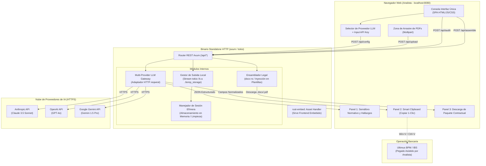

# Especificación Técnica de Arquitectura: Standalone HTTP Server (Rust)
## Asistente Inteligente de Formalización de Préstamos Personales
### Solución Ejecutable Autocontenida (Localhost & Cloud-Ready) para Estaciones Bancarias

**Organización:** Caja de Ahorros de Panamá  
**Liderazgo Técnico:** Célula de Innovación (StraTech / Caja de Ahorros)  
**Fecha:** Octubre 2026  
**Documento Base:** [diseno-arquitectura-asistente-formalizacion.md](file:///c:/Users/rblasser/OneDrive%20-%20Latinex/Escritorio/PROJECTS/CDA/celulas/formalizacion-pp/design/diseno-arquitectura-asistente-formalizacion.md)  
**Estado:** Especificación de Implementación Standalone HTTP  

---

## 1. Justificación y Enfoque Arquitectónico

### 1.1. Contexto Operativo
Actualmente, las estaciones de trabajo de los analistas de formalización en Caja de Ahorros carecen de un servidor interno dedicado en la infraestructura bancaria central para alojar microservicios web. Asimismo, las políticas de ciberseguridad y gobierno de TI restringen la instalación de runtimes dinámicos (como Python, Node.js o entornos virtuales) en las máquinas de los usuarios operativos.

### 1.2. Decisión Arquitectónica: Standalone HTTP Server en Rust
Se adopta el patrón **Standalone HTTP Server** desarrollado en **Rust**:
1. **Binario Único Autocontenido (`.exe`):** Se compila a un único archivo ejecutable de 15 a 25 MB que incluye el servidor web HTTP, la lógica de negocio, las plantillas y el frontend completo empaquetado en tiempo de compilación. No requiere DLLs externas, instaladores con privilegios de administrador ni runtimes de lenguajes interpretados.
2. **Consumo Mínimo de Recursos:** Huella de memoria RAM inferior a 30 MB y arranque instantáneo (<50 ms), garantizando cero interferencia con la ejecución paralela de Ultimus BPM o emuladores del Core IBS.
3. **Consumo Browser-Based (`http://127.0.0.1:PORT`):** El analista interactúa desde su navegador corporativo habitual (Microsoft Edge / Google Chrome), operando con ergonomía de pantalla dividida (`Win + Flecha`).
4. **Portabilidad Inmediata a la Nube (Cloud-Ready):** Al implementarse sobre el protocolo estándar HTTP mediante endpoints REST desacoplados, el 100% de la lógica y la interfaz es idéntica en local y en la nube. Cuando Caja de Ahorros asigne infraestructura en OCI, AWS o Kubernetes institucional, el binario o su contenedor Docker se despliega directamente sin refactorizaciones.

---

## 2. Principios de Diseño e Implementación (Fail-Fast y Cero Simulación)

En estricto apego a las directrices de ingeniería del proyecto:
* **Cero Sobreingeniería:** Arquitectura concisa y directa. Se utilizan únicamente las abstracciones necesarias para orquestar la carga de documentos, la llamada a los APIs de los modelos de lenguaje y la inyección en plantillas.
* **Cero Funciones Fallback Silenciosas:** No se permiten degradaciones artificiales ni capturas de error que intenten "adivinar" resultados o disimular fallas de conexión. Si la API de IA rechaza la solicitud, si la clave es inválida o si un PDF está corrupto, la aplicación detiene el procesamiento y expone el mensaje de error exacto al analista de forma inmediata (`fail-fast`).
* **Cero Mockdata:** En ningún entorno (ni en local ni en pruebas) se utilizarán datos simulados o respuestas ficticias pre-grabadas. Toda ejecución procesa los documentos reales suministrados contra el proveedor de IA configurado.

---

## 3. Diagrama de Arquitectura del Servidor Local



---

## 4. Componentes y Stack Tecnológico en Rust

| Capa | Componente | Crate / Tecnología | Propósito |
| :--- | :--- | :--- | :--- |
| **Runtime Asíncrono** | I/O Multihilo | `tokio` (features = ["full"]) | Motor asíncrono para atención concurrente sin bloqueos de hilo. |
| **Servidor HTTP** | Framework Web | `axum` (v0.7+) | Enrutamiento REST de alto rendimiento y bajo overhead. |
| **Embebedor de Assets** | Empaquetado Frontend | `rust-embed` (v8.4+) | Incorpora `index.html`, estilos CSS y scripts JS dentro del ejecutable en tiempo de compilación. |
| **Extracción Multipart** | Recepción de Archivos | `axum::extract::Multipart` | Streaming directo de PDFs de expedientes hacia almacenamiento temporal local sin cargar archivos gigantescos en RAM. |
| **Cliente HTTP / LLM** | Conexión con IA | `reqwest` (features = ["json", "stream"]) | Cliente HTTPS para orquestar llamadas hacia Anthropic, OpenAI y Google Gemini. |
| **Serialización** | Manejo de JSON | `serde`, `serde_json` | Tipado estricto y validación de payloads de entrada y respuesta estructurada. |
| **Manipulación Docx** | Ensamblado Legal | `docx-rs` o manipulación de plantillas ZIP/XML | Sustitución de etiquetas dinámicas (`{{nombre}}`, `{{monto}}`, `{{cuenta}}`) sobre plantillas `.docx` oficiales. |

---

## 5. Capa Multi-Proveedor de Modelos de Lenguaje (LLM Gateway)

### 5.1. Selector Dinámico y Credenciales
La interfaz expone en su barra de configuración un control desplegable (*dropdown*) y un campo de clave:
1. **Selección de Proveedor:**
   * `Anthropic Claude 3.5 Sonnet` (Recomendado para extracción espacial compleja en documentos bancarios).
   * `OpenAI GPT-4o` (Procesamiento multimodal estructurado).
   * `Google Gemini 1.5 Pro` (Ventana de contexto extendida y análisis documental).
2. **Entrada de API Key:**
   * Campo protegido en pantalla (`type="password"`).
   * Almacenada exclusivamente en la memoria volátil del servidor local (`Arc<RwLock<ConfigState>>`) durante la sesión de trabajo. No se persiste en texto plano ni se expone a terceros.
3. **Validación Inmediata (Fail-Fast):**
   * El endpoint `POST /api/config/validate` realiza una llamada de prueba mínima al proveedor seleccionado. Si el API Key es inválida, expiró o no tiene crédito, retorna un error HTTP 401/400 con el detalle recibido directamente del proveedor. Cero respuestas simuladas.

### 5.2. Contrato de Integración Común (Adapter Pattern)
Internamente, Rust define un *trait* unificado:

```rust
#[async_trait]
pub trait LlmGateway: Send + Sync {
    async fn audit_and_extract(
        &self,
        api_key: &str,
        documents: Vec<DocumentPayload>,
        prompt_rules: &str,
    ) -> Result<ExtractionResponse, LlmError>;
}
```

Cada adaptador (`AnthropicAdapter`, `OpenAiAdapter`, `GeminiAdapter`) implementa este trait, traduciendo los bytes de los PDFs a los formatos requeridos por sus respectivas APIs (ej. bloques `document` en Anthropic, imágenes/archivos en Gemini, o payloads multimodales en OpenAI).

---

## 6. Implementación de los Tres Casos de Uso en el Servidor Local

### 6.1. Caso de Uso 1: Auditoría Documental y Semáforo Normativo
1. **Flujo:** El analista arrastra los documentos escaneados (cédula, talonario/slip, carta de trabajo, proforma/APC) a la zona de carga.
2. **Recepción:** El endpoint `POST /api/upload` almacena los archivos en un subdirectorio efímero `./temp_storage/<uuid_sesion>/`.
3. **Auditoría:** `POST /api/audit` despacha los documentos junto con la matriz de reglas bancarias al modelo seleccionado.
4. **Respuesta Estructurada:** El modelo devuelve un JSON estricto con:
   * Estado del Semáforo: `VERDE` (Conforme), `AMARILLO` (Advertencia subsanable), `ROJO` (Faltante crítico o bloqueo normativo).
   * Lista detallada de inconsistencias (ej. "Talonario excede vigencia de 60 días", "Falta certificado físico de CSS para jubilado").

### 6.2. Caso de Uso 2: Smart Clipboard (Copiado Asistido en 1 Clic)
1. **Normalización:** La respuesta del LLM parsea los campos críticos requeridos por Ultimus BPM y el Core IBS:
   * Nombre completo, Cédula, Patrono / Institución, Posición de planilla, Salario neto comprobado, Monto aprobado, Plazo.
2. **Despliegue:** La UI renderiza tarjetas visuales ordenadas exactamente en la secuencia de captura de Ultimus.
3. **Acción de Copiado:** Al pulsar el icono de copiar, JavaScript ejecuta `navigator.clipboard.writeText(...)` y muestra confirmación visual. El analista coloca las ventanas en paralelo (`Win + Flechas`) y traslada la información sin fatiga visual ni errores de tipeo.

### 6.3. Caso de Uso 3: Ensamblador Legal de Compra de Saldo
1. **Requerimiento:** En consolidación de deudas, se requiere generar cartas de promesa y pagarés a nombre de los bancos acreedores (Banco General, Banistmo, BAC, etc.).
2. **Inyección en Plantillas:** El endpoint `POST /api/assemble` toma los datos extraídos (nombre de acreedor, número de préstamo a cancelar, saldo al centavo, fecha límite) y los inyecta sobre plantillas `.docx` base ubicadas en `./templates/`.
3. **Descarga Directa:** El servidor compila el documento final y emite una respuesta HTTP con cabecera `Content-Disposition: attachment; filename="paquete_formalizacion_<cedula>.docx"`, iniciando la descarga en la carpeta del analista.

---

## 7. Manejo de Almacenamiento Efímero y Limpieza

Para garantizar la confidencialidad de la información bancaria en estaciones compartidas:
1. **Almacenamiento Temporal:** Todos los PDFs y archivos generados residen en `./temp_storage/<session_id>/`.
2. **Limpieza Automática y Manual:**
   * La UI dispone del botón **"Nueva Solicitud"** (`POST /api/reset`), el cual purga de inmediato el directorio temporal de la sesión y reinicia el estado en memoria.
   * Al detener el proceso del ejecutable o reiniciar el servicio, un hook de terminación (`Drop` o control de señales de SO) elimina la carpeta de trabajo temporal.

---

## 8. Especificación de Endpoints de la API REST

| Método | Endpoint | Descripción | Manejo de Error (Fail-Fast) |
| :--- | :--- | :--- | :--- |
| `GET` | `/` | Retorna la SPA embutida en el binario. | 404 si el asset interno no existe. |
| `POST` | `/api/config` | Configura en memoria el proveedor (`provider`) y el API Key. | 400 si faltan parámetros requeridos. |
| `POST` | `/api/upload` | Recibe `multipart/form-data` con los PDFs del expediente. | 400 si el archivo no es PDF válido o excede 50 MB. |
| `POST` | `/api/audit` | Ejecuta la auditoría y extracción con el LLM seleccionado. | 502/401 si la API externa falla, devolviendo error íntegro. |
| `GET` | `/api/clipboard` | Retorna el JSON estructurado de campos para el portapapeles. | 404 si no hay sesión procesada previa. |
| `POST` | `/api/assemble` | Genera y descarga el paquete legal en formato `.docx`. | 500 si la plantilla local está ausente o no se pudo ensamblar. |
| `POST` | `/api/reset` | Elimina archivos temporales y reinicia el estado de sesión. | 200 confirmando purga exitosa. |

---

## 9. Estrategia de Portabilidad a Contenedores Institucionales (Docker)

Cuando Caja de Ahorros habilite servidores centrales o infraestructura cloud, el despliegue se efectúa mediante un contenedor *multi-stage* ultraligero (<30 MB):

```dockerfile
# Etapa 1: Compilación en entorno controlado
FROM rust:1.80-slim as builder
WORKDIR /usr/src/app
COPY . .
RUN cargo build --release

# Etapa 2: Imagen de producción mínima sin runtime ni compiladores
FROM debian:bookworm-slim
RUN apt-get update && apt-get install -y ca-certificates && rm -rf /var/lib/apt/lists/*
WORKDIR /app
COPY --from=builder /usr/src/app/target/release/asistente-formalizacion-server /app/server
COPY ./templates /app/templates

ENV PORT=8080
ENV STORAGE_DIR=/tmp/formalizacion_storage
EXPOSE 8080

CMD ["/app/server"]
```
Sin requerir cambios en el código fuente, la misma aplicación pasa de ser un `.exe` local a un microservicio en la nube bancaria.
