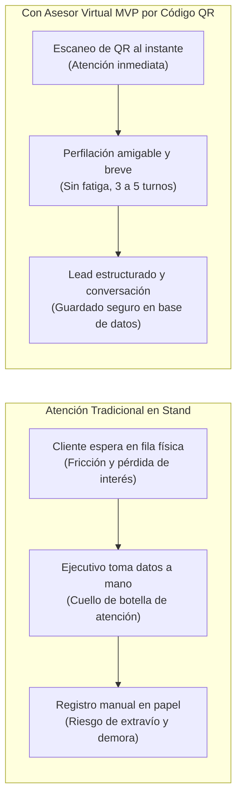
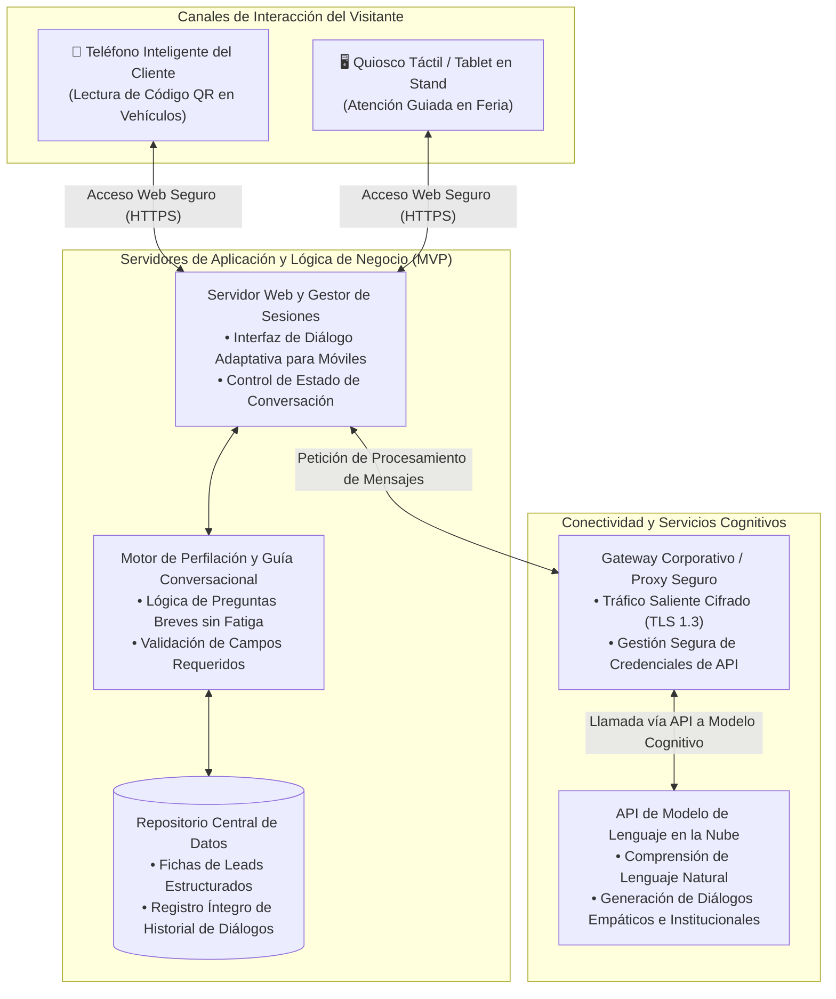
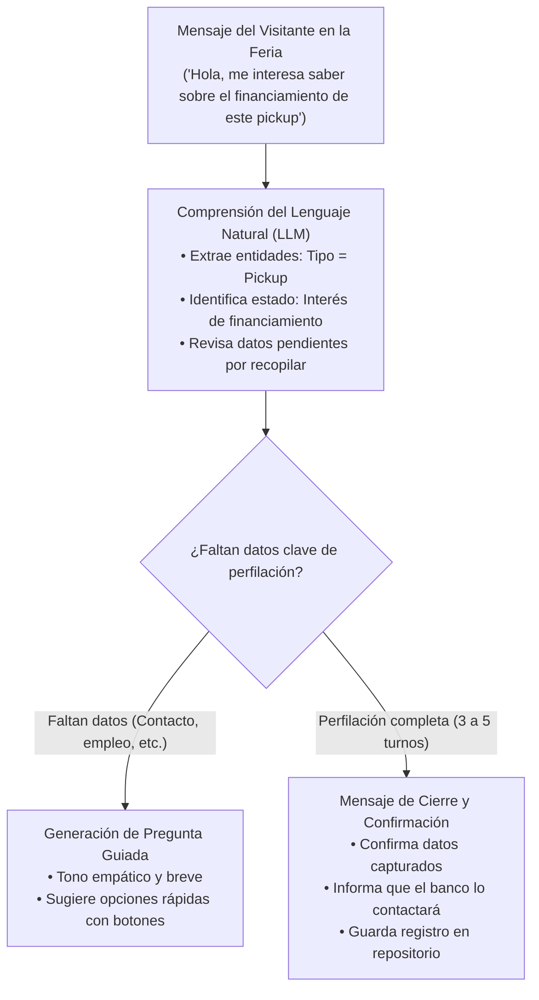
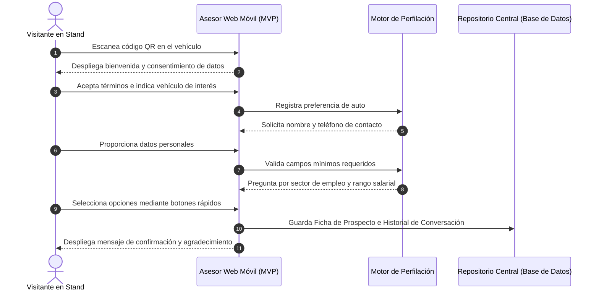

# Diseño de Arquitectura: Producto Mínimo Viable (MVP) - Asesor Virtual de Préstamo de Auto (Feria y Canales Digitales)
## Solución MVP Web Conversacional para Captura de Prospectos y Perfilación Ágil en Eventos Masivos

**Organización:** Caja de Ahorros de Panamá  
**Liderazgo Técnico:** Célula de Innovación (StraTech / Caja de Ahorros)  
**Fecha:** Octubre 2026  
**Versión:** 1.5 (Especificación de Arquitectura de Producto Mínimo Viable - MVP)  

---

## 1. Introducción

La presencia de Caja de Ahorros en ferias comerciales automotrices (como el Panamá Motor Show y exhibiciones regionales) constituye una de las principales iniciativas de originación de préstamos de auto para la institución. Durante estos eventos masivos, miles de visitantes recorren el stand con el interés de cotizar opciones de financiamiento para vehículos nuevos o de segunda mano.

El **Asesor Virtual de Préstamo de Auto** se concibe y estructura como un **Producto Mínimo Viable (MVP)** accesible de manera instantánea mediante el escaneo de códigos QR distribuidos en los vehículos de exhibición, volantes y quioscos táctiles del stand. En su **alcance actual**, el sistema se enfoca estrictamente en **captar la información del cliente, registrar las conversaciones íntegras y realizar una perfilación comercial preliminar**. La solución **no realiza simulaciones de cálculo de letra ni proyecciones de cuotas financieras**, garantizando una interacción ágil, natural y cordial, orientada a obtener la información justa y necesaria para el negocio sin causar agotamiento o abandono por parte del usuario.

Toda la información recopilada (fichas de identificación del prospecto y transcripciones completas de los diálogos) queda registrada y asegurada en el **repositorio central de datos** de la solución, garantizando la persistencia estructurada de las oportunidades comerciales para su posterior análisis y custodia por parte de la institución.

---

## 2. Visión de Negocio

### 2.1. El Desafío Comercial en Ferias y Eventos Masivos
En la dinámica habitual de las ferias automotrices se generan cuellos de botella que limitan el aprovechamiento de la inversión institucional:

1. **Pérdida de Prospectos por Filas y Tiempos de Espera:** Durante los periodos de mayor afluencia, los visitantes superan con creces la capacidad física de atención del personal del stand. Un cliente que debe esperar en filas físicas suele desmotivarse, abandonar el lugar o acudir a stands bancarios competidores.
2. **Registro Manual Ineficiente y Descentralizado:** La recopilación manual de datos en libretas o formularios físicos genera extravío de información, errores de digitación de números telefónicos o correos y demoras antes de que los contactos puedan ser procesados formalmente.
3. **Pérdida de Inmediatez Comercial:** El visitante de una feria toma decisiones en caliente. Si el banco no recopila sus preferencias e información de contacto en el momento exacto en que está interesado frente al vehículo, el costo de volver a contactar a ese prospecto se multiplica.

### 2.2. Principio de Perfilación Conversacional sin Fatiga al Usuario
Uno de los factores determinantes para el éxito del MVP es el **equilibrio en la profundidad de las preguntas**:

* **Evitar Cuestionarios Extensos:** Obligar al usuario en una feria a responder decenas de preguntas técnicas o formularios interminables en su pantalla móvil ocasiona una alta tasa de abandono y fatiga.
* **Perfilación Enfocada y Progresiva:** El asistente guía la conversación en un rango óptimo de **3 a 5 intervenciones naturales**, recopilando los datos indispensables para el banco:
  * Identificación básica: Nombre completo y cédula.
  * Datos de contacto: Número telefónico y correo electrónico.
  * Interés vehicular: Marca, modelo o categoría de auto (SUV, sedán, comercial) y condición (nuevo o usado).
  * Perfil laboral general: Sector de empleo (público, privado, independiente o jubilado) y rango salarial aproximado.
* **Tono Cercano y Sin Cálculos Complejos:** Al no realizar cálculos matemáticos de letra, la interacción se mantiene libre de fricciones o discusiones técnicas sobre tasas, abonos o tablas de amortización, preservando la expectativa de una atención personalizada posterior por parte del banco.

### 2.3. Objetivos Estratégicos y Retorno de Negocio del MVP
* **Validación Comercial Rápida:** Comprobar la receptividad y efectividad de la captación digital por código QR en un entorno de feria real.
* **Atención Simultánea Ilimitada:** Atender a múltiples visitantes en paralelo durante los días pico de la feria sin requerir la contratación de personal adicional en el stand.
* **Captura Estructurada de Oportunidades:** Cada interacción concluye con una ficha de prospecto completa y el historial de la conversación debidamente persistido en base de datos.
* **Trazabilidad Integral de Contactos:** Centralizar digitalmente el registro de prospectos generados durante el evento, eliminando la dispersión o pérdida de libretas de apuntes manuales.

### 2.4. KPI de Eficiencia y Metodología de Medición Sugerida para Caja de Ahorros

Para evaluar el impacto y la ganancia de eficiencia operativa del MVP, se propone que Caja de Ahorros mida desde su lado los resultados comparando el modelo de captación tradicional manual frente al modelo digital por código QR.

#### A. Definición del KPI Principal: Eficiencia en Captura de Prospectos (ECP)
El indicador mide el rendimiento en la recopilación de datos y perfilación de clientes, evaluando el tiempo de interacción, la reducción de pasos de captura y la capacidad de atención en paralelo:

$$\text{Ganancia de Eficiencia en Tiempo (\%)} = \frac{T_{\text{manual}} - T_{\text{MVP}}}{T_{\text{manual}}} \times 100$$

Donde:
* $T_{\text{manual}}$: Tiempo promedio invertido por un funcionario en abordar, interrogar y registrar a mano los datos de un visitante en el stand.
* $T_{\text{MVP}}$: Tiempo promedio de la interacción digital autogestionada por el usuario desde su teléfono móvil (medido automáticamente entre el primer mensaje y la confirmación final de registro).

#### B. Medición en Términos de Pasos Operativos

| Etapa | Flujo Tradicional Manual (5 pasos) | Flujo Digital MVP con Asistente (3 pasos) |
| :--- | :--- | :--- |
| **Paso 1** | Abordaje verbal e interrupción al cliente en fila física. | Escaneo espontáneo del código QR por parte del visitante. |
| **Paso 2** | Preguntas abiertas y desestructuradas por el personal de atención. | Diálogo guiado de 3 a 5 preguntas con botones rápidos de respuesta. |
| **Paso 3** | Anotación manuscrita en libreta o formulario de papel. | Confirmación de datos y almacenamiento automático en base de datos. |
| **Paso 4** | Transcripción diferida de libretas a formatos electrónicos. | *(Paso eliminado: los datos ya nacen digitalizados y estructurados).* |
| **Paso 5** | Corrección y depuración de registros ilegibles o incompletos. | *(Paso eliminado: validación inmediata de campos en el chat).* |

**Reducción de Pasos Operativos:** Disminución del 40% en pasos de gestión (de 5 pasos manuales a 3 pasos digitales directos), eliminando por completo la re-digitación posterior.

#### C. Medición en Términos de Tiempo y Capacidad de Concurrencia
* **Tiempo de Ciclo:** CDA cronometra el tiempo promedio que toma una interacción presencial en el stand versus la duración de la sesión digital en el asistente.
* **Capacidad de Concurrencia (Rendimiento por Hora):** Medición de la cantidad de prospectos capturados simultáneamente durante horas de máxima afluencia. Mientras un funcionario presencial solo puede atender a 1 persona a la vez, el asistente digital atiende concurrentemente a decenas de visitantes en paralelo sin generar tiempos de espera.

#### D. Protocolo Sugerido de Medición para CDA
1. **Línea Base:** Registrar durante las primeras horas de feria una muestra de atenciones manuales tradicionales (cronometrando duración y contando registros completados).
2. **Medición Digital:** Extraer las marcas de tiempo de las sesiones registradas en el repositorio de la solución durante el mismo periodo.
3. **Contraste y Cálculo:** Aplicar la fórmula de eficiencia y comparar el volumen total de prospectos perfilados versus el personal requerido.

---

## 3. Arquitectura: Mapa de Componentes

La arquitectura del MVP se diseña bajo un patrón web ligero y desacoplado, concebido para operar de forma perimetral con alta disponibilidad y tiempos de respuesta inmediatos en dispositivos móviles, sin sobrecargar la infraestructura central del banco.

### 3.1. Diagrama de Arquitectura del Sistema (MVP)

### 3.2. Descripción de Componentes Principales

1. **Interfaz Web de Diálogo (Cliente Móvil):**
   * Aplicación web ligera optimizada para pantallas táctiles de cualquier marca o sistema operativo.
   * No requiere descargas desde tiendas de aplicaciones, garantizando apertura inmediata tras el escaneo del código QR.
   * Incorpora elementos visuales amigables como botones de respuesta rápida para seleccionar marcas o rangos de ingreso con un solo toque, agilizando el flujo y reduciendo la necesidad de escribir en teclados virtuales pequeños.
2. **Servidor Web y Gestor de Sesiones:**
   * Administra la persistencia de las sesiones activas, garantizando que si el usuario interrumpe brevemente la conversación pueda retomarla de forma fluida.
   * Aplica políticas de tiempo de inactividad para liberar recursos del servidor y cerrar sesiones concluidas.
3. **Motor de Perfilación y Guía Conversacional:**
   * Controla que la conversación cubra los datos clave del negocio (nombre, cédula, teléfono, correo, vehículo deseado y rango salarial) en el menor número de intervenciones posibles.
   * Supervisa que el asistente no se desvíe hacia temas ajenos al crédito de auto ni intente calcular letras financieras, manteniendo al usuario enfocado en completar su registro.
4. **Repositorio Central de Prospectos y Conversaciones:**
   * Base de datos centralizada donde se registran dos estructuras complementarias:
     * **Ficha de Lead:** Tabla normalizada con los atributos específicos del prospecto (cédula, nombre, teléfono, correo, modelo, sector laboral, fecha y hora de registro).
     * **Historial de Conversación:** Registro íntegro y correlacionado de todos los mensajes intercambiados entre el cliente y el asistente virtual, permitiendo conservar el contexto exacto de cada interacción.
5. **Gateway Corporativo y Conexión vía API a LLM:**
   * Canal seguro que permite invocar las capacidades cognitivas del modelo de lenguaje en la nube sin exponer la red del banco ni almacenar claves de acceso en el navegador del cliente.

---

## 4. Estrategia de Datos y Seguridad

Dado que la solución de MVP recopila datos personales e identificadores de contacto en un entorno público, se aplican estrictas medidas de protección:

### 4.1. Cumplimiento de la Ley 81 de Protección de Datos Personales
* **Cláusula de Consentimiento Expreso:** Al iniciar la interacción, el usuario visualiza un texto claro donde autoriza a Caja de Ahorros a almacenar sus datos con la finalidad exclusiva de asesorarle y contactarle respecto a opciones de crédito de auto.
* **Principio de Proporcionalidad y No Intrusión:** Solo se solicitan los datos indispensables para la gestión comercial preliminar. No se piden claves de acceso, números de cuenta, tarjetas de crédito ni información financiera confidencial.

### 4.2. Seguridad Perimetral y Resguardo de la Información
* **Cifrado en Tránsito (HTTPS con TLS 1.3):** Toda la comunicación entre los navegadores móviles y los servidores de la aplicación se efectúa bajo certificados digitales de nivel bancario.
* **Aislamiento de Infraestructura:** El servidor web y su repositorio operan en un entorno perimetral protegido (zona desmilitarizada o nube segura), **sin conexión directa ni dependencias con el Core Bancario (IBS)**. Este desacoplamiento total salvaguarda los sistemas transaccionales del banco frente a cualquier eventualidad de tráfico público.
* **Seguridad y Control del Repositorio de Datos:** La base de datos centralizada cuenta con políticas estrictas de cifrado en reposo, acceso restringido mediante perfiles autorizados y pistas de auditoría que registran toda consulta o transacción sobre las tablas de clientes y conversaciones.

---

## 5. Capacidades de Inteligencia Artificial

El modelo de lenguaje se implementa como un facilitador empático de diálogo, adaptado a la idiosincrasia panameña:

### 5.1. Comprensión Contextual y Manejo de Modismos Locales
* El modelo reconoce expresiones populares del mercado automotriz en Panamá: *"pickup"*, *"camioneta"*, *"sedancito"*, *"segunda mano"*, *"abono chiquito"*, *"de paquete"*, identificando la intención del usuario sin forzarlo a hablar en términos bancarios formales.

### 5.2. Conducción Guiada sin Fatiga
* La inteligencia artificial mantiene el control del diálogo: si el usuario menciona de inicio su nombre y el modelo de vehículo que le gusta, el asistente agradece el detalle y pasa de inmediato a preguntar por su contacto y sector laboral, evitando redundancias.
* Si el cliente formula preguntas abiertas sobre requisitos generales (por ejemplo: *"¿qué papeles piden para independientes?"*), el asistente responde de forma concisa y retoma el flujo de captura de datos amablemente.

### 5.3. Delimitación Estricta de Alcance (Sin Simulación Financiera)
* El asistente está instruido para aclarar con total transparencia que en esta etapa no efectúa simulaciones matemáticas de cuotas ni tablas de amortización, informando que las condiciones especiales de feria (tasas preferenciales y promociones de concesionarios) serán personalizadas posteriormente por los canales de crédito del banco.

---

## 6. Flujo de Proceso

El flujo operativo del MVP contempla la interacción completa desde el contacto inicial en el stand hasta la persistencia final de los datos:

### Detalle de las Etapas del Flujo:
1. **Acceso Inmediato por QR (Pasos 1-2):** El visitante abre el asistente en su teléfono móvil sin instalaciones previas tras escanear el código QR ubicado en el vehículo o quiosco.
2. **Perfilación Progresiva sin Fatiga (Pasos 3-8):** En 3 a 5 intercambios directos se obtienen los datos de contacto, vehículo de interés y perfil laboral básico, facilitando la respuesta mediante botones de selección rápida.
3. **Validación y Almacenamiento Seguro (Paso 9):** Se almacena la información estructurada del cliente junto con la transcripción completa de la conversación en el repositorio central de datos.
4. **Confirmación y Cierre (Paso 10):** El asistente confirma al visitante que su información ha sido recibida satisfactoriamente, concluyendo la sesión de forma cordial.

---

## 7. Decisión Técnica

Las decisiones arquitectónicas adoptadas para el MVP priorizan la agilidad de lanzamiento, la experiencia del usuario y la independencia operativa:

### 7.1. Adopción de Solución Web Desacoplada sin Dependencia del Core Bancario
* **Cero Barreras para el Visitante:** El acceso mediante navegador web activado por código QR elimina la fricción de descarga en tiendas de aplicaciones, permitiendo que cualquier visitante participe de inmediato independientemente de la marca o capacidad de su teléfono.
* **Despliegue Inmediato y Seguro:** Al no conectarse directamente a las bases de datos transaccionales del banco (IBS), el MVP puede ponerse en producción rápidamente para las fechas de feria sin requerir autorizaciones complejas de red interna ni comprometer la seguridad perimetral de la institución.

### 7.2. Delimitación a Captura y Perfilación sin Cálculo de Letras
* **Evitar Discrepancias Comerciales:** En ferias, las tasas de interés y condiciones de seguro suelen variar según el concesionario, promociones de marca y negociaciones de abono. Generar simulaciones automáticas en un chat web sin evaluación de buró crediticio formal (APC) podría crear expectativas erradas en el cliente.
* **Optimización de Tiempos de Interacción:** Eliminar la simulación matemática permite que el diálogo se mantenga enfocado en la perfilación rápida (3 a 5 preguntas), agilizando sustancialmente la interacción, evitando el agotamiento del usuario y maximizando el número de prospectos capturados durante la jornada ferial.

### 7.3. Persistencia Centralizada Directa sin Capas Adicionales de Gestión
* **Simplicidad y Foco en el Objetivo Central:** En esta fase de MVP se prescinde de tableros de control complejos o módulos administrativos adicionales, enfocando todos los recursos en la estabilidad y fluidez del canal conversacional de cara al cliente.
* **Seguridad y Centralización:** Al depositar los datos de manera directa y normalizada en el repositorio central, se asegura que la información quede lista, ordenada e íntegra para su posterior consulta y explotación por parte de las áreas pertinentes de Caja de Ahorros.
