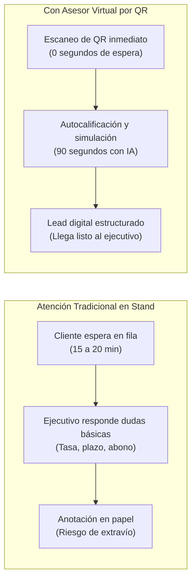
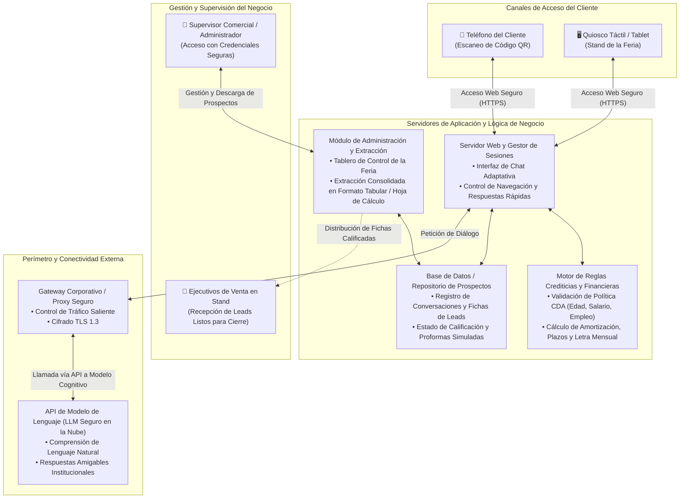
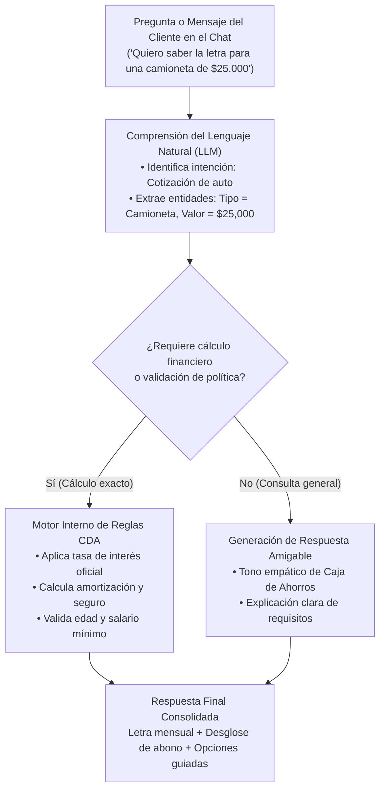
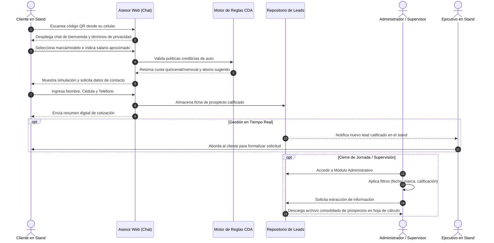

# Diseño de Arquitectura: Asesor Virtual de Préstamo de Auto (Feria y Canales Digitales)
## Solución Web Conversacional con Código QR y Módulo Administrativo de Extracción

**Organización:** Caja de Ahorros de Panamá  
**Liderazgo Técnico:** Célula de Innovación (StraTech / Caja de Ahorros)  
**Audiencia:** Vicepresidencia de Negocio, Dirección de Canales, Mercadeo, Tecnología y Seguridad  
**Fecha:** Octubre 2026  
**Versión:** 1.0 (Documento Técnico-Funcional de Arquitectura)  

---

## 1. Introducción

La participación de Caja de Ahorros en ferias comerciales automotrices (como el Panamá Motor Show y exhibiciones regionales) representa una de las mayores fuentes de originación de créditos de auto para la institución. Durante estos eventos de alta concurrencia, miles de personas visitan el stand del banco con la intención de cotizar financiamiento para adquirir vehículos nuevos o de segunda.

El **Asesor Virtual de Préstamo de Auto** se concibe como una solución web conversacional accesible de forma instantánea mediante el escaneo de códigos QR desde cualquier teléfono inteligente o a través de quioscos interactivos en el stand. La herramienta brinda atención inmediata las 24 horas, filtra a los prospectos conforme a las políticas crediticias oficiales de Caja de Ahorros, realiza simulaciones financieras de cuota y abono en tiempo real, y captura prospectos calificados listos para el cierre por parte de los ejecutivos de ventas.

Asimismo, la solución incorpora un **Módulo Administrativo de Extracción de Datos**, diseñado para que los supervisores comerciales puedan consultar, gestionar y exportar de forma ágil y segura toda la información capturada en el repositorio central del sistema, garantizando la derivación oportuna a la fuerza de ventas y la analítica comercial del evento.

Este documento presenta la arquitectura técnica y operativa de la solución, sus componentes, políticas de seguridad, capacidades de inteligencia artificial, flujos de datos y justificaciones de diseño.

---

## 2. Visión de Negocio

### 2.1. El Desafío Comercial en Ferias
En las ferias automotrices tradicionales, la captura comercial enfrenta importantes barreras operativas:

1. **Pérdida de Clientes por Tiempos de Espera:** En horas pico de la feria, la cantidad de visitantes supera la capacidad física de atención de los ejecutivos del stand. Los prospectos que esperan más de 10 a 15 minutos suelen retirarse a stands de entidades bancarias competidoras.
2. **Saturación en Consultas Básicas y Repetitivas:** Los ejecutivos de crédito dedican más del 70% de su tiempo a responder preguntas introductorias de cotización ("¿cuánto pagaría al mes?", "¿cuánto piden de abono?", "¿califico con mi salario?"), en lugar de enfocarse en negociar y cerrar ventas con clientes decididos.
3. **Pérdida y Desorganización de Contactos:** Muchos prospectos son registrados en listas de papel o notas informales que tardan días en procesarse, perdiendo la inmediatez comercial necesaria para concretar el crédito.

### 2.2. Objetivos Estratégicos y Retorno de Negocio
* **Atención Masiva y Simultánea:** Capacidad de atender a decenas de clientes al mismo tiempo sin incrementar el personal físico en el stand.
* **Calificación según Política Oficial:** Garantizar que los prospectos derivados a la fuerza comercial cumplan estrictamente con los parámetros de edad (21 a 75 años), ingreso mínimo y estabilidad laboral de Caja de Ahorros.
* **Trazabilidad Comercial y Extracción Inmediata:** Disponer de una consola administrativa para descargar y consolidar los prospectos generados durante cada jornada de la feria, asegurando una gestión comercial oportuna.

---

## 3. Arquitectura: Mapa de Componentes

La arquitectura de la solución se estructura bajo un modelo web desacoplado y ligero, optimizado para ofrecer tiempos de respuesta inferiores a un segundo en dispositivos móviles y facilitar la labor de supervisión comercial.

### 3.1. Diagrama de Arquitectura del Sistema

### 3.2. Descripción de Componentes Principales

1. **Canal de Acceso Web (Chat Conversacional):**
   * Interfaz web responsiva compatible con cualquier navegador móvil moderno, sin requerir descarga ni instalación de aplicaciones en las tiendas de software.
   * Permite interactuar mediante mensajes de texto fluidos o mediante botones de opciones guiadas para agilizar la interacción (marcas de auto, rangos de salario, plazos de financiamiento).
2. **Servidor de Aplicación Web:**
   * Mantiene el estado de la sesión conversacional de cada prospecto.
   * Coordina el flujo de diálogo, combinando la flexibilidad de comprensión del modelo de lenguaje con el rigor de cálculo del motor financiero interno.
3. **Motor de Reglas Crediticias y Financieras:**
   * Evalúa las políticas de crédito de auto de Caja de Ahorros: rango de edad (21 a 75 años al vencimiento), salario mínimo según sector laboral y capacidad de pago.
   * Realiza la formulación matemática exacta de las cuotas mensuales y quincenales, proyectando escenarios de abono (10%, 15%, 20%) y plazos (hasta 84 o 96 meses según aplique).
4. **Base de Datos / Repositorio Central de Prospectos:**
   * Almacena de forma estructurada los datos capturados de cada cliente: nombre completo, cédula, número telefónico, correo electrónico, marca y modelo cotizado, valor del vehículo, abono propuesto, cuota calculada y resultado de pre-calificación.
5. **Módulo Administrativo y Extracción de Datos:**
   * Consola protegida mediante autenticación institucional para el equipo de supervisión de Caja de Ahorros.
   * Permite monitorear en tiempo real el volumen de prospectos atendidos durante cada hora de la feria.
   * Ofrece filtros avanzados por fecha, marca de vehículo, nivel de ingresos o estatus crediticio.
   * **Método de Extracción:** Incluye la funcionalidad de descarga en un clic de la base de datos completa en formatos tabulares estándar (hojas de cálculo estructuradas), facilitando su importación por lotes hacia el sistema de gestión de clientes (CRM) del banco o la asignación inmediata de expedientes a la fuerza de ventas.
6. **Gateway Corporativo y Conexión vía API a LLM:**
   * Canal seguro que permite al servidor de la aplicación consultar modelos de lenguaje avanzados alojados en infraestructura de nube segura.
   * El gateway garantiza que el tráfico externo viaje cifrado y autenticado, evitando cualquier exposición de la red interna del banco.

---

## 4. Estrategia de Datos y Seguridad

Dado que el asesor captura información de contacto y parámetros económicos de clientes, la arquitectura incorpora salvaguardas rigurosas de seguridad y cumplimiento legal:

### 4.1. Protección de Datos Personales (Ley 81 de Panamá)
* **Consentimiento Informado:** Al iniciar la conversación, el asistente despliega una cláusula de aceptación informando al usuario que sus datos serán utilizados exclusivamente por Caja de Ahorros para contactarlo sobre su solicitud de crédito de auto.
* **Finalidad Específica:** Los datos recopilados se limitan a los campos indispensables para formalizar la cotización comercial.

### 4.2. Seguridad en Canales y Repositorios
* **Cifrado Extremo a Extremo (HTTPS / TLS 1.3):** Toda comunicación entre los dispositivos móviles de los clientes y el servidor web viaja protegida por certificados digitales bancarios.
* **Aislamiento de Red:** El servidor de la aplicación y su repositorio de prospectos residen en una zona desmilitarizada (DMZ) o entorno de nube perimetral. **No tienen acceso ni enlaces directos con el Core Bancario (IBS)**, preservando intacta la seguridad de la red transaccional del banco.
* **Control de Acceso al Módulo Administrativo:** La consola de extracción de datos exige autenticación segura institucional con políticas de contraseñas robustas y control de acceso basado en roles (RBAC).
* **Registro de Auditoría de Extracciones:** Cada vez que un usuario administrador descarga la base de prospectos en formato de hoja de cálculo, el sistema genera una traza de auditoría con la fecha, hora, identidad del usuario y cantidad de registros exportados.

---

## 5. Capacidades de Inteligencia Artificial

La solución integra capacidades cognitivas de procesamiento del lenguaje natural para transformar una cotización financiera compleja en una experiencia amigable y cercana:

1. **Comprensión Contextual y Tolerancia a Errores:**
   Capacidad de entender modismos panameños, términos informales de autos (*"camioneta"*, *"pickup"*, *"sedancito"*, *"segunda mano"*) y variaciones tipográficas en dispositivos táctiles, respondiendo con claridad sin trabar el diálogo.
2. **Personalidad Institucional y Tono de Asesoría:**
   El modelo está configurado para reflejar los valores de Caja de Ahorros: calidez, empatía, claridad financiera y transparencia en costos.
3. **Hibridación Inteligente (IA Conversacional + Matemáticas Determinísticas):**
   Para garantizar total rigor financiero, la inteligencia artificial no calcula cifras de memoria; en su lugar, identifica la intención del usuario y traslada los montos al motor matemático interno, el cual genera el cálculo exacto de la letra. Luego, el modelo viste el resultado en un mensaje comprensible.

---

## 6. Flujo de Proceso

El ciclo de interacción abarca desde el primer contacto en el stand hasta la gestión de ventas por el equipo comercial:

### Detalle de las Etapas del Flujo:
1. **Acceso Inmediato (Paso 1):** El cliente escanea el código QR ubicado en los vehículos en exhibición, volantes o tótems del stand, abriendo el chat en su navegador sin esperas.
2. **Prospección y Simulación (Pasos 2 al 4):** El asesor conversa con el cliente, recopila sus preferencias de vehículo y salario, valida su perfil frente a la política de crédito y le presenta la letra mensual con opciones para modificar el abono o plazo.
3. **Captura y Confirmación (Pasos 5 al 7):** El cliente registra sus datos para recibir la cotización formal. El sistema genera la ficha del prospecto y le confirma que un ejecutivo lo atenderá.
4. **Extracción y Derivación Comercial (Pasos 8 al 10):** El supervisor comercial accede a la consola administrativa, supervisa las métricas de la jornada y extrae la base de datos de prospectos en un archivo estructurado para distribuirla entre la fuerza de ventas o integrarla al seguimiento comercial del banco.

---

## 7. Decisión Técnica

El diseño arquitectónico adoptado responde a principios de simplicidad, agilidad de despliegue y máxima efectividad comercial:

### 7.1. Adopción de Aplicación Web en lugar de Aplicación Móvil Nativa
* **Cero Barreras de Entrada:** Exigir al visitante de una feria descargar una aplicación desde tiendas virtuales implicaría una tasa de abandono superior al 80%. La aplicación web accesible por código QR garantiza acceso universal instantáneo en cualquier dispositivo Android o iOS sin consumir espacio de memoria en el teléfono del usuario.
* **Mantenimiento Centralizado:** Cualquier cambio en tasas, plazos o políticas de la feria se actualiza en el servidor central de forma inmediata, reflejándose en todos los usuarios sin requerir aprobaciones de tiendas de aplicaciones.

### 7.2. Inferencia Cognitiva vía API con Salida a Internet
* La utilización de modelos de lenguaje mediante servicios API externos a través del gateway corporativo permite desplegar capacidades de procesamiento de lenguaje natural de última generación sin incurrir en la adquisición de costosos servidores con aceleración de hardware dedicados en las instalaciones del banco.
* El consumo en la nube brinda escalabilidad elástica para soportar incrementos abruptos de tráfico durante los días de mayor concurrencia de la feria (fines de semana), garantizando respuestas rápidas y estables.

### 7.3. Módulo Administrativo Integrado para Extracción de Datos
* En lugar de depender de procesos manuales de solicitud a los equipos de base de datos o tecnología para obtener los contactos de la feria, la inclusión de una consola administrativa web con funcionalidad de exportación en un clic otorga autonomía completa al equipo de Negocio y Mercadeo.
* Esta capacidad permite que los leads recopilados durante la mañana sean distribuidos a los ejecutivos de ventas esa misma tarde, cerrando la brecha temporal y aumentando significativamente la tasa de conversión de créditos de auto.
