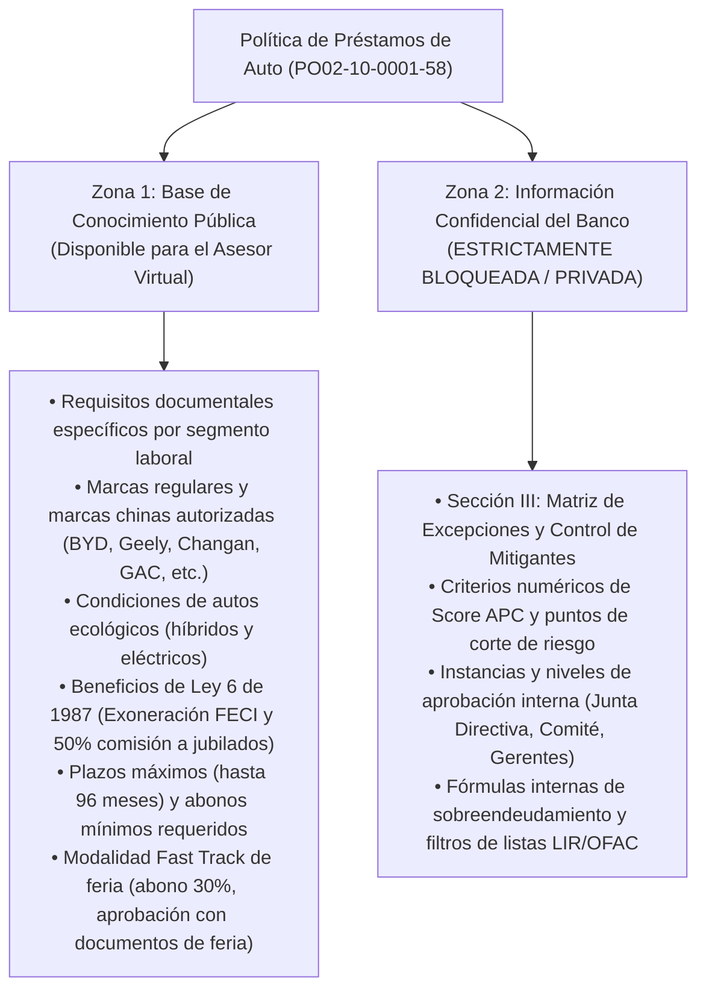
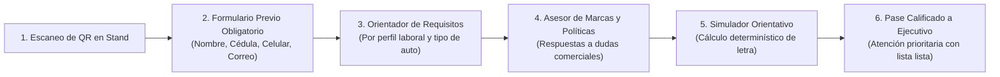
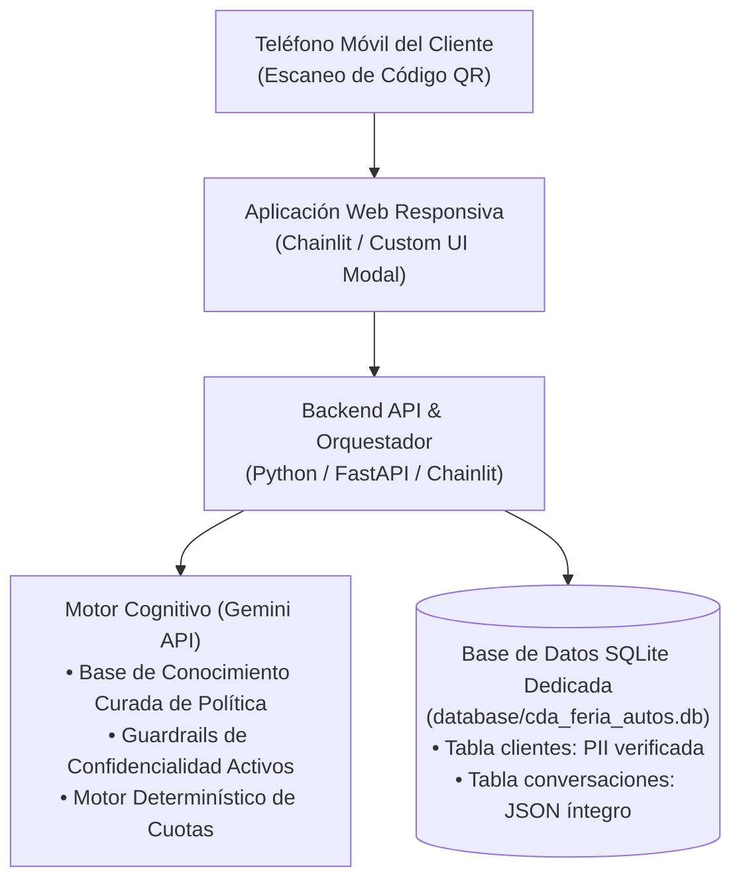

# Propuesta de Solución: Asesor Virtual de Préstamos de Auto
## Herramienta Inteligente de Orientación y Precalificación en Feria (Canal QR)
**Proyecto:** Célula de Innovación Caja de Ahorros  
**Audiencia:** Gerencia de Crédito de Consumo, Mercadeo, Canales Digitales y Tecnología  
**Elaborado por:** Célula de Innovación (StraTech / Caja de Ahorros)  
**Fecha:** 28 de octubre de 2026  
**Versión:** 1.0 (Diseño Funcional, Gobernanza de Política y Experiencia del Cliente)  

---

## 1. Resumen Ejecutivo y Oportunidad de Negocio

Durante las ferias de autos (ej. Panamá Motor Show, ferias regionales y eventos en agencias de autos), Caja de Ahorros enfrenta un desafío operativo crítico: **un volumen masivo de visitantes simultáneos interesados en cotizar financiamiento para su vehículo**.

Actualmente, los ejecutivos comerciales del banco en el stand se saturan atendiendo consultas repetitivas de primer contacto:
* Explicar una y otra vez qué documentos necesita presentar cada perfil.
* Responder dudas recurrentes sobre qué marcas aplican (especialmente marcas chinas emergentes y autos ecológicos).
* Aclarar cuánto abono mínimo se requiere según el valor del vehículo.

Esta sobrecarga genera filas de espera, desalienta a prospectos calificados que se retiran sin atención y reduce el tiempo que el ejecutivo humano debería dedicar al cierre y formalización de solicitudes viables.

### 1.1. Resumen Ejecutivo y Enfoque de la Solución (Opción 1: Pitch Institucional)

A través de un código QR visible en el stand y material promocional de la feria, el interesado accede de inmediato a un asesor virtual interactivo. La herramienta resuelve dudas frecuentes sobre requisitos documentales y lineamientos de financiamiento (basados estrictamente en aspectos no confidenciales de las políticas de crédito de autos) y le permite simular una letra mensual aproximada según sus supuestos de monto, abono inicial y plazo estimado.

Lejos de constituir una aprobación o rechazo de crédito, el asesor actúa como un **canal de triaje y orientación preliminar**: antes de interactuar, el cliente registra sus datos básicos de contacto en un formulario obligatorio, y posteriormente el ejecutivo comercial dispone de dicha información junto con el historial completo de la conversación para comprender con precisión sus intereses específicos.

Esto libera a la fuerza de ventas en stand de responder consultas informativas de primer nivel, destila prospectos altamente perfilados y facilita un seguimiento comercial consultivo, ágil y personalizado vía llamada, mensajería de texto o correo electrónico.

---

## 2. Evaluación de la Política de Préstamo de Auto (`PO02-10-0001-58`)

La utilización del documento oficial de política ([`politica_prestamo_auto.pdf`](file:///C:/Users/rblasser/OneDrive%20-%20Latinex/Escritorio/PROJECTS/CDA/celulas/innovation-cda/potential-artifact/politica_prestamo_auto.pdf)) tiene **total sentido y viabilidad**, siempre que se aplique una estricta **gobernanza y partición de información**:

### 2.1. Información Apta para el Asesor Virtual (De cara al Cliente)
* **Requisitos documentales por perfil:** Diferenciación precisa entre empresa privada, sector público general, estamentos con leyes especiales (educadores y salud), jubilados e independientes.
* **Catálogo de marcas financiadas:** Respaldo explícito de marcas tradicionales (Toyota, Nissan, Hyundai, etc.) y marcas chinas representadas por agencias autorizadas en Panamá (BYD, Geely, Changan, GAC, JAC, Riddara, Jetour).
* **Condiciones especiales de producto:** Exoneración de FECI y descuento en comisión para jubilados (Ley 6 de 1987), plazo máximo de 60 meses para mayores de 63/65 años, y abono mínimo del 15% para autos con precio menor a B/. 10,000.00.

### 2.2. Información Confidencial Protegida (Blindaje de Seguridad)
* **Políticas internas de mitigación:** El cliente jamás debe conocer las reglas de penalización de tasa (ej. aumento de hasta 0.50% por referencias APC regulares).
* **Niveles de aprobación:** Las facultades de decisión de los comités de crédito y directivos no son de dominio público.
* **Límites de endeudamiento estrictos:** Los porcentajes exactos de capacidad de pago se evalúan internamente y no se publican para evitar arbitrajes o tergiversaciones.

---

## 3. Dinámica Operativa y Experiencia en Feria (Narrativa de Negocio)

### 3.1. Narrativa Operativa y de Negocio Detallada (Opción 2: Los Tres Pilares en Feria)

La dinámica operativa del asesor virtual se fundamenta en tres pilares sinérgicos concebidos para maximizar la conversión en el stand ferial:

1. **Canal de Autoservicio *Phygital* y Puerta de Entrada:**  
   El cliente escanea el código QR ubicado en el stand o material publicitario de la feria y completa un breve formulario de identificación (Nombre Completo, Cédula de Identidad Personal, Número de Celular y Correo Electrónico). Este paso garantiza la captura de contacto del 100% de los visitantes interesados antes de habilitar la sesión con el asesor virtual.

2. **Orientación Normativa y Simulación sin Fricción:**  
   El agente virtual atiende las dudas generales del interesado sobre requisitos documentales y políticas institucionales públicas (marcas financiadas, autos ecológicos, condiciones para jubilados e independientes), basándose exclusivamente en los criterios no confidenciales de la política de crédito. Adicionalmente, ofrece una estimación determinística de la letra mensual en función de los parámetros brindados por el cliente (monto del auto, abono inicial y plazo). Se establece con total transparencia que este ejercicio es meramente orientativo y no representa un compromiso vinculante de aprobación o rechazo crediticio.

3. **Prospección Inteligente y Optimización del Talento Humano:**  
   La herramienta actúa como un filtro calificado de alta eficiencia. En lugar de que los ejecutivos en stand inviertan tiempo valioso respondiendo consultas introductorias repetitivas, el sistema registra cada conversación y los datos del interesado en una base de datos SQLite dedicada (`cda_feria_autos.db`). El oficial de crédito accede a este expediente conversacional (con el historial serializado en formato JSON) para identificar el interés real del cliente, su presupuesto y dudas planteadas, permitiéndole ejecutar un seguimiento posterior certero y prioritario mediante llamada telefónica, mensajería instantánea o correo electrónico.

### 3.2. Flujo de Interacción y Módulos de Servicio en Stand

El flujo de interacción ha sido concebido para ser rápido, resolutivo y libre de fricciones:

#### Módulo 0: Captura y Validación de Prospectos (Pre-Chat Gate)
Antes de acceder al diálogo interactivo, el visitante completa un formulario con validaciones en tiempo real:
* Nombre completo del solicitante.
* Cédula de identidad personal (formato oficial panameño).
* Número de teléfono celular (8 dígitos).
* Correo electrónico de contacto.
Los datos se almacenan de inmediato en la base de datos local y se emite un pase digital personalizado en pantalla.

#### Módulo 1: Orientador Personalizado de Requisitos
Mediante preguntas interactivas y amables, el cliente obtiene la lista exacta de documentos requeridos para su caso:
1. *¿Cuál es su ocupación o condición laboral?*
   * *Empresa Privada:* Cédula, carta de trabajo (vigencia 45 días), ficha digital y último comprobante.
   * *Sector Educación o Salud:* Cédula, proforma de certificado de Contraloría o carta de RRHH y último talonario (aplica con solo 1 mes de permanencia).
   * *Jubilado / Pensionado:* Cédula y último talonario de pago.
   * *Independiente Profesional:* Movimientos de cuenta y carta de ingresos de CPA.
2. *¿Cuenta con la proforma de la agencia?* Se le recuerda que la cotización formal del auto es el requisito clave para abrir la solicitud.

#### Módulo 2: Consultor de Políticas y Marcas (FAQ Inteligente)
Responde en lenguaje natural preguntas comunes del visitante:
* *"¿Financian autos eléctricos o de agencias como BYD?"* -> Confirma la elegibilidad de marcas ecológicas y agencias reconocidas.
* *"¿Qué beneficios tengo si soy jubilado?"* -> Explica la exoneración de FECI y rebaja de comisión de cierre.
* *"¿Tienen plazo a 8 años?"* -> Informa sobre el plazo máximo de hasta 96 meses para clientes regulares.

#### Módulo 3: Simulador Orientativo Preliminar (Motor Determinístico)
El cliente ingresa el valor de venta del vehículo, abono previsto y plazo deseado. El motor de simulación:
* Valida el cumplimiento del abono mínimo según la política (10% regular, 15% para autos menores a B/. 10,000, o 30% en modalidad ágil *Fast Track*).
* Calcula de manera determinística la letra mensual aproximada (utilizando la fórmula financiera estándar $R = P \frac{i(1+i)^n}{(1+i)^n - 1}$), con tasa referencial de feria del 7.00% anual y desglose de seguro de vida estimado.
* Muestra de forma destacada el descargo de responsabilidad indicando que el cálculo es orientativo.

#### Módulo 4: Pase Calificado al Ejecutivo de Stand (*Handoff*)
Al finalizar la consulta, el asistente le ofrece un botón destacado:  
> **"Deseo que un ejecutivo me atienda ahora en el stand"**  
El sistema genera un código o resumen digital en la pantalla del móvil que el cliente le muestra al ejecutivo bancario. El ejecutivo ya no tiene que indagar desde cero: conoce la marca, el perfil y sabe que el cliente tiene los requisitos claros.

---

## 4. Ejemplos Reales de Conversación (Demostración de Tono y Blindaje)

### Caso 1: Consulta sobre Marcas Chinas y Autos Eléctricos
* **Pregunta del Visitante:** *"Hola, buenas tardes. Estoy viendo un auto BYD eléctrico aquí en la feria, ¿Caja de Ahorros me lo puede financiar?"*
* **Respuesta del Asesor Virtual:**  
  > *"Muy buenas tardes. Es un placer saludarle. Con mucho gusto le informamos que en Caja de Ahorros sí financiamos vehículos de la marca BYD, así como otras marcas respaldadas por agencias distribuidoras autorizadas en Panamá (tales como Geely, GAC, Changan, entre otras).*  
  > *Adicionalmente, al ser un vehículo 100% eléctrico, cuenta con condiciones especiales para autos ecológicos, con plazos de financiamiento de hasta 96 meses según su perfil laboral. Le invitamos a solicitar la proforma con su asesor en la agencia y acercarse a nuestro stand para estructurar su financiamiento formalmente."*

---

### Caso 2: Consulta de un Profesional con Ley Especial (Educador / Médico)
* **Pregunta del Visitante:** *"Soy educador nombrado en el MEDUCA, ¿cuántos años de trabajo tengo que tener para que me aprueben en la feria?"*
* **Respuesta del Asesor Virtual:**  
  > *"Estimado profesor, con mucho gusto le orientamos. Para los profesionales del sector educativo y de la salud, nuestra política institucional contempla condiciones preferenciales: se requiere únicamente contar con un (1) mes de permanencia laboral o encontrarse en periodo probatorio.*  
  > *Para solicitar su crédito hoy en la feria, solo requerirá presentar su cédula vigente, la proforma del vehículo y su proforma de certificado de trabajo de Contraloría o carta de recursos humanos junto a su último talonario. ¿Desea que le generemos un turno de atención en nuestro stand para revisar su caso?"*

---

### Caso 3: Consulta sobre Historial Crediticio (Demostración del Blindaje de Confidencialidad)
* **Pregunta del Visitante:** *"Tuve un problemita viejo en la APC que ya pagué, ¿el banco me lo aprueba si pago más tasa de interés?"*
* **Respuesta del Asesor Virtual (Blindaje Activo):**  
  > *(Comportamiento de la IA: La IA jamás menciona códigos de manuales, números de sección ni expresiones como "la política interna" o "criterios confidenciales"; responde amablemente desde la perspectiva de servicio y lineamientos institucionales).*  
  > 
  > *"Estimado cliente, comprendemos perfectamente su consulta. Caja de Ahorros realiza una evaluación crediticia integral y personalizada de cada solicitud, tomando en cuenta su capacidad de pago actual y su estabilidad laboral.*  
  > *Los casos que ameriten una revisión particular son analizados con el mayor detalle por nuestros especialistas. Le recomendamos acercarse a nuestro stand con sus comprobantes de ingresos y su proforma, donde nuestros ejecutivos con gusto evaluarán su perfil para brindarle la mejor asesoría."*

---

## 5. Directivas de Seguridad y Blindaje del Modelo (*System Prompt Guardrails*)

Para asegurar que la herramienta jamás filtre información clasificada del banco, el motor de inteligencia artificial debe estar regido por los siguientes parámetros inquebrantables en su prompt de sistema:

1. **Gobernanza de Información y Lenguaje Amigable:**
   * **Prohibición de citar manuales, códigos o "política interna":** La IA tiene estrictamente prohibido utilizar expresiones como *"según la política interna"*, *"la Sección III del manual"*, *"criterios confidenciales"* o códigos como `PO02-10-0001-58`. De cara al cliente siempre se emplean términos cálidos y de servicio: *"nuestros lineamientos de financiamiento"*, *"los criterios de evaluación del banco"* o *"las condiciones para su solicitud"*.
   * **Prohibición de revelar parámetros de riesgo internos:** No revelar porcentajes de mitigación de tasa, niveles o cargos de aprobación (Junta Directiva, Gerencia de Crédito) ni umbrales numéricos de Score APC.
   * **Permitido:** Explicar requisitos de documentos, plazos máximos públicos, abonos mínimos comerciales y marcas autorizadas.
2. **Descargo Legal Obligatorio (*Disclaimer*):**
   * Toda respuesta orientativa debe acompañarse de una nota al pie:  
     *`"Orientación preliminar de carácter informativo. Las condiciones, tasa y aprobación final están sujetas al análisis crediticio formal de Caja de Ahorros."`*
3. **Trato Institucional:**
   * Tono formal panameño (trato de *"Usted"*), cortés, cordial y empático.
   * Respuestas estructuradas en viñetas cortas para fácil lectura en pantalla móvil.

---

## 6. Arquitectura Técnica y Persistencia en Base de Datos

Para garantizar que esta solución se despliegue de forma ágil, autónoma y sin tocar sistemas transaccionales del core bancario:

* **Frontend Móvil:** Interfaz web ligera adaptativa para teléfonos móviles con puerta de entrada obligatoria (formulario modal de registro con validaciones de cédula, celular y correo).
* **Backend y Orquestación:** Servicio en Python (Chainlit / FastAPI) que gestiona el ciclo de vida de la sesión, valida parámetros financieros determinísticos y coordina las llamadas de inferencia.
* **Inteligencia y Blindaje:** Conexión vía API a Gemini con contexto cerrado exclusivo de la política pública de auto y reglas estrictas de confidencialidad institucional.
* **Persistencia Dedicada (SQLite):** Subdirectorio dedicado `database/` con el archivo `cda_feria_autos.db`, estructurado en:
  * Tabla `clientes`: Almacena `nombre_completo`, `cedula`, `celular`, `correo` y marca de tiempo de registro.
  * Tabla `conversaciones`: Almacena la sesión asociada, el cliente vinculado, el total de mensajes y el historial completo estructurado en formato `chat_json` para su posterior ingesta y auditoría por parte del equipo comercial.

---

## 7. Beneficios y Métricas de Éxito

| Beneficio para Caja de Ahorros | Métrica de Impacto en Feria |
| :--- | :--- |
| **Mayor Captación de Prospectos** | Reducción de visitantes que abandonan el stand sin ser atendidos. |
| **Eficiencia del Ejecutivo Comercial** | Clientes llegan a la mesa con documentos completos y expectativas claras. |
| **Posicionamiento Innovador** | Caja de Ahorros se proyecta como un banco moderno y accesible con atención digital asistida. |
| **Cero Riesgo Institucional** | Total preservación de la confidencialidad de las políticas internas de riesgo. |

### 7.1. Conclusiones y Factores Clave de Impacto (Opción 3: Narrativa Estratégica de Cierre)

La implementación del Asesor Virtual en ferias de autos redefine la interacción entre el banco y los solicitantes a través de cuatro factores determinantes de impacto:

1. **Filtro de Orientación y Gestión de Expectativas (No Decisorio):**  
   Despeja dudas preliminares y educa al cliente sobre los requisitos reales de Caja de Ahorros antes de que se siente con un ejecutivo, eliminando la frustración por falta de documentación o expectativas irreales de cuota.

2. **Captura Garantizada del 100% del Tráfico Interesado:**  
   El formulario de registro previo asegura que ningún prospecto que se acerque al stand se pierda en el anonimato. Todo visitante queda registrado en la base de datos persistente con sus datos de contacto verificados (nombre, cédula, celular y correo).

3. **Inteligencia Conversacional para el Cierre Efectivo:**  
   El ejecutivo comercial no contacta a un lead 'frío'; dispone del expediente digital completo con el historial íntegro de la conversación (almacenado en formato JSON estructurado), permitiéndole conocer con exactitud qué vehículo busca el cliente, cuánto abono posee y cuáles fueron sus principales inquietudes antes de iniciar la llamada o mensaje.

4. **Optimización Radical del Tiempo y Productividad en Stand:**  
   Multiplica la capacidad de atención en momentos de alta afluencia (horas pico de feria), eliminando cuellos de botella informativos y reservando el talento del equipo comercial exclusivamente para la estructuración y cierre de solicitudes viables.
