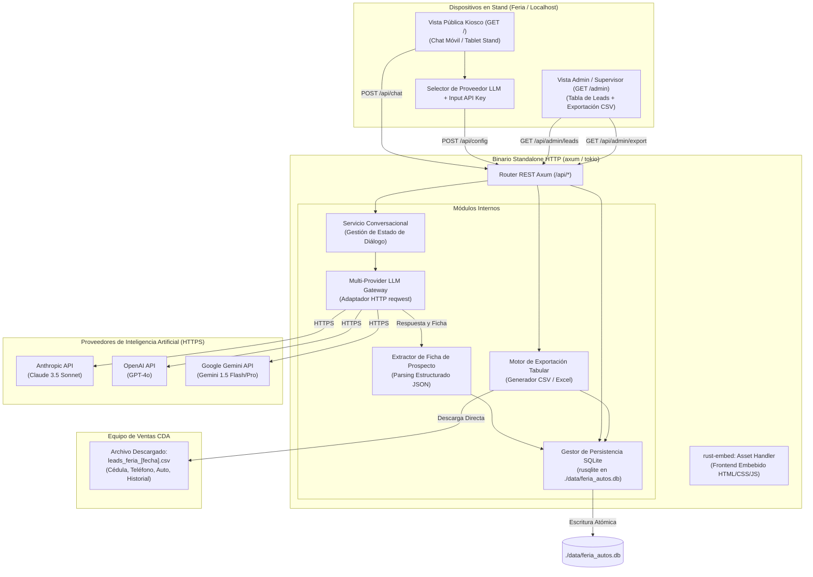

# Especificación Técnica de Arquitectura: Standalone HTTP Server (Rust)
## Asesor Virtual de Préstamo de Auto (Feria y Canales Digitales)
### Solución Ejecutable Autocontenida (Localhost & Cloud-Ready) con Persistencia Embebida y Exportación

**Organización:** Caja de Ahorros de Panamá  
**Liderazgo Técnico:** Célula de Innovación (StraTech / Caja de Ahorros)  
**Fecha:** Octubre 2026  
**Documento Base:** [diseno-arquitectura-asesor-feria-autos.md](file:///c:/Users/rblasser/OneDrive%20-%20Latinex/Escritorio/PROJECTS/CDA/celulas/innovation-cda/design/diseno-arquitectura-asesor-feria-autos.md)  
**Estado:** Especificación de Implementación Standalone HTTP  

---

## 1. Justificación y Enfoque Arquitectónico

### 1.1. Contexto Operativo en Feria
En el contexto de eventos comerciales masivos (como el Panamá Motor Show o ferias en centros comerciales), Caja de Ahorros no dispone de conectividad directa ni de servidores internos dedicados en el stand. Las interacciones se atienden a través de laptops o quioscos táctiles locales en el stand, o mediante el escaneo de códigos QR por parte de los visitantes desde sus dispositivos móviles conectados a la red local o internet del evento.

### 1.2. Decisión Arquitectónica: Standalone HTTP Server en Rust
Se adopta el patrón **Standalone HTTP Server** desarrollado en **Rust**:
1. **Binario Único Autocontenido (`.exe`):** Un solo archivo ejecutable de 15 a 25 MB que contiene el servidor web HTTP, la base de datos local embebida, la lógica de integración con LLMs y el frontend completo compilado en su interior. No requiere instalar Python, gestores de paquetes ni dependencias del sistema operativo.
2. **Persistencia Local Segura y Autónoma (SQLite):** Dado que en la feria no hay acceso a las bases de datos centrales de Caja de Ahorros, el binario gestiona un archivo SQLite local (`./data/feria_autos.db`). Toda conversación y ficha de contacto queda persistida de manera atómica e inmediata, evitando la pérdida de leads ante desconexiones.
3. **Consumo Browser-Based (`http://127.0.0.1:PORT`):** Se opera desde el navegador web nativo (Edge / Chrome) en modo kiosco/pantalla completa para la atención al público.
4. **Portabilidad a la Nube (Cloud-Ready):** La arquitectura desacoplada basada en REST permite que el mismo servidor se ejecute en local durante la feria y, posteriormente, se despliegue en un contenedor Docker institucional (OCI / AWS / Kubernetes) para operar como asesor virtual web público sin reescribir la lógica ni la interfaz.

---

## 2. Principios de Diseño e Implementación (Fail-Fast y Cero Simulación)

En cumplimiento estricto con las directrices de ingeniería:
* **Cero Sobreingeniería:** Arquitectura directa y sin capas superfluas. El sistema se limita a: servir la interfaz, orquestar el diálogo con la API de IA seleccionada, almacenar los datos capturados en SQLite y exportar los registros a formato tabular.
* **Cero Funciones Fallback:** No existen mecanismos de degradación silenciosa ni respuestas simuladas. Si la conexión a internet del stand se interrumpe o la API Key del proveedor de IA es inválida, el sistema detiene la transacción y reporta de inmediato el error exacto (`fail-fast`).
* **Cero Mockdata:** No se utilizan datos simulados de vehículos ni prospectos falsos. Las respuestas conversacionales y la captura de leads reflejan en todo momento la interacción real con el usuario y la política oficial vigente de Caja de Ahorros.

---

## 3. Diagrama de Arquitectura del Servidor Local



---

## 4. Componentes y Stack Tecnológico en Rust

| Capa | Componente | Crate / Tecnología | Propósito |
| :--- | :--- | :--- | :--- |
| **Runtime Asíncrono** | I/O Multihilo | `tokio` (features = ["full"]) | Manejo concurrente de múltiples conexiones simultáneas en la feria. |
| **Servidor HTTP** | Framework Web | `axum` (v0.7+) | Servidor web asíncrono y enrutador REST ultraligero. |
| **Embebedor de Assets** | Empaquetado Frontend | `rust-embed` (v8.4+) | Empaqueta la interfaz gráfica web dentro del ejecutable `.exe`. |
| **Base de Datos Embebida** | Persistencia Local | `rusqlite` (features = ["bundled"]) | Motor relacional SQLite embebido en el binario sin instalar software adicional. |
| **Cliente HTTP / LLM** | Conexión con IA | `reqwest` (features = ["json", "stream"]) | Despacho seguro de peticiones HTTPS a Anthropic, OpenAI y Google Gemini. |
| **Serialización** | Manejo de JSON | `serde`, `serde_json` | Tipado de mensajes, fichas de contacto e historiales. |
| **Exportador de Datos** | Generación de Reportes | `csv` (crate oficial de Rust) | Generación en memoria de archivos tabulares CSV delimitados para apertura inmediata en Excel. |

---

## 5. Capa Multi-Proveedor de Modelos de Lenguaje (LLM Gateway)

### 5.1. Selector Dinámico y Credenciales
El sistema incorpora en su vista de configuración un control desplegable (*dropdown*) para seleccionar el motor conversacional:
* **Proveedores Soportados:**
  * `Anthropic Claude 3.5 Sonnet` (Tono conversacional cordial, adherencia estricta a reglas de perfilación).
  * `Google Gemini 1.5 Flash` (Respuesta de ultra-baja latencia y bajo costo por token).
  * `OpenAI GPT-4o` (Precisión en extracción estructurada).
* **Entrada de API Key:**
  * Campo protegido en pantalla (`type="password"`).
  * Guardada en memoria volátil (`Arc<RwLock<ConfigState>>`) o en archivo de configuración local `.config.env`.
  * **Comportamiento Fail-Fast:** Si la API Key no es válida o se agota la cuota, la llamada falla de inmediato y muestra el mensaje del proveedor al operador del stand. Cero respuestas simuladas.

---

## 6. Persistencia Local y Doble Interfaz (Kiosco vs. Admin)

### 6.1. Esquema de Base de Datos Embebida (SQLite)
La base de datos reside en `./data/feria_autos.db` y se autoinicializa al arrancar el ejecutable con el siguiente esquema relacional:

```sql
CREATE TABLE IF NOT EXISTS leads (
    id INTEGER PRIMARY KEY AUTOINCREMENT,
    session_id TEXT NOT NULL UNIQUE,
    created_at DATETIME DEFAULT CURRENT_TIMESTAMP,
    nombre_completo TEXT,
    cedula TEXT,
    telefono TEXT,
    correo TEXT,
    vehiculo_interes TEXT,
    condicion_vehiculo TEXT, -- Nuevo o Usado
    sector_laboral TEXT,     -- Público, Privado, Independiente, Jubilado
    rango_salarial TEXT,
    abono_disponible TEXT,
    conversacion_json TEXT NOT NULL
);
```

### 6.2. Doble Interfaz de Usuario
1. **Vista Pública Kiosco (`GET /`):**
   * Diseñada para móvil y tabletas táctiles con la identidad institucional de Caja de Ahorros.
   * Interacción conversacional breve (3 a 5 turnos de perfilación amigable).
   * No expone botones administrativos ni datos de otros clientes.
2. **Vista de Administración y Exportación (`GET /admin` o botón de acceso con PIN):**
   * Protegida por un PIN administrativo configurable (ej. `CDA2026`).
   * **Tabla de Control:** Muestra el listado cronológico de prospectos capturados en la jornada (Nombre, Cédula, Teléfono, Auto cotizado, Fecha/Hora).
   * **Botón "Exportar a Excel / CSV":** Invoca `GET /api/admin/export`, generando una descarga inmediata en la laptop del archivo `leads_feria_[fecha].csv`.

---

## 7. Especificación de Endpoints de la API REST

| Método | Endpoint | Descripción | Manejo de Error (Fail-Fast) |
| :--- | :--- | :--- | :--- |
| `GET` | `/` | Retorna la SPA de chat embutida en el binario. | 404 si el asset no se encuentra. |
| `POST` | `/api/config` | Configura el proveedor LLM y el API Key en memoria. | 400 si faltan parámetros requeridos. |
| `POST` | `/api/chat` | Procesa un mensaje conversacional con el LLM seleccionado. | 502 si la API externa falla (muestra error real). |
| `POST` | `/api/lead` | Guarda la ficha estructurada y conversación en SQLite. | 500 si la base de datos reporta error de I/O. |
| `GET` | `/api/admin/leads` | Retorna la lista de leads capturados (requiere PIN en cabecera). | 401 si el PIN es incorrecto. |
| `GET` | `/api/admin/export` | Genera y descarga el archivo CSV con todos los leads. | 401 si el PIN es incorrecto. |

---

## 8. Estrategia de Portabilidad a Contenedores Institucionales (Docker)

Cuando la solución sea desplegada en la infraestructura web central de Caja de Ahorros, el contenedor se construye con la siguiente definición:

```dockerfile
# Etapa 1: Compilación
FROM rust:1.80-slim as builder
WORKDIR /usr/src/app
COPY . .
RUN cargo build --release

# Etapa 2: Imagen mínima de producción
FROM debian:bookworm-slim
RUN apt-get update && apt-get install -y ca-certificates && rm -rf /var/lib/apt/lists/*
WORKDIR /app
COPY --from=builder /usr/src/app/target/release/asesor-autos-server /app/server

ENV PORT=8080
ENV DATABASE_PATH=/app/data/feria_autos.db
VOLUME ["/app/data"]
EXPOSE 8080

CMD ["/app/server"]
```
Este diseño garantiza que la solución pueda operar de forma 100% aislada en la laptop del stand durante el evento y, simultáneamente, esté lista para ser subida a la nube bancaria sin requerir cambios estructurales.
